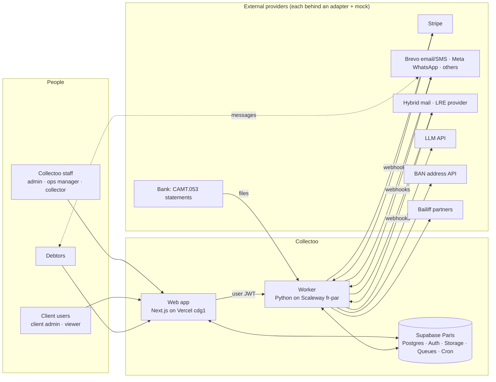
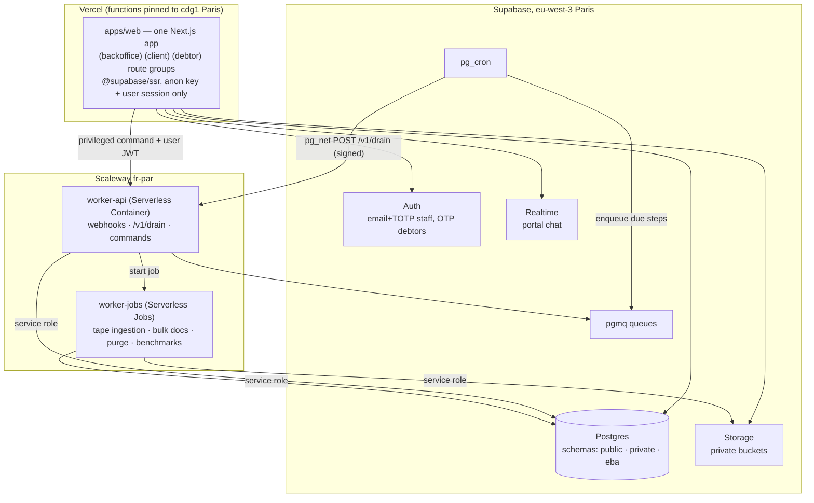
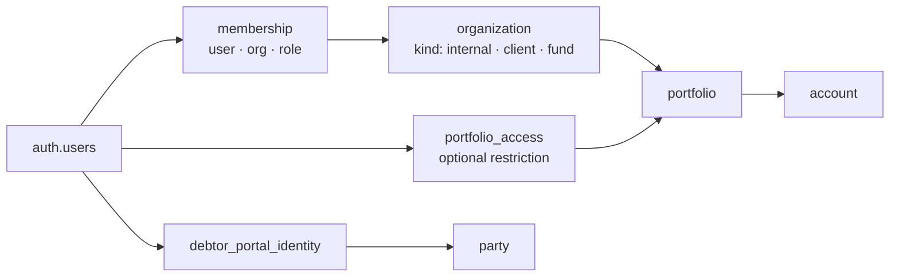
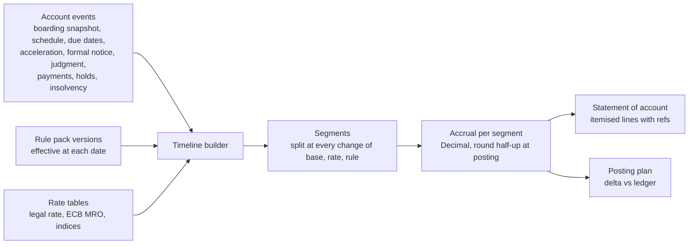
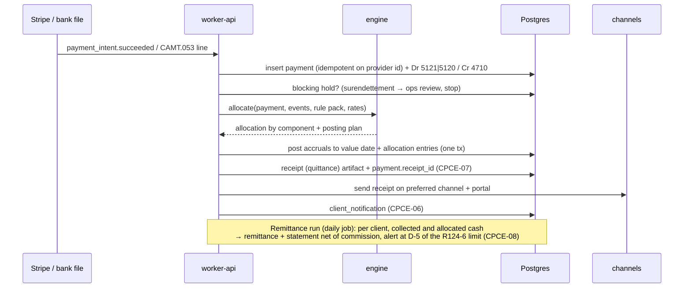
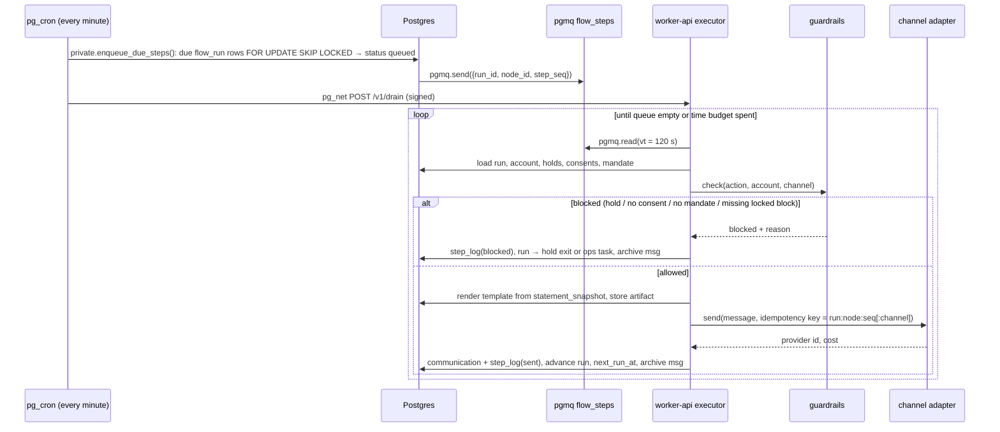
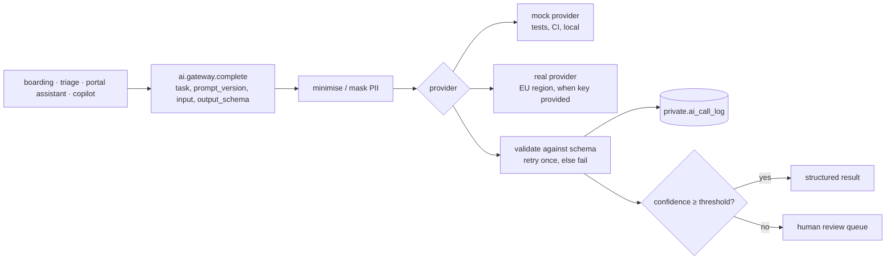

# Architecture

Status: Phase 0 draft, 2026-11-07. Decisions are recorded in `docs/adr/`. Legal requirements and their enforcement points are in `docs/COMPLIANCE.md` (IDs like CPCE-04 refer there). Rule packs and the engine conventions are in `docs/CALCULATION_RULES.md`. Channels are in `docs/CHANNELS.md`. The entity model is in `docs/DOMAIN.md`.

Guiding rule: **the simplest thing that works**, on standard Postgres, with every external provider behind an adapter that has a mock.

---

## 1. System context



## 2. Containers



| Container | Runs | Talks to |
|---|---|---|
| `apps/web` | UI for the three surfaces; server components and route handlers use the **user's** session (anon key + JWT). Never holds the service-role key. | Supabase (RLS applies), worker-api (forwards the user JWT). |
| Supabase | Data, auth, files, queues, cron, realtime. Business invariants that must never be bypassed live here (constraints, triggers, `SECURITY DEFINER` RPCs). | — |
| `worker-api` | Python 3.12 HTTP service (`collectoo_worker.api`): provider webhooks, flow-step executor (`/v1/drain`), privileged commands (boarding commit, payment allocation, sends), AI gateway. Scale-to-zero. | Postgres (service role), pgmq, providers. |
| `worker-jobs` | Same image, batch entrypoints: large tape ingestion (Polars/DuckDB, streaming), bulk document OCR, retention purge of files, 1M-row benchmark. | Postgres, Storage. |
| Edge Functions | **None in the MVP.** Allowed later only for small glue tasks, invoked in Paris (ADR-0002). | — |

**Why the executor is woken over HTTP:** a scale-to-zero container cannot poll a queue. A pg_cron tick (every minute) enqueues due steps, then calls `POST /v1/drain` through `pg_net` with a signed token. The worker drains the queue for up to a time budget and returns. Providers' webhooks wake it the same way. No always-on process, nothing Scaleway-specific in the code (ADR-0003, ADR-0004).

## 3. Repository layout

```
apps/web/                     Next.js (TypeScript, Tailwind, shadcn/ui, React Flow)
  app/(backoffice)/ app/(client)/ app/(debtor)/
worker/                       Python 3.12, uv, package collectoo_worker
  src/collectoo_worker/
    api/          HTTP entrypoints (webhooks, drain, commands)
    boarding/     profiling, mapping, transforms, validation, DQ report, commit
    engine/       calculation engine (rule packs, rate tables, statement of account)
    ledger/       posting service, allocation, reversal, reconciliation
    payments/     Stripe adapter, CAMT.053 parser, receipts, remittances
    flows/        flow executor, node handlers, simulation
    guardrails/   pre-send gate (holds, consent, mandate, locked blocks)
    channels/     adapter interface, descriptors, adapters + mocks, health
    ai/           AI gateway, prompts (versioned), schemas, mock provider
    decisioning/  bandits (M8)
    synth/        synthetic portfolio generator (Faker fr_FR)
  rule_packs/     YAML rule packs (data, ADR-0005)
  evals/          golden datasets for mapping and triage (ADR-0010)
  tests/          pytest, hypothesis, golden cases, adapter contract tests
supabase/
  migrations/     forward-only SQL
  tests/          pgTAP
  seed.sql        synthetic tenants and users only
tools/            dev tooling (e.g. eba_catalogue)
docs/             brief, design docs, ADRs, screenshots
```


---

## 4. Data model and database layout

Two layers (ADR-0009, details in `docs/DOMAIN.md`):
- **Layer 1, EU NPL template** (`eba` schema): staging rows of boarded EU-template tapes and the export views that regenerate a compliant tape at any date. Driven by `docs/reference/eba_field_catalogue.csv`.
- **Layer 2, operational** (`public` + `private`): parties, accounts, ledger, flows, communications, holds, mandates, ownership history. This is what the platform runs on.

| Schema | Exposed through the Data API? | Contents | Who writes |
|---|---|---|---|
| `public` | Yes | Business tables the UI reads; RPCs the UI calls. | Worker (service role) and `SECURITY DEFINER` RPCs. Direct RLS writes only on a short allow-list of low-risk tables (ADR-0011). |
| `private` | No | RLS helper functions, flow runtime (`flow_run`, `flow_step_log`), rule-pack internals, `change_log`, `ai_call_log`, retention policies, job runs, idempotency keys. | Worker, triggers, cron. |
| `eba` | No | Layer-1 staging (`eba.t1_counterparty` … `eba.t5_collection`), export views. | Worker (boarding). |
| `pgmq` | No | Queues: `flow_steps`, `outbound`, `boarding`, `webhooks_retry`. | Cron, worker. |

Conventions:
- Every tenant-scoped table carries `client_org_id` (denormalised) and, when relevant, `portfolio_id`, so RLS predicates stay cheap and indexable.
- Money: `bigint` minor units + `char(3)` currency. Rates: `numeric`. In Python: `int` cents and `Decimal`. No floats anywhere in money paths (ADR-0006).
- Timestamps `timestamptz` (UTC). Business dates `date`, interpreted in Europe/Paris.
- Commands and outbound sends carry an idempotency key with a unique constraint.
- Core tables have a trigger writing to `private.change_log` (table, row id, op, old/new JSON diff, actor, at). Cheap, and it settles disputes.
- Ownership over time: `claim_ownership(account_id, owner_org_id, servicer_org_id, mandate_id, valid_from, valid_to)`. Servicer ≠ owner from day one (phase C ready).

## 5. Multi-tenancy and RLS



- **Organizations:** `organization(kind ∈ {internal, client, fund})`. Collectoo itself is the one `internal` org. Funds/FCTs are orgs too (phase C).
- **Roles:** internal `admin | ops_manager | collector`; client `client_admin | client_viewer`; `debtor` for portal users.
- **JWT claims:** a Supabase *custom access token hook* (a Postgres function) adds `app_role`, `org_ids` and `is_internal`. Claims are hints for the UI; **RLS reads the tables** through helpers so revoking access takes effect immediately.
- **Helpers** (`private`, `STABLE`, `SECURITY DEFINER`, `search_path` pinned):
  - `private.is_internal()`, `private.has_role(role)`, `private.is_aal2()` (MFA level from `auth.jwt()->>'aal'`)
  - `private.can_read_portfolio(portfolio_id)`: internal staff with `aal2` and (no restriction or a matching `portfolio_access`), or a client member of the portfolio's client org (optionally narrowed by `portfolio_access`)
  - `private.debtor_party_ids()`: parties linked to the current debtor identity
- **Policy pattern** (one per table, generated from a template in the migration):

```sql
alter table public.account enable row level security;
create policy account_read on public.account for select
  using (private.can_read_portfolio(portfolio_id)
         or party_id = any (private.debtor_party_ids()));
-- no insert/update/delete policy: writes go through the worker or SECURITY DEFINER RPCs
```

- **Staff MFA:** internal roles must be at `aal2` (TOTP via Supabase Auth). Enforced in the helpers, so an internal user without MFA reads nothing (GDPR-05).
- **Debtor access:** unique link (signed, single-use token) → `public.debtor_link_exchange(token)` RPC → OTP to a contact point on file → Supabase session with role `debtor`. Lightweight identity check (e.g. date of birth or reference) inside the RPC, with rate limiting.
- **pgTAP strategy** (`supabase/tests/`):
  1. Catalog test: every table in `public` has RLS enabled and no `using (true)` policy; no table in `private`/`eba` is granted to `anon`/`authenticated`.
  2. Isolation test: seed two client orgs with portfolios; for each table, user of org A cannot select/insert/update/delete org B rows.
  3. Role matrix: viewer cannot call write RPCs; collector restricted by `portfolio_access`; internal without `aal2` sees nothing.
  4. Write-path tests: direct `insert` into `ledger_entry`, `payment`, `communication`, `boarding_batch` as `authenticated` fails.
  5. Debtor test: a debtor sees only their own accounts and statements.

## 6. Portfolio boarding pipeline

```mermaid
flowchart LR
  UP[Upload to Storage<br/>raw, immutable] --> PR[Profile<br/>types, nulls, distinct, patterns]
  PR --> MAP[Propose mapping<br/>AI gateway + saved profile]
  MAP --> REV[Human review UI<br/>accept/edit per field]
  REV --> TR[Transform<br/>declarative, versioned]
  TR --> CT[Assign claim type<br/>+ legal regime]
  CT --> VAL[Validate<br/>blocking / warning]
  VAL --> DQ[DQ report<br/>completeness, contactability, reconciliation]
  DQ --> STG[Staging tables]
  STG --> COM[Commit batch<br/>reversible until confirmed]
```



- **Batch state machine:** `uploaded → profiled → mapping_proposed → mapping_approved → transformed → validated → staged → committed → confirmed` (or `rejected` / `rolled_back`). Defined in `docs/DOMAIN.md`.
- **Streaming:** the worker reads files with Polars lazy scans / DuckDB, processes in chunks, writes to staging with `COPY`. Large tapes run as a Serverless Job. Targets: 50k rows in CI, 1M rows benchmarked within VM memory.
- **Mapping:** the AI gateway proposes `source column → canonical field` with confidence and rationale, from column names, profiles and a few sample values (masked). Saved **mapping profiles** per seller/client are applied first; the LLM only fills gaps. Nothing commits without human approval of the mapping.
- **Transforms** are data (a versioned list of named, pure functions: `parse_fr_date`, `parse_fr_decimal`, `siren_check`, `iban_normalise`, `phone_e164`, `ban_geocode`...), so a batch can be replayed exactly.
- **Claim type and legal regime** are assigned at boarding from mapped fields (`contract_date`, product) and never recomputed silently (CCD-01).
- **Commit** (one transaction, `SECURITY DEFINER` function called by the worker):

```mermaid
sequenceDiagram
  participant Ops as Ops user (web)
  participant W as worker-api
  participant DB as Postgres
  Ops->>W: POST /v1/boarding/{batch}/commit (user JWT)
  W->>DB: check role + active mandate (CPCE-03)
  W->>DB: begin
  W->>DB: insert parties, accounts, contacts, documents from staging (batch_id on every row)
  W->>DB: ledger: opening entries per account and component (idempotency key = batch:account:component)
  W->>DB: claim_ownership rows, account_event(boarded)
  W->>DB: batch.status = committed; commit
  W-->>Ops: summary + DQ report link
  Note over Ops,DB: Until "confirmed": rollback = reversal entries + soft-delete of batch rows.<br/>After "confirmed": corrections only through normal reversal.
```

## 7. Calculation engine

Pure Python library (`collectoo_worker.engine`), no I/O inside. Same inputs give the same output, bit for bit.



- **Inputs** are loaded by a thin repository layer, hashed (`inputs_hash`), and passed in. The engine returns a statement of account and a **posting plan** (the ledger entries needed to bring posted accruals in line with the computed ones).
- **Posting:** accruals are posted at segment ends and on demand (statement, payment, letter). Each entry records `engine_version`, `rule_pack_version` and `inputs_hash`.
- **Back-dated events** (e.g. a payment value-dated earlier): the engine recomputes and the posting plan reverses the affected accruals and reposts them. Nothing is mutated.
- **Statement of account (décompte)** lines: component, base, rate, period, days, day count, amount, legal/contract reference, rule-pack version. When a statement goes into a communication it is frozen as `statement_snapshot` (JSON + hash), and the message references it (CPCE-04).
- **Allocation** of a payment is computed by the engine (rule-pack waterfall, with Code civil 1343-1 "interest first" checks, INT-09), because it depends on accrued interest at the payment's value date.
- **Rule packs** are YAML in `worker/rule_packs/`, validated at load (schema + semantic rules from `CALCULATION_RULES.md` §5), loaded into `private.rule_pack_version` with a content hash. An account pins its pack id; versions apply by effective date (ADR-0005).
- **Tests:** golden cases per claim type (founder-validated), Hypothesis property tests (no negative balances from allocation, interest monotonic in time without payments, segment split invariance, allocation never pays principal before interest unless designated).

## 8. Ledger

Double-entry, append-only, integer minor units (ADR-0006).

**Tables:** `ledger_entry` (header: id, `client_org_id`, `entry_type`, `value_date`, `booked_at`, `idempotency_key` unique, `reverses_entry_id`, `source_type/source_id`, `engine_version`, `rule_pack_version`) and `ledger_line` (entry_id, `ledger_account_code`, `account_id` nullable, `component` nullable, `amount_minor` signed (+debit / −credit), `currency`).

**Invariants (in the DB):**
- Lines of an entry sum to zero per currency (deferred constraint trigger).
- No `UPDATE`/`DELETE` on ledger tables (trigger raises; privileges revoked). Corrections = a reversal entry (negated lines, `reverses_entry_id`), then a new entry.
- `recovery_fee` lines on a debtor receivable require `account.enforceable_title_id` (CPCE-09). Consumer-credit accounts only accept whitelisted components (INT-05).
- Debtor cash can only land on a `client_funds` bank ledger account (CPCE-02).

**Chart of accounts (minimal):**

| Code | Account | Dimension | Side |
|---|---|---|---|
| `1100` | Debtor receivable | account × component (principal, contractual_interest, late_interest, indemnity, insurance, fees, costs) | Asset of the claim owner, serviced by us |
| `3100` | Claim counterpart (owner's claim) | account × component | Mirror of 1100: opening balances, accruals, write-offs |
| `5120` | Client funds bank (R124-2 dedicated account) | bank account | Asset held for clients |
| `5121` | PSP clearing (Stripe balance) | PSP account | Transit |
| `4710` | Unallocated receipts (suspense) | — | Liability |
| `4670` | Client payable (money owed to the creditor) | client org | Liability |
| `5121-own` / `5122` | Own operating bank | — | Collectoo's own money |
| `7060` | Commission revenue | client org | Collectoo P&L |
| `6270` | PSP fees | — | Collectoo P&L (see open question) |

**Posting rules (examples):**

| Event | Lines |
|---|---|
| Boarding, per component | Dr 1100 / Cr 3100 |
| Interest accrual (engine) | Dr 1100:late_interest / Cr 3100:late_interest |
| Payment arrives on PSP | Dr 5121 / Cr 4710 |
| PSP payout to client-funds account | Dr 5120 / Cr 5121 |
| Bank transfer received (CAMT.053) | Dr 5120 / Cr 4710 |
| Allocation of a payment | cash side: Dr 4710 / Cr 4670 (client) · claim side: Dr 3100:X / Cr 1100:X per component (engine allocation) |
| Remittance run | Dr 4670 (gross) / Cr 5120 (net paid to client) / Cr 7060 (commission, if the mandate allows netting) |
| Commission cash moved to own bank | Dr 5122 / Cr 5120 |
| Write-off / recall | Dr 3100:X / Cr 1100:X |

**Balances** are `SUM(amount_minor)` over lines (views per account/component and per client). A rebuildable snapshot table may be added for speed; it is always verifiable against the lines. Property test: Σ5120 = Σ collected − Σ remitted − Σ commission moved (CPCE-02).

## 9. Payments and reconciliation

- **Stripe** (test mode): card and SEPA Direct Debit via Payment Links / Checkout created by the worker with `metadata.account_id` and an idempotency key. Webhooks (`checkout.session.completed`, `payment_intent.succeeded`, `charge.refunded`, `charge.dispute.created`, `payout.paid`) → worker-api, signature verified, stored raw in `payment_event`, processed idempotently by event id.
- **SEPA transfers:** each account gets a structured reference (RF creditor reference, ISO 11649). Bank statements arrive as **CAMT.053** files (upload or SFTP pull later), parsed by the worker into `bank_transaction`, auto-matched by reference, then amount + name fuzzy match → ops review queue for the rest.
- **Surendettement hold:** payments are not auto-allocated; they go to ops review (HOLD-01).



## 10. Flow engine

Postgres-native (ADR-0004). Flow graphs are edited in React Flow, stored as versioned JSON.

| Table | Purpose |
|---|---|
| `public.flow`, `public.flow_version` | Definition (draft/published), graph JSON, scope (portfolio / claim type / segment). Written via RPC. |
| `private.flow_run` | One row per account in a flow: `flow_version_id`, `current_node`, `status`, `next_run_at`, `step_seq`, `context` JSON. |
| `private.flow_step_log` | Every executed step: node, idempotency key, outcome, guardrail result, timings. |



- **Idempotency:** key `run_id:node_id:step_seq` (plus channel suffix on fallback). A redelivered message whose key is already logged is archived without effect.
- **Retries:** a crashed step reappears after the visibility timeout; after N reads it moves to a dead-letter queue and creates an ops task.
- **Versioning:** in-flight runs stay on their version; migration to a new version maps node ids (explicit mapping in the publish dialog).
- **Simulation:** the executor runs node handlers against a sample with mock adapters and a virtual clock; output = timeline + estimated cost (from capability descriptors).
- **Guardrails** (`collectoo_worker.guardrails`): one gate for every outbound action, flows cannot skip it. Order: active mandate (CPCE-03) → blocking holds (HOLD-01/02, dispute, deceased, wrong party, recalled) → first-letter precondition and reference (CPCE-05) → channel consent (LRE-01, opt-in channels) → locked legal blocks present for this message type and channel (CPCE-04, GDPR-01) → business caps (frequency, windows, budget) → idempotency. Details in `CHANNELS.md` §4.1.

## 11. Channel layer

- **Adapter interface** (Python `Protocol`, one per provider):
  - `send(OutboundMessage) -> SendResult` (provider id, accepted/rejected, cost estimate)
  - `parse_inbound(request) -> InboundMessage | None`
  - `parse_status(request) -> list[StatusEvent]` (delivered, read, failed, template rejected, account restricted)
  - `fetch_proof(provider_id) -> Proof` (legal-grade for LRAR/LRE)
  - `verify_webhook(request) -> bool`
- **Capability descriptor** per (channel, provider): versioned YAML (schema in `CHANNELS.md` §5) loaded into `channel_descriptor`. Decisioning, the guardrail and simulation read it; no channel-specific `if` outside adapters.
- **Every adapter ships with a mock** (records sends to `mock_outbox`, emits fake status/inbound events) and **contract tests** shared by all adapters of a channel.
- **Health:** `channel_health(tenant, channel, provider, sender_identity, state)` with states `healthy → degraded → restricted / down`, driven by the signals in `CHANNELS.md` §4.2. A change emits an event and an ops alert. Fallback order: provider failover first, then channel fallback; a fallback re-runs the full guardrail.
- **Unified inbox:** inbound messages from every channel → `communication(direction='in')` on the debtor timeline → AI triage (later milestone) → hold or task.
- **Evidence:** every outbound message stores the exact rendered content (per channel format), its hash, the statement snapshot used, provider ids, status history and proof (`communication_artifact`, Storage, immutable).

## 12. AI gateway



- Provider-agnostic interface; prompts are versioned files in the repo; every call logs task, prompt version, model, masked input hash, output, latency, cost (ADR-0010).
- **LLMs never produce authoritative amounts, dates or legal text.** They fill slots in locked templates; values come from the ledger/engine via tool calls. Output schemas forbid free-form amounts.
- AI decision nodes choose only from a pre-approved, non-significant action set (channel, timing, copy variant); settlements and escalations stay with rules or humans (GDPR-06).
- **Evals:** golden datasets in `worker/evals/` (mapping, triage) run in CI against the mock; against a real model nightly once a key exists.
- A non-EU provider needs a recorded transfer basis before activation (GDPR-07).

## 13. Security

- **Service-role key** only in the worker (Scaleway Secret Manager) and in CI for the local stack. Never in `apps/web`, never in the browser. The web app forwards the user JWT to the worker, which verifies it (Supabase JWKS) and re-checks the role before any privileged command.
- **RLS everywhere** in `public`; `private`, `eba` and `pgmq` are not exposed. Ledger, payments, communications and boarding tables are written only by the worker or `SECURITY DEFINER` functions (ADR-0011).
- **`SECURITY DEFINER` functions:** `search_path = ''`, fully qualified names, explicit role checks at the top, revoked from `public` and granted only to the intended role.
- **Staff MFA:** TOTP via Supabase Auth, `aal2` required by RLS helpers for internal roles.
- **Storage:** private buckets, paths prefixed by `client_org_id/`, RLS on `storage.objects`, short-lived signed URLs.
- **Webhooks:** signature verification per provider, replay protection by event id.
- **Secrets:** Vercel env (anon key + worker URL only), Scaleway Secret Manager (service role, provider keys), GitHub Actions secrets (none for production). `.env.example` only in the repo.
- **Encryption:** Supabase TLS and encryption at rest. No extra column encryption in the MVP (decision recorded; revisit for bank clients).

## 14. Observability (minimal)

- Worker: structured JSON logs to stdout → Scaleway Cockpit; request id and idempotency key on every log line.
- `private.job_run` (job, started, finished, status, counts, error) for cron and batch jobs; a back-office page lists failures.
- Alerts (email to ops, later Slack): job failure, dead-letter message, channel health change, remittance deadline at D-5, reconciliation mismatch.
- Supabase logs/metrics as provided. No separate APM until needed.

## 15. Environments

| Env | Database | Web | Worker | Providers |
|---|---|---|---|---|
| Local / cloud session | `supabase start` (Docker) | `next dev` | `uv run` | Mocks only |
| CI (GitHub Actions) | `supabase start` + `supabase db reset` + `supabase test db` | build, lint, type-check, Vitest, Playwright (screenshots) | ruff, mypy, pytest (+ 50k-row boarding test) | Mocks only |
| Production | Supabase Paris (`eu-west-3`), migrations applied by the Supabase GitHub integration on merge to `main` | Vercel, functions in `cdg1` | Scaleway fr-par | Test mode until go-live decision |

No shared staging in the MVP. Previews use mocks; a Supabase branch or staging project is added when a client needs UAT.

Migrations: forward-only SQL, each passes on the local stack and in CI before the PR. Generated types: `supabase gen types` for TypeScript, plus Pydantic models for the worker generated from the same schema snapshot.

## 16. GDPR retention and purge

- `private.retention_policy(data_category, trigger_event, period, action ∈ {delete, anonymise}, legal_basis)`. Periods are set by counsel (OQ-12); until then the purge runs in **dry-run** mode (reports only).
- Nightly pg_cron job `private.run_retention_purge()` handles rows; storage objects are deleted by a worker job from a list it produces. Each run is logged in `private.job_run` with counts.
- Ledger and evidence of legal letters are anonymised (party detached, identifiers hashed), not deleted, for the accounting/evidence period.
- Data-subject requests (access export, rectification, erasure, objection) are a back-office workflow; erasure goes through the same purge functions.

## 17. Open questions (architecture)

1. **PSP and R124-2:** debtor card/SEPA DD payments sit in the Stripe balance before payout. Must the payout always go to the dedicated client-funds account, and who bears Stripe fees (client per mandate, or Collectoo)? Default: payouts only to the client-funds account; fees booked to Collectoo (`6270`) unless the mandate says otherwise. To validate with counsel/bank.
2. **Vercel is a US company:** debtor portal requests transit Vercel (EU region). Needs a transfer basis under GDPR ch. V (DPF/SCCs) in the sub-processor register (GDPR-07). Alternative if refused: host Next.js on Scaleway too.
3. **Scaleway Serverless limits** (request timeout for `/v1/drain`, job duration, memory for 1M-row tapes) to verify against current docs before M1; fallback is a small Scaleway instance running the same image.
4. **VAT on commissions** in remittance statements: rates and invoicing rules to confirm with the accountant.
