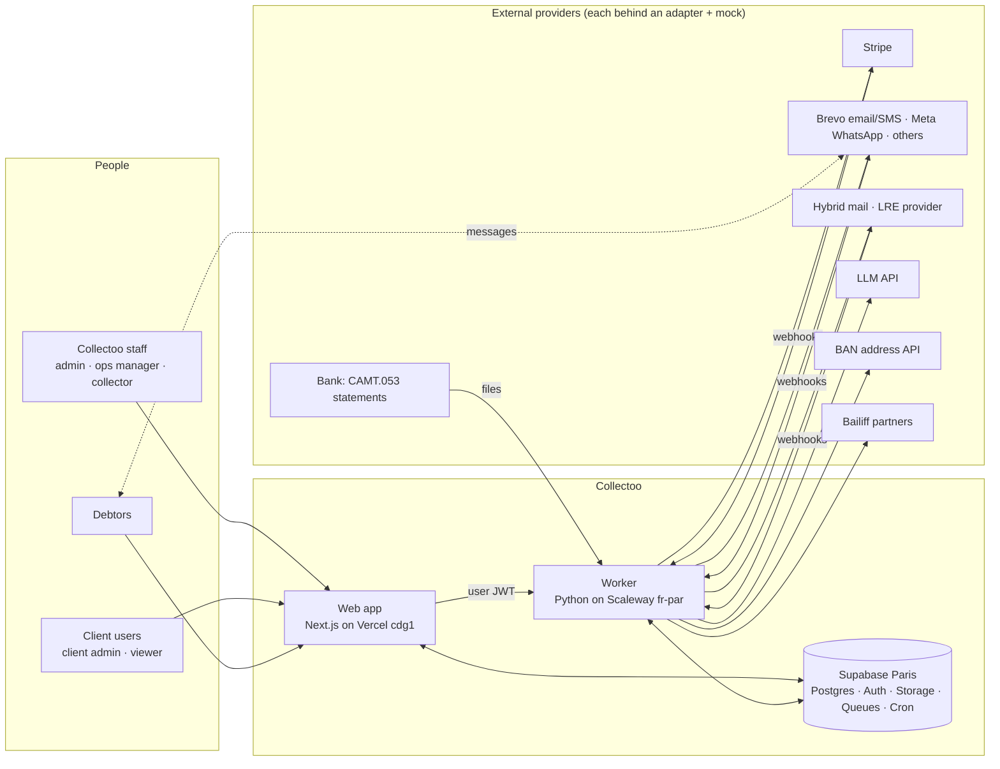
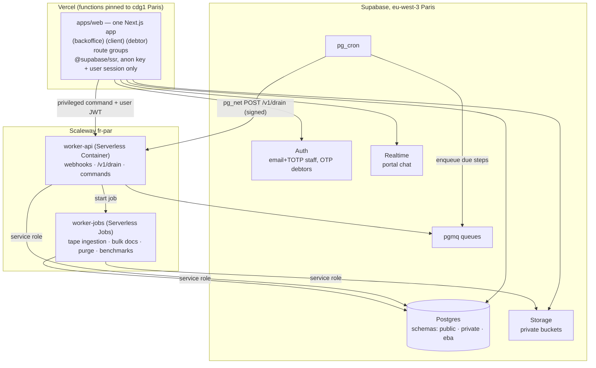
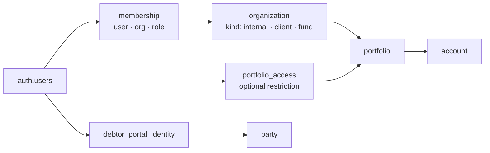
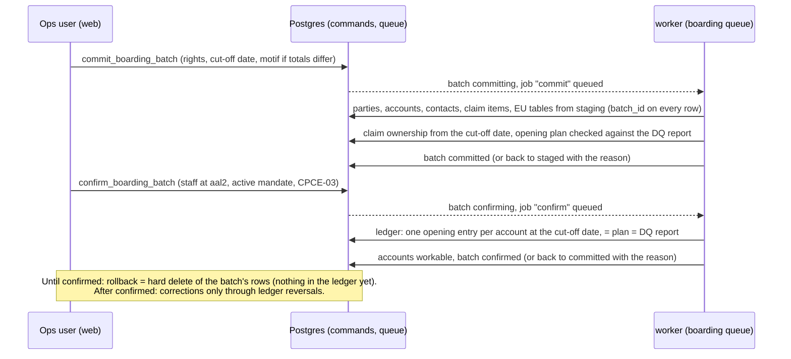
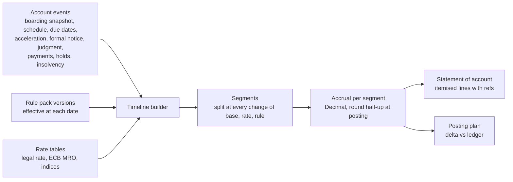
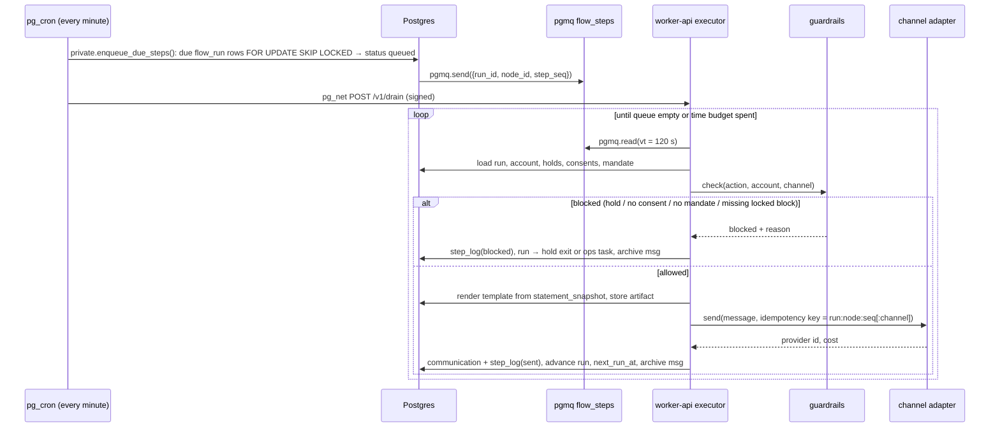
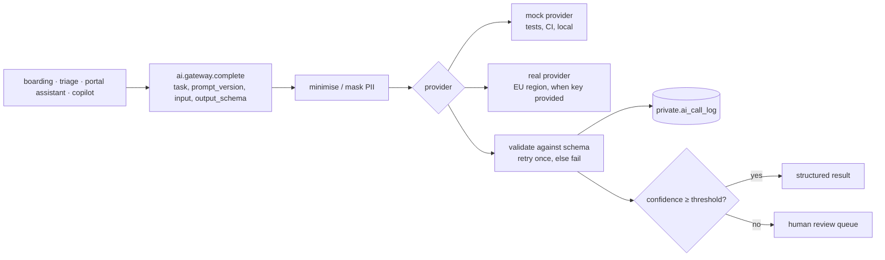

# Architecture

Status: Phase 0 draft, 2026-11-07. Decisions are recorded in `docs/adr/`. Legal requirements and their enforcement points are in `docs/COMPLIANCE.md` (IDs like CPCE-04 refer there). Rule packs and the engine conventions are in `docs/CALCULATION_RULES.md`. Channels are in `docs/CHANNELS.md`. The entity model is in `docs/DOMAIN.md`.

Guiding rule: **the simplest thing that works**, on standard Postgres, with every external provider behind an adapter that has a mock.

---

## 1. System context



## 2. Containers



| Container | Runs | Talks to |
|---|---|---|
| `apps/web` | UI for the three surfaces; server components and route handlers use the **user's** session (anon key + JWT). Never holds the service-role key. | Supabase (RLS applies), worker-api (forwards the user JWT). |
| Supabase | Data, auth, files, queues, cron, realtime. Business invariants that must never be bypassed live here (constraints, triggers, `SECURITY DEFINER` RPCs). | — |
| `worker-api` | Python 3.12 HTTP service (`collectoo_worker.api`): provider webhooks, flow-step executor (`/v1/drain`), privileged commands (boarding commit, payment allocation, sends), AI gateway. Scale-to-zero. | Postgres (service role), pgmq, providers. |
| `worker-jobs` | Same image, batch entrypoints: large tape ingestion (Polars/DuckDB, streaming), bulk document OCR, retention purge of files, 1M-row benchmark. | Postgres, Storage. |
| Edge Functions | **None in the MVP.** Allowed later only for small glue tasks, invoked in Paris (ADR-0002). | — |

**Why the executor is woken over HTTP:** a scale-to-zero container cannot poll a queue. A pg_cron tick (every minute) enqueues due steps, then calls `POST /v1/drain` through `pg_net` with a signed token. The worker drains the queue for up to a time budget and returns. Providers' webhooks wake it the same way. No always-on process, nothing Scaleway-specific in the code (ADR-0003, ADR-0004).

## 3. Repository layout

```
apps/web/                     Next.js (TypeScript, Tailwind, shadcn/ui, React Flow)
  app/(backoffice)/ app/(client)/ app/(debtor)/
worker/                       Python 3.12, uv, package collectoo_worker
  src/collectoo_worker/
    api/          HTTP entrypoints (webhooks, drain, commands)
    boarding/     profiling, mapping, transforms, validation, DQ report, commit
    engine/       calculation engine (rule packs, rate tables, statement of account)
    ledger/       posting service, allocation, reversal, reconciliation
    payments/     Stripe adapter, CAMT.053 parser, receipts, remittances
    flows/        flow executor, node handlers, simulation
    guardrails/   pre-send gate (holds, consent, mandate, locked blocks)
    channels/     adapter interface, descriptors, adapters + mocks, health
    ai/           AI gateway, prompts (versioned), schemas, mock provider
    decisioning/  bandits (M8)
    synth/        synthetic portfolio generator (Faker fr_FR)
  rule_packs/     YAML rule packs (data, ADR-0005)
  evals/          golden datasets for mapping and triage (ADR-0010)
  tests/          pytest, hypothesis, golden cases, adapter contract tests
supabase/
  migrations/     forward-only SQL
  tests/          pgTAP
  seed.sql        synthetic tenants and users only
tools/            dev tooling (e.g. eba_catalogue)
docs/             brief, design docs, ADRs, screenshots
```


---

## 4. Data model and database layout

Two layers (ADR-0009, details in `docs/DOMAIN.md`):
- **Layer 1, EU NPL template** (`eba` schema): staging rows of boarded EU-template tapes and the export views that regenerate a compliant tape at any date. Driven by `docs/reference/eba_field_catalogue.csv`.
- **Layer 2, operational** (`public` + `private`): parties, accounts, ledger, flows, communications, holds, mandates, ownership history. This is what the platform runs on.

| Schema | Exposed through the Data API? | Contents | Who writes |
|---|---|---|---|
| `public` | Yes | Business tables the UI reads; RPCs the UI calls. | Worker (service role) and `SECURITY DEFINER` RPCs. Direct RLS writes only on a short allow-list of low-risk tables (ADR-0011). |
| `private` | No | RLS helper functions, flow runtime (`flow_run`, `flow_step_log`), rule-pack internals, `change_log`, `ai_call_log`, retention policies, job runs, idempotency keys. | Worker, triggers, cron. |
| `eba` | No | Layer-1 staging (`eba.t1_counterparty` … `eba.t5_collection`), export views. | Worker (boarding). |
| `pgmq` | No | Queues: `flow_steps`, `outbound`, `boarding`, `webhooks_retry`. | Cron, worker. |

Conventions:
- Every tenant-scoped table carries `client_org_id` (denormalised) and, when relevant, `portfolio_id`, so RLS predicates stay cheap and indexable.
- Money: `bigint` minor units + `char(3)` currency. Rates: `numeric`. In Python: `int` cents and `Decimal`. No floats anywhere in money paths (ADR-0006).
- Timestamps `timestamptz` (UTC). Business dates `date`, interpreted in Europe/Paris.
- Commands and outbound sends carry an idempotency key with a unique constraint.
- Core tables have a trigger writing to `private.change_log` (table, row id, op, old/new JSON diff, actor, at). Cheap, and it settles disputes.
- Ownership over time: `claim_ownership(account_id, owner_org_id, servicer_org_id, mandate_id, valid_from, valid_to)`. Servicer ≠ owner from day one (phase C ready).
- Plans that hold whatever the statistics (ADR-0013 #21, migration `20261110130000`): `enable_hashjoin = off` / `enable_mergejoin = off` only forbid join methods, they never fix a join order (a forced nested loop with stale statistics put the 4710 pool outside: 439 s in CI). A per-row lookup is made structural instead: it drives from the row it is about through a lateral subquery that cannot be pulled up (`LIMIT`, or `OFFSET 0`; outer conditions are not pushed into it either, so a lateral holding only a key can only use that key's index) and reaches every other row by key (a correlated scalar lookup, e.g. the book of a posting's account). Where one pass over a set is the right plan, nested loops are forbidden instead, so the join is a hash join, linear whatever the estimates. Tests check what such a function reads (`pg_stat_xact_user_tables`: seq scans, probes), not how long it takes. Since M2c-6b-1 (review round 2, ADR-0014): a lateral holds the row's key **only** — a second condition inside it (the servicer, a status) lets stale statistics pick another index that reads every row of that servicer, dead versions included (the nightly checks' pending-refund lookup: 1.44M buffers, 2 s); a step that must run once for a set (a grouped subquery joined back to its rows, which the planner re-runs per row) is a `MATERIALIZED` CTE; and a statement made of many checks is bounded per check, rows handled and buffers touched per plan node read from `auto_explain` JSON in a rolled-back call, so a wide read fails a test before it is slow (`test_transfer_files_scale_integration.py`: `checks_work`, `assert_checks_bounded`). Since review round 3 (ADR-0014): a step that aggregates a set per group never carries a value that grows with the group into a `GROUP BY` or sort key (each of a batch line's N rows grouped with the array of its N transfer ids: N² bytes sorted, 392 MB of temporary files at 5,000 members) — it aggregates per group first, in its own `MATERIALIZED` step, then compares one row per group; a key read once per group is read from the distinct groups, not once per row of a group; a temporary table that a later statement joins to itself is `ANALYZE`d right after its `CREATE TABLE … AS` (autovacuum never analyses temporary tables: unanalysed, the self-join was a nested loop over every pair of a line's rows), or the comparison is a window; and such a statement's tests bound the temporary files too (`pg_stat_database.temp_bytes` unchanged, no plan node with `Temp Written Blocks`), not only its rows (`test_debit_bookings_batch_rules_integration.py`, the payout scale test's (b)) — which also counts an insert's statement-trigger transition table (`new_rows`, held in `work_mem`): a large set is posted in chunks of the job's size (`post_run_settlements`, 2,000 runs per `ledger_post_set` call).

## 5. Multi-tenancy and RLS



- **Organizations:** `organization(kind ∈ {internal, client, fund})`. Collectoo itself is the one `internal` org. Funds/FCTs are orgs too (phase C).
- **Roles:** internal `admin | ops_manager | collector`; client `client_admin | client_viewer`; `debtor` for portal users.
- **JWT claims:** a Supabase *custom access token hook* (a Postgres function) adds `app_role`, `org_ids` and `is_internal`. Claims are hints for the UI; **RLS reads the tables** through helpers so revoking access takes effect immediately.
- **Helpers** (`private`, `STABLE`, `SECURITY DEFINER`, `search_path` pinned):
  - `private.is_internal()`, `private.has_role(role)`, `private.is_aal2()` (MFA level from `auth.jwt()->>'aal'`)
  - `private.can_read_portfolio(portfolio_id)`: internal staff with `aal2` and (no restriction or a matching `portfolio_access`), or a client member of the portfolio's client org (optionally narrowed by `portfolio_access`)
  - `private.debtor_party_ids()`: parties linked to the current debtor identity
- **Policy pattern** (one per table, generated from a template in the migration):

```sql
alter table public.account enable row level security;
create policy account_read on public.account for select
  using (private.can_read_portfolio(portfolio_id)
         or party_id = any (private.debtor_party_ids()));
-- no insert/update/delete policy: writes go through the worker or SECURITY DEFINER RPCs
```

- **Staff MFA:** internal roles must be at `aal2` (TOTP via Supabase Auth). Enforced in the helpers, so an internal user without MFA reads nothing (GDPR-05).
- **Debtor access:** unique link (signed, single-use token) → `public.debtor_link_exchange(token)` RPC → OTP to a contact point on file → Supabase session with role `debtor`. Lightweight identity check (e.g. date of birth or reference) inside the RPC, with rate limiting.
- **pgTAP strategy** (`supabase/tests/`):
  1. Catalog test: every table in `public` has RLS enabled and no `using (true)` policy; no table in `private`/`eba` is granted to `anon`/`authenticated`.
  2. Isolation test: seed two client orgs with portfolios; for each table, user of org A cannot select/insert/update/delete org B rows.
  3. Role matrix: viewer cannot call write RPCs; collector restricted by `portfolio_access`; internal without `aal2` sees nothing.
  4. Write-path tests: direct `insert` into `ledger_entry`, `payment`, `communication`, `boarding_batch` as `authenticated` fails.
  5. Debtor test: a debtor sees only their own accounts and statements.

## 6. Portfolio boarding pipeline


- **Batch state machine:** `uploaded → profiled → mapping_proposed → mapping_approved → transformed → validated → staged → committing → committed → confirming → confirmed` (or `needs_fix`, `abandoned`, `rolled_back`). Defined in `docs/DOMAIN.md` §4.4.
- **Streaming:** the worker reads files with Polars lazy scans / DuckDB, processes in chunks, writes to staging with `COPY`. Large tapes run as a Serverless Job. Targets: 50k rows in CI, 1M rows benchmarked within VM memory.
- **Mapping:** the AI gateway proposes `source column → canonical field` with confidence and rationale, from column names, profiles and a few sample values (masked). Saved **mapping profiles** per seller/client are applied first; the LLM only fills gaps. Nothing commits without human approval of the mapping.
- **Transforms** are data (a versioned list of named, pure functions: `parse_fr_date`, `parse_fr_decimal`, `siren_check`, `iban_normalise`, `phone_e164`, `ban_geocode`...), so a batch can be replayed exactly.
- **Claim type and legal regime** are assigned at boarding from mapped fields (`contract_date`, product) and never recomputed silently (CCD-01).
- **Commit and confirmation** are requested from the web (one short `SECURITY DEFINER` command each, within the API's 8 s) and run by worker jobs on the `boarding` queue, each in one transaction (M2a-2, M2a-3; ADR-0012). At 50k loans the commit job takes ~21 s and the confirmation ~20 s (`docs/benchmarks/boarding.md`).



## 7. Calculation engine

Pure Python library (`collectoo_worker.engine`), no I/O inside. Same inputs give the same output, bit for bit.



- **Inputs** are loaded by a thin repository layer, hashed (`inputs_hash`), and passed in. The engine returns a statement of account and a **posting plan** (the ledger entries needed to bring posted accruals in line with the computed ones).
- **Posting:** accruals are posted at segment ends and on demand (statement, payment, letter). Each entry records `engine_version`, `rule_pack_version` and `inputs_hash`.
- **Back-dated events** (e.g. a payment value-dated earlier): the engine recomputes and the posting plan reverses the affected accruals and reposts them. Nothing is mutated.
- **Statement of account (décompte)** lines: component, base, rate, period, days, day count, amount, legal/contract reference, rule-pack version. When a statement goes into a communication it is frozen as `statement_snapshot` (JSON + hash), and the message references it (CPCE-04).
- **Allocation** of a payment is computed by the engine (rule-pack waterfall, with Code civil 1343-1 "interest first" checks, INT-09), because it depends on accrued interest at the payment's value date.
- **Rule packs** are YAML in `worker/rule_packs/`, validated at load (schema + semantic rules from `CALCULATION_RULES.md` §5), loaded into `private.rule_pack_version` with a content hash. An account pins its pack id; versions apply by effective date (ADR-0005).
- **Tests:** golden cases per claim type (founder-validated), Hypothesis property tests (no negative balances from allocation, interest monotonic in time without payments, segment split invariance, allocation never pays principal before interest unless designated).

## 8. Ledger

Double-entry, append-only, integer minor units (ADR-0006).

**Tables** (ADR-0012): `ledger_entry` (header: `organization_id`, `client_organization_id`, `portfolio_id`, `account_id`, `entry_type`, `effective_date`, `posted_at`, `line_count`, `idempotency_key` unique per organization + `request_hash`, `reverses_entry_id`, `boarding_batch_id`, `source_type/source_id`, `reason`, `engine_version`, `rule_pack_version_id`, `inputs_hash`, actor), `ledger_posting` (`entry_id`, `line_no`, `ledger_account_id`, `amount_minor` signed (+debit / −credit), `currency`, `effective_date`) and `ledger_account` (book + dimensions: receivable per claim item × component, owner claim pooled per owner × portfolio × component, client books per client). Writes only through `private.ledger_post` / `private.ledger_reverse` (service_role).

**Invariants (in the DB, `ENABLE ALWAYS` triggers: they hold for the owner role too):**
- Lines of an entry sum to zero per currency, their number equals `line_count`, and the receivable (1100) and owner claim (3100) move by opposite amounts per component (deferred check at commit, `LG001`). A closed entry cannot take another line.
- No `UPDATE`/`DELETE`/`TRUNCATE` on ledger tables (`LG000`; DELETE/TRUNCATE also revoked from the owner). Corrections = a reversal entry (negated lines, `reverses_entry_id`, at most one per entry, never reversed itself), then a new entry.
- Set-based guards: book allowed for the entry type, tenant/client/portfolio/account coherence, line currency and date = ledger account's and entry's (`LG002`).
- `recovery_fee` lines on a debtor receivable require `account.enforceable_title_id` (CPCE-09, M3). Consumer-credit accounts only accept whitelisted components (INT-05, M3).
- Debtor cash can only land on a `client_funds` bank ledger account (CPCE-02, M2b).
- **Since M2b (ADR-0013):** client-money books (5120, 4710, 4670) closed in every entry (`LG001`); entry shapes per payment type; what is left of a payment never negative at any date, and an allocated or netted receivable never overdrawn from its date on (`LG007`); payment entry types (`cash_in`, `allocation`, `forward`, `cash_out`, `netting`) posted only through the set-based `private.ledger_post_set`; a `cash_in` is never reversed; every writer that lowers a payment or a receivable takes the servicer's allocation lock.
- **Since M2c (ADR-0014; rewritten at M2c-7's close-out, checked against the migrations):** two funds, each closed per currency in every entry (I2′, `LG001`), crossed only through the 4679 / 4689 mirror (I12); the M2c entry types have fixed books and shapes (I3′, `private.ledger_entry_verify`) and are posted only by `private.ledger_post_set`; no M2c type touches 1100, 3100 or 4710, and 7060 only through the two commission types against the same client's 4111; `commission_invoice`, `commission_credit_note`, `client_settlement` and `advance_write_off` are never reversed (`LG003`; one exception: a settlement withheld at the debit, below); each client's 4670 is never in debit at commit (I13, `LG008`); a reversal of an entry already remitted to its client commits only with its cover (I23, `LG009`, M2c-7a).

**Chart of accounts** (`public.ledger_book`; the numbers are Collectoo's labels, which the accountant maps):

| Code | Book | Dimension | Fund |
|---|---|---|---|
| `1100` | Debtor receivable (`debtor_receivable`) | claim item × component | the claim (serviced for its owner) |
| `3100` | Owner's claim (`owner_claim`) | owner × portfolio × component | mirror of 1100 |
| `5120` | Dedicated account, R124-2 (`client_money_cash`) | per `client_funds` bank account | **dedicated-account fund** |
| `4710` | Receipts to allocate (`unallocated_payment`) | pooled per servicer and currency | dedicated-account fund |
| `4670` | Owed to the client (`client_payable`) | per client | dedicated-account fund |
| `4679` | Due to the servicer on the dedicated account (`due_to_servicer`) | pooled | dedicated-account fund |
| `5122` | Own account, movements recorded (`own_cash`) | per `own` bank account | **servicer's fund** |
| `4111` | Commission invoices and credit notes (`commission_receivable`) | per client | servicer's fund |
| `4112` | Advances to recover (`client_advance_receivable`) | per client | servicer's fund |
| `419` | Sums owed back to the client (`client_credit_owed`, M2c-7c-1) | per client | servicer's fund |
| `44571` / `44574` | VAT collected due / on commission not yet settled | pooled | servicer's fund |
| `4689` | Due from the dedicated account (`due_from_client_funds`) | pooled | servicer's fund |
| `7060` | Commission (`servicer_revenue`) | per client | servicer's fund |
| `6270` | Bank fees on the dedicated account (`bank_fees`) | pooled | servicer's fund |
| `6780` | Losses borne by the servicer (`servicer_losses`) | pooled | servicer's fund |
| `7714` | Recoveries of advances passed as a loss (`written_off_recovered`, M2c-7c-1) | pooled | servicer's fund |

A PSP clearing book (5121) and PSP fees come with Stripe (M5): not books yet.

**Posting rules** (+ debit / − credit; ‖ separates the two funds):

| Event | Lines |
|---|---|
| Boarding, per component | Dr 1100 / Cr 3100 |
| Interest accrual (engine) | Dr 1100:late_interest / Cr 3100:late_interest |
| Bank transfer received (CAMT.053), per statement day (M2b-2) | Dr 5120 / Cr 4710 (pool) |
| Allocation of a payment (M2b-4) | cash side: Dr 4710 / Cr 4670 (client) · claim side: Dr 3100:X / Cr 1100:X per component (engine allocation) |
| Forward to the client without allocation (M2b-4) | Dr 4710 / Cr 4670 |
| Credit note applied (M2b-4) | Dr 1100 (credit item) / Cr 1100 (invoice), principal |
| Bank return or chargeback (M2b-6) | reversal of each live allocation and forward **at the return date**, then Dr 4710 / Cr 5120 (`cash_out`) at the return date |
| Refund to the payer (M2b-6) | Dr 4710 / Cr 5120 (`cash_out`) at the date of its debit on the statement; a refund that bounces: its reversal |
| Debtor paid the client directly (M2b-6) | Dr 3100:X / Cr 1100:X (`adjustment`, legal order; no client money) |
| Commission invoice, issued at a run's approval (`commission_invoice`) | +4111 TTC / −7060 HT / −44574 VAT (−44571 when the servicer opted for débits) |
| Commission credit note (`commission_credit_note`) | −4111 TTC / +7060 HT / +44574 v₁ / +44571 v₂ |
| The run's set-off, posted at its payout's debit (or at approval when N = 0) (`client_settlement`), only under a netting clause | +4670 D / −4679 D ‖ +4689 D / −4111 Dc / −4112 Da, D = Dc + Da, and one VAT pair +44574 v / −44571 v |
| The payout, at the bank's debit (`remittance`) | +4670 N / −5120 N |
| The sweep of the servicer's share to its own account (`servicer_sweep`) | +4679 S / −5120 S ‖ +5122 S / −4689 S |
| A top-up from the own account, at its credit (`servicer_top_up`) | +5120 T / −4679 T ‖ +4689 T / −5122 T |
| A bank fee on the dedicated account (`bank_fee`) | +4679 F / −5120 F ‖ +6270 F / −4689 F |
| An advance of the servicer to the client (`client_advance`: a remitted reversal, a payout overrun, a double payout) | +4679 A / −4670 A ‖ +4112 A / −4689 A |
| The excess of a return over what is left of its payment (`servicer_loss`) | +4679 X / −5120 X ‖ +6780 X / −4689 X |
| A client's payment to the own account (`client_payment_own`, M2c-7c-1) | +5122 P / −4111 / −4112 / −419 (a surplus owed back) / −7714 (a recovery), and the VAT pair of what it settles |
| A client's payment on the dedicated account (`client_payment_dedicated`, M2c-7c-1) | +5120 P / −4679 P ‖ +4689 P / −4111 / −4112 / −419 / −7714, and the VAT pair |
| A refund to the client from the own account (`client_refund_own`, M2c-7c-1) | +4111 R (a credit note's excess) or +419 R (a credit owed back) / −5122 R |
| An advance passed as a loss (`advance_write_off`, M2c-7b) | +6780 W / −4112 W |
| Write-off / recall of a claim | Dr 3100:X / Cr 1100:X |

Each M2c entry names its document (C. com. R123-174): the invoice, the run, the bank transfer or bank line, the advance, the proof. **Netting happens only under a clause** (founder #3): a client whose mandate has no netting clause is paid its gross and invoiced, and pays the invoice itself; advances are taken back in the plan only under a claw-back clause (M2c-7b; CALCULATION_RULES §7). When a set-off is barred at the debit (a proceeding, a liquidation, a death or a seizure recorded after the approval, M2c-7d-2) the settlement is posted and reversed in the same transaction under `LG003`'s one exception (its key `return:barred:<run>`), the run's next draft giving it back.

**The property formula and the funds' identities** (checked at commit where they can be, every night over all postings):
- I8′: 5120 + 4710 + 4670 + 4679 = 0 per servicer and currency (`client_money_identity`); the servicer's fund closed (`own_fund_identity`); 4679 + 4689 = 0 (`fund_mirror`).
- I19: each dedicated account's 5120 = what its bank lines moved — its payments in, its returns and refunds out, and what its lines booked in the funds (`bank_line_booking`: top-ups and returned payouts in; fees, losses, payouts and sweeps out) — (`bank_cash_identity`); with I9 (the bank balance at the last statement) 5120 is the bank.
- I13: each client's 4670 never in debit (`client_payable_debit`); I14 and I15: what each client is owed = its pending items and its runs in flight (`remittance_completeness`), each item in one live run at most (`remittance_item_twice`).
- I18: per client 4111 = its open invoices less the refunds owed, and 44574 = the documents' pending VAT (`settlement_ledger`); 4112 = the open part of its advances (`advance_ledger`); 419 = its open credits (`client_credit_ledger`); 7714 = the recoveries of advances passed as a loss (`written_off_recovery_ledger`).
- I23: every reversal of a remitted entry covered by what was remitted of it (`LG009` at commit; `remitted_reversal_uncovered` at night).

**Balances** are `SUM(amount_minor)` over lines (views per account/component and per client); `private.client_payable_balance` keeps each client's 4670 for the commit check, verified against the lines every night. A rebuildable snapshot table may be added for speed; it is always verifiable against the lines.

**Nightly checks (M2b-6, extended in M2c):** pg_cron queues `payments.invariants` per servicer; `private.run_payment_checks` writes a `payment_check_run` and its `payment_check_result` rows (violations: I8 client money closed per currency, each bank account's cash = its payments less what went back out, I11 cash_in = payments per statement day, each payment's position against its status, no negative per-file allocation, I6 no allocated receivable below zero, owner-claim mirror, one current receipt per identified payment, one notification per entry; alerts: statement continuity, bank balance at the last statement (I9), ageing of unmatched and unallocated money, pending refunds, debits to classify, duplicates, direct payments), then the funds' checks above, the runs', transfers' and files' checks (M2c-4 to M2c-6) and the advances' (`private.run_advance_checks`, M2c-7: `remitted_reversal_uncovered`, `advance_ledger`, `advance_open` after 30 days, `client_credit_owed`, `client_credit_ledger`, `written_off_recovery_ledger`, `repayment_request_document_missing`, `protection_event_to_qualify`, `seizure_standing`, `set_off_after_bar`, `claims_to_declare`, `post_opening_unpaid`, `payout_after_liquidation`, `top_up_account_missing`, `top_up_order_failed`, `label_reference_waiting`; and `servicer_shortfall`, the servicer's debt to the dedicated account beyond the top-ups ordered). The advances' delta pass reads only what changed since the last run; the whole history is read on the 1st of the month or when an admin asks « Vérification complète des avances ». Read on « Contrôles » (admins, ops managers).

## 9. Payments and reconciliation

- **Stripe** (test mode): card and SEPA Direct Debit via Payment Links / Checkout created by the worker with `metadata.account_id` and an idempotency key. Webhooks (`checkout.session.completed`, `payment_intent.succeeded`, `charge.refunded`, `charge.dispute.created`, `payout.paid`) → worker-api, signature verified, stored raw in `payment_event`, processed idempotently by event id.
- **SEPA transfers:** each account gets a structured reference (RF creditor reference, ISO 11649). Bank statements arrive as **CAMT.053** (or CSV) files uploaded by ops (SFTP pull later), parsed by the worker into `bank_transaction`, then (M2b, `docs/design/m2b-payments.md`):
  - `payments.import`: lines deduplicated per bank account, one `payment` per debtor credit, one `cash_in` per statement day; queues `match` and, when the statement has returns or our refunds, `process_debits`;
  - `payments.match`: deterministic rules R1–R6 (RF structured, RF in the text, corroborated invoice or file number, IBAN memory; suggestions otherwise) → gating (file not confirmed, closed, other currency, hold, before the cut-off, nothing due) → ops queue « Paiements à traiter »;
  - `payments.allocate`: the legal-order waterfall (Python) posted set-based under the allocation lock; `client_notification` per entry (CPCE-06);
  - `payments.receipts`: versioned deterministic PDF receipts built from the ledger (CPCE-07);
  - `payments.process_debits` (M2b-6): returns linked to their payment (end-to-end id, bank transaction id), our refunds to their `refund_request` (`RFD…`), bounced refunds to the refund; the rest left to ops (« Débits et retours », `link_debit`); posting reverses allocations at the return date and books the `cash_out`;
  - `payments.direct_payment` (M2b-6): a payment the debtor made to the client, planned by the waterfall, booked as an `adjustment`;
  - `payments.invariants` (M2b-6, nightly): the checks above.
  Ops commands (admins and ops managers at aal2, idempotency key + request hash, compare and set, ≤ 2 s lock wait): assign / accept / unassign, reverse / allocate again / release a hold / forward / apply a credit note, request / cancel a refund, link a debit, resolve a duplicate, record a direct payment. Lock order for every writer: files (`FOR KEY SHARE`), payments (`FOR UPDATE`), refund requests, bank accounts, then the servicer's allocation lock.
- **Surendettement / collective proceeding hold:** payments are not auto-allocated; they are held (the client told) until ops refund them or allocate them on the judge's authorisation (HOLD-01, HOLD-02).
- **Money leaving the client-funds account (M2b-6):** returns and chargebacks (allocations undone at the return date, the receipt voided, the client told), refunds (booked when the bank's debit shows them), never fees (founder #20: M2b-6's rule, superseded since M2c-6b by the `bank_fee` booking of the bank's coded charges on the dedicated account, +4679 / −5120 ‖ +6270 / −4689, the next bullet and §8). The ledger cash follows the bank: nothing leaves 5120 without a bank line.
- **The debit job's bookings and covers (M2c-6b, M2c-7; ADR-0014):** `payments.process_debits` and the funds pass (`private.apply_bank_bookings`) book each line of the dedicated account's statement that is ours: a payout's debit posts the run's stored plan (its `client_settlement` and the `remittance` of N), a sweep's debit the `servicer_sweep`, a top-up's credit carrying our `TOP…` id the `servicer_top_up`, the bank's coded charges a `bank_fee`, a returned payout the reversal of its `remittance` (re-queued for the client as `payout_returned`); ops book the rest from « Débits et retours » (« Comptabiliser… » and its sheets; the transfers themselves are listed on « Virements ») (a batch line, a line without our reference, a client's credit paying the servicer, a debtor's credit relayed from the own account, a credit citing our reference in its label: `label_reference`, held, never a payment by itself, with its four exits: its transfer's return, a client's payment, a debtor's payment, our top-up). **Covers:** a reversal of a collection already remitted to its client (« Désimputer », a return in either mode) is covered the same day by a `client_advance` of what was remitted of it (`cover_remitted_reversals`, M2c-7a); a line reversed while its run was in flight is covered at that run's booking (`cover_booked_run_reversals`), before any `payout_overrun` cover; a reversal without its cover is refused at commit (`LG009`). A set-off barred at the debit (an event recorded after the approval) is withheld: posted and reversed at once, given back by the next run (M2c-7d-2). Each booking takes the locks its lines need (the allocation lock for 4670, then the remit lock for 4679); a line the ledger's checks refuse goes to ops with its reason (`private.ledger_check_now`), never half booked.
- **Own money and recovery (M2c-7):** each hour (`servicer-top-ups`) the servicer is ordered to top up the dedicated account by what it owes there beyond the top-ups already ordered (`private.top_up_needed`: Σ4679 in debit plus its shares still on their way to the own account, less the top-ups ordered or in a file), typed in the bank with its `TOP…` id or sent in the own account's pain.001 file; each file sweeps the servicer's settled share to its own account (S = −Σ4679 − the sweeps in flight). Advances are recovered by the claw-back under its clause (in the plan, M2c-7b), by the client's payment (« Règlement du client », to the own account or the dedicated account, M2c-7c-1) or after a repayment request (its letter, M2c-7c-2), or passed as a loss (`advance_write_off`); client money above what is open is a credit owed back (419), refunded from the own account.

```mermaid
sequenceDiagram
  participant S as Stripe / bank file
  participant W as worker-api
  participant E as engine
  participant DB as Postgres
  participant C as channels
  S->>W: payment_intent.succeeded / CAMT.053 line
  W->>DB: insert payment (idempotent on provider id) + Dr 5121|5120 / Cr 4710
  W->>DB: blocking hold? (surendettement → ops review, stop)
  W->>E: allocate(payment, events, rule pack, rates)
  E-->>W: allocation by component + posting plan
  W->>DB: post accruals to value date + allocation entries (one tx)
  W->>DB: receipt (quittance) artifact + payment.receipt_id (CPCE-07)
  W->>C: send receipt on preferred channel + portal
  W->>DB: client_notification (CPCE-06)
  Note over W,DB: Remittance run (hourly schedule, twice monthly per client): per client the pending items<br/>→ payout of N, commission set off only under a netting clause (else invoiced and paid by the client),<br/>advances taken back only under a claw-back clause; statement and invoice; R124-6 deadline guard and alerts (CPCE-08)
```

## 10. Flow engine

Postgres-native (ADR-0004). Flow graphs are edited in React Flow, stored as versioned JSON.

| Table | Purpose |
|---|---|
| `public.flow`, `public.flow_version` | Definition (draft/published), graph JSON, scope (portfolio / claim type / segment). Written via RPC. |
| `private.flow_run` | One row per account in a flow: `flow_version_id`, `current_node`, `status`, `next_run_at`, `step_seq`, `context` JSON. |
| `private.flow_step_log` | Every executed step: node, idempotency key, outcome, guardrail result, timings. |



- **Idempotency:** key `run_id:node_id:step_seq` (plus channel suffix on fallback). A redelivered message whose key is already logged is archived without effect.
- **Retries:** a crashed step reappears after the visibility timeout; after N reads it moves to a dead-letter queue and creates an ops task.
- **Versioning:** in-flight runs stay on their version; migration to a new version maps node ids (explicit mapping in the publish dialog).
- **Simulation:** the executor runs node handlers against a sample with mock adapters and a virtual clock; output = timeline + estimated cost (from capability descriptors).
- **Guardrails** (`collectoo_worker.guardrails`): one gate for every outbound action, flows cannot skip it. Order: active mandate (CPCE-03) → blocking holds (HOLD-01/02, dispute, deceased, wrong party, recalled) → first-letter precondition and reference (CPCE-05) → channel consent (LRE-01, opt-in channels) → locked legal blocks present for this message type and channel (CPCE-04, GDPR-01) → business caps (frequency, windows, budget) → idempotency. Details in `CHANNELS.md` §4.1.

## 11. Channel layer

- **Adapter interface** (Python `Protocol`, one per provider):
  - `send(OutboundMessage) -> SendResult` (provider id, accepted/rejected, cost estimate)
  - `parse_inbound(request) -> InboundMessage | None`
  - `parse_status(request) -> list[StatusEvent]` (delivered, read, failed, template rejected, account restricted)
  - `fetch_proof(provider_id) -> Proof` (legal-grade for LRAR/LRE)
  - `verify_webhook(request) -> bool`
- **Capability descriptor** per (channel, provider): versioned YAML (schema in `CHANNELS.md` §5) loaded into `channel_descriptor`. Decisioning, the guardrail and simulation read it; no channel-specific `if` outside adapters.
- **Every adapter ships with a mock** (records sends to `mock_outbox`, emits fake status/inbound events) and **contract tests** shared by all adapters of a channel.
- **Health:** `channel_health(tenant, channel, provider, sender_identity, state)` with states `healthy → degraded → restricted / down`, driven by the signals in `CHANNELS.md` §4.2. A change emits an event and an ops alert. Fallback order: provider failover first, then channel fallback; a fallback re-runs the full guardrail.
- **Unified inbox:** inbound messages from every channel → `communication(direction='in')` on the debtor timeline → AI triage (later milestone) → hold or task.
- **Evidence:** every outbound message stores the exact rendered content (per channel format), its hash, the statement snapshot used, provider ids, status history and proof (`communication_artifact`, Storage, immutable).

## 12. AI gateway



- Provider-agnostic interface; prompts are versioned files in the repo; every call logs task, prompt version, model, masked input hash, output, latency, cost (ADR-0010).
- **LLMs never produce authoritative amounts, dates or legal text.** They fill slots in locked templates; values come from the ledger/engine via tool calls. Output schemas forbid free-form amounts.
- AI decision nodes choose only from a pre-approved, non-significant action set (channel, timing, copy variant); settlements and escalations stay with rules or humans (GDPR-06).
- **Evals:** golden datasets in `worker/evals/` (mapping, triage) run in CI against the mock; against a real model nightly once a key exists.
- A non-EU provider needs a recorded transfer basis before activation (GDPR-07).

## 13. Security

- **Service-role key** only in the worker (Scaleway Secret Manager) and in CI for the local stack. Never in `apps/web`, never in the browser. The web app forwards the user JWT to the worker, which verifies it (Supabase JWKS) and re-checks the role before any privileged command.
- **RLS everywhere** in `public`; `private`, `eba` and `pgmq` are not exposed. Ledger, payments, communications and boarding tables are written only by the worker or `SECURITY DEFINER` functions (ADR-0011).
- **`SECURITY DEFINER` functions:** `search_path = ''`, fully qualified names, explicit role checks at the top, revoked from `public` and granted only to the intended role.
- **Staff MFA:** TOTP via Supabase Auth, `aal2` required by RLS helpers for internal roles.
- **Storage:** private buckets, paths prefixed by `client_org_id/`, RLS on `storage.objects`, short-lived signed URLs. The bucket `transfer-files` (pain.001 files, risk R4) is narrower (M2c-6a review T4): its one policy, `private.can_read_transfer_file_object`, opens a file's object only to the money-staff member who recorded its download (`transfer_file_download`, the command that re-runs the generation's checks) in the last 60 seconds, and only while the file is downloaded or sent; the web route calls the command first, then reads the bytes with the user's session and serves them only if their SHA-256 is the one recorded. A superseded, rejected or failed file is never readable.
- **Webhooks:** signature verification per provider, replay protection by event id.
- **Secrets:** Vercel env (anon key + worker URL only), Scaleway Secret Manager (service role, provider keys), GitHub Actions secrets (none for production). `.env.example` only in the repo.
- **Encryption:** Supabase TLS and encryption at rest. No extra column encryption in the MVP (decision recorded; revisit for bank clients).

## 14. Observability (minimal)

- Worker: structured JSON logs to stdout → Scaleway Cockpit; request id and idempotency key on every log line.
- `private.job_run` (job, started, finished, status, counts, error) for cron and batch jobs; a back-office page lists failures.
- Alerts (email to ops, later Slack): job failure, dead-letter message, channel health change, remittance deadline at D-5, reconciliation mismatch.
- Supabase logs/metrics as provided. No separate APM until needed.

## 15. Environments

| Env | Database | Web | Worker | Providers |
|---|---|---|---|---|
| Local / cloud session | `supabase start` (Docker) | `next dev` | `uv run` | Mocks only |
| CI (GitHub Actions) | `supabase start` + `supabase db reset` + `supabase test db` | build, lint, type-check, Vitest, Playwright (screenshots) | ruff, mypy, pytest (+ 50k-row boarding test) | Mocks only |
| Production | Supabase Paris (`eu-west-3`), migrations applied by the Supabase GitHub integration on merge to `main` | Vercel, functions in `cdg1` | Scaleway fr-par | Test mode until go-live decision |

No shared staging in the MVP. Previews use mocks; a Supabase branch or staging project is added when a client needs UAT.

Migrations: forward-only SQL, each passes on the local stack and in CI before the PR. Generated types: `supabase gen types` for TypeScript, plus Pydantic models for the worker generated from the same schema snapshot.

## 16. GDPR retention and purge

- `private.retention_policy(data_category, trigger_event, period, action ∈ {delete, anonymise}, legal_basis)`. Periods are set by counsel (OQ-12); until then the purge runs in **dry-run** mode (reports only).
- Nightly pg_cron job `private.run_retention_purge()` handles rows; storage objects are deleted by a worker job from a list it produces. Each run is logged in `private.job_run` with counts.
- Ledger and evidence of legal letters are anonymised (party detached, identifiers hashed), not deleted, for the accounting/evidence period.
- Data-subject requests (access export, rectification, erasure, objection) are a back-office workflow; erasure goes through the same purge functions.

## 17. Open questions (architecture)

1. **PSP and R124-2:** debtor card/SEPA DD payments sit in the Stripe balance before payout. Must the payout always go to the dedicated client-funds account, and who bears Stripe fees (client per mandate, or Collectoo)? Default: payouts only to the client-funds account; fees booked to Collectoo (`6270`) unless the mandate says otherwise. To validate with counsel/bank.
2. **Vercel is a US company** (decided 2026-11-07: keep Vercel EU region + DPF/SCCs in the sub-processor register): debtor portal requests transit Vercel (EU region). Needs a transfer basis under GDPR ch. V (DPF/SCCs) in the sub-processor register (GDPR-07). Alternative if refused: host Next.js on Scaleway too.
3. **Scaleway Serverless limits** (request timeout for `/v1/drain`, job duration, memory for 1M-row tapes) to verify against current docs before M1; fallback is a small Scaleway instance running the same image.
4. **VAT on commissions** in remittance statements: rates and invoicing rules to confirm with the accountant.
