# Domain model

> **Status:** Phase 0 draft. Code in English, debtor-facing copy in French. Legal IDs (CPCE-04, INT-05, HOLD-01…) refer to `docs/COMPLIANCE.md`; field IDs (`3.12`) to `docs/reference/eba_field_catalogue.csv`; the gap analysis behind Layer 2 is `docs/reference/eba_gap_analysis.md`.

Contents: [1. Glossary](#1-glossary-fr--en) · [2. Conventions](#2-modelling-conventions) · [3. Entity model](#3-entity-model-two-layers) · [4. State machines](#4-state-machines) · [5. Open questions](#5-open-questions-founder)

## 1. Glossary FR ↔ EN

`In code` is the identifier used in tables, enums and APIs.

### 1.1 Parties and roles

| Français | English | In code | Note |
|---|---|---|---|
| Créancier | Creditor | `organization(kind = creditor_client)` | Owner of the claim in phase A |
| Mandant | Principal (client giving the mandate) | `organization(kind = creditor_client)` | Our client in third-party collection |
| Mandataire | Agent | — | Collectoo when collecting under mandate |
| Débiteur | Debtor | `party` + `account_party(role = borrower)` | |
| Codébiteur / co-emprunteur | Co-debtor / co-borrower | `account_party(role = co_borrower)` | Usually jointly and severally liable |
| Caution | Guarantor (surety) | `account_party(role = guarantor)` | |
| Fournisseur de protection | Protection provider | `account_party(role = protection_provider)` | Template `1.05` |
| Personne physique / morale | Natural person / legal entity | `party.kind` | |
| Consommateur / non-professionnel / professionnel | Consumer / non-professional / professional | `account_party.capacity` | Capacity is per contract |
| Ayants droit / succession | Heirs / estate | `party_life_event(kind = deceased)` | |
| Commissaire de justice (ex-huissier) | Bailiff / judicial officer | `bailiff_partner` | |
| Mandataire judiciaire / liquidateur | Court-appointed creditors' representative / liquidator | `insolvency_proceeding.administrator` | |
| Gestionnaire de crédits | Credit servicer | `organization(kind = servicer)` | Dir. (EU) 2021/2167, phase B |
| Acheteur de crédits | Credit purchaser | `organization(kind = fund \| fct)` | |
| Cédant | Seller / assignor | `portfolio_transfer.seller_organization_id` | |
| Cessionnaire | Buyer / assignee | `portfolio_transfer.buyer_organization_id` | |
| FCT (fonds commun de titrisation) | French securitisation fund | `organization(kind = fct)` | Phase C |
| Société de gestion | Management company | `organization(kind = management_company)` | Manages the FCT |
| Dépositaire | Depositary | `organization(kind = depositary)` | Holds the FCT's assets |
| Fonds de dette / de crédit | Credit fund | `organization(kind = fund)` | |
| Co-investissement | Co-investment | `fund_share` | Our share in each FCT |
| Identité de facturation | Billing identity | `billing_identity` (one per organization: the servicer and each client; name and SIREN on `organization`) | What invoices, statements and receipts print: legal form and capital, RCS city, registered office, VAT number, liquidation, EI (C. com. R123-237/238; CGI ann. II 242 nonies A 1°–2°). M2c-2 |
| Paramètres de facturation | Billing settings | `servicer_billing_settings` | Invoice prefix, own account for due invoices, VAT on debits, penalty text, bank cut-offs. M2c-2 |
| Client professionnel établi en France métropolitaine | Professional client in mainland France | `billing_identity.is_professional`, `established_in.mainland_france` (from the registered office's postcode; not 97x/98x) | The only clients served until other VAT and invoice rules are built (founder #13, OQ-42). M2c-2 |
| Compte de reversement du mandant | Client payout account | `client_payout_account` (IBAN and holder as on the client's RIB; `proposed → active → retired`, `returned`, `rejected`) | Confirmed by a second person: the client's administrator at aal2 or another servicer admin (founder #10). A court-appointed account (liquidator), and every account of a client whose liquidation or court-appointed payee is recorded, only by a second admin: the client's users neither confirm, reject nor retire it (L641-9 I; OQ-41 default). « Nouvel IBAN » until a payout of that client to that exact IBAN is booked and not returned. Its IBAN reads credits as `client_transfer_in`. M2c-2 |
| Document du client | Client document | `document(kind = payout_rib \| mandate_document \| client_status_evidence)`, bucket `documents` at `client/<servicer>/<client>/…` | The RIB, the signed mandate or an amendment, the evidence of an event. M2c-2 |
| Événement du client | Client status event | `client_status_event` (proceeding opened, liquidation, death, guardianship, mandate ended) | Append-only, with evidence. A mandate end or a guardianship, a death (C. civ. 2003) or a liquidation (our rule) keeps the client's portfolios from being confirmed (`client_mandate_ended`, `client_deceased`, `client_in_liquidation`, with the event's date); a liquidation or a court-appointed payee leaves the payout accounts to a second admin; effects on payouts come with the runs (OQ-41). M2c-2 |

### 1.2 Claims and contracts

| Français | English | In code | Note |
|---|---|---|---|
| Créance | Claim | `account` (+ `claim_item`) | |
| Dossier | Case / account | `account` | The unit we service |
| Ligne de créance (facture, échéance, loyer) | Claim item | `claim_item` | Invoice, instalment, rent period, judgment head |
| Portefeuille | Portfolio | `portfolio` | |
| Bande de données / data tape | Data tape | `boarding_file` | |
| Date d'arrêté / cut-off | Cut-off date | `boarding_batch.cut_off_date` | Template `3.00` |
| Créance non performante (NPL / NPE) | Non-performing loan / exposure | — | CRR art. 47a |
| Crédit à la consommation amortissable | Consumer instalment loan | `claim_type = consumer_instalment_loan` | |
| Crédit renouvelable | Revolving credit | `claim_type = revolving_credit` | |
| Découvert | Overdraft | `claim_type = overdraft` | |
| Paiement fractionné (BNPL) | Buy now pay later / split payment | `claim_type = bnpl` | |
| Crédit immobilier | Mortgage credit | `claim_type = mortgage` | |
| Prêt professionnel | Professional / SME loan | `claim_type = professional_loan` | |
| Facture B2B / B2C | B2B / B2C invoice | `claim_type = b2b_invoice \| b2c_invoice` | |
| Loyers et charges | Rent and charges | `claim_type = rent` | |
| Prêt entre particuliers | Private loan between individuals | `claim_type = private_loan` | |
| Titre exécutoire | Enforceable title | `enforceable_title` | Judgment, order for payment with enforcement formula, notarial deed… |
| Jugement | Judgment | `account_event(kind = judgment)` | |
| Signification | Service (of a judgment) | `account_event(kind = judgment_served)` | |
| Régime juridique applicable | Applicable legal regime | `account.legal_regime` | e.g. `pre_ccd2`, `ccd2` |
| Tableau d'amortissement | Amortisation schedule | `schedule_line` | |
| Échéance | Instalment / due date | `schedule_line`, `claim_item.due_date` | |
| Échéance impayée | Unpaid instalment | ledger component `unpaid_instalment_*` | |
| Capital restant dû (CRD) | Capital outstanding | ledger component `capital_outstanding` | |
| Déchéance du terme | Acceleration | `account_event(kind = acceleration)` | |
| Mise en demeure | Formal notice (letter of demand) | `account_event(kind = formal_notice)` | Starts legal-rate interest (INT-01) |
| Garantie / sûreté | Collateral / security | `protection` | Template T4.1 |
| Hypothèque | Mortgage (security) | `mortgage` | Template T4.2 |
| Mesure de restructuration (forbearance) | Forbearance measure | `forbearance_measure` | Template `3.38`–`3.43` |

### 1.3 Amounts, interest, ledger

| Français | English | In code | Note |
|---|---|---|---|
| Principal / capital | Principal | component `principal` | |
| Intérêts conventionnels | Contractual interest | component `contractual_interest` | |
| Intérêts moratoires / de retard | Late-payment interest | component `late_interest` | |
| Taux d'intérêt légal | Legal interest rate | `rate_index = legal_rate_consumer_creditor \| legal_rate_other` | Two rates per semester (INT-02) |
| Majoration de 5 points | +5-point increase | rule `l313_3_increase` | 2 months after the judgment is enforceable (INT-03) |
| Pénalités de retard (B2B) | Late-payment penalties | component `late_penalty` | INT-08 |
| Indemnité forfaitaire de 40 € | €40 flat recovery indemnity | component `b2b_flat_indemnity` | D441-5 |
| Indemnité de défaillance | Default indemnity (consumer credit) | component `statutory_indemnity` | D312-16 / D312-17 |
| Accessoires | Accessories (interest, fees, costs) | — | R124-4 breakdown |
| Frais de recouvrement | Recovery fees | component `recovery_fee` | Never debtor-chargeable without a title (CPCE-09) |
| Dépens / frais taxables | Taxable legal costs | component `procedure_cost` | |
| Anatocisme / capitalisation | Capitalisation of interest | rule-pack `capitalisation` | INT-04, INT-06 |
| Décompte | Itemised statement of account | `statement` (engine output) | Used in letters, portal, bailiff files |
| Imputation des paiements | Payment allocation | `allocation_order` (rule pack), `ledger_entry(entry_type = allocation)`, one entry per (payment, account) | INT-09; ADR-0013 |
| Quittance | Receipt | `receipt` | CPCE-07; template `quittance-fr-3` (M2c-2) adds the issuer block (SIREN, RCS, registered office, legal form and capital; C. com. R123-237/238); a stored receipt keeps its template and bytes |
| Reversement | Remittance to the client | `remittance_run` | CPCE-08 |
| Compte dédié aux fonds de tiers | Client money account | `bank_account(purpose = client_funds)`, book `client_money_cash` (5120) | CPCE-02; ADR-0013; one active per currency (founder #14, not the law; M2c-1); an IBAN has one purpose only |
| Compte propre du cabinet | Servicer's own bank account | `bank_account(purpose = own)`, book `own_cash` (5122: the movements the dedicated account shows, not the own account's balance) | M2c-1, ADR-0014; statements not imported |
| Fonds du compte dédié / fonds du cabinet | Dedicated-account fund / servicer's fund | `ledger_book.money_of = client` (5120, 4710, 4670, 4679) / `= servicer` (5122, 4111, 4112, 44571, 44574, 4689, 7060, 6270, 6780) | Each closed in every entry (I2′); ADR-0014 |
| Sommes revenant au cabinet sur le compte dédié | Servicer's share on the dedicated account | book `due_to_servicer` (4679), mirrored by `due_from_client_funds` (4689) | The only crossing between the funds (I12) |
| Approvisionnement du compte dédié | Top-up from the own account | `bank_transfer(kind = top_up)` (our `TOP…` id), `ledger_entry(entry_type = servicer_top_up)` | Ordered by ops, booked from the credit (M2c-1) |
| Virement au compte propre | Sweep | `ledger_entry(entry_type = servicer_sweep)`, `bank_transfer(kind = sweep)` (`SWP…`) | M2c-6 |
| Frais bancaires du compte dédié | Bank fee on the dedicated account | `ledger_entry(entry_type = bank_fee)`, book `bank_fees` (6270) | The servicer's cost (founder #9) |
| Perte à la charge du cabinet | Servicer's loss | `ledger_entry(entry_type = servicer_loss)` (a return beyond its payment, OQ-34), `advance_write_off`; book `servicer_losses` (6780) | Never a client's |
| Avance au mandant | Advance to the client | `ledger_entry(entry_type = client_advance)`, book `client_advance_receivable` (4112) | Covers a remitted collection that came back (M2c-7) |
| Encaissements à reverser | Pending remittance items | `private.remittance_pending` (allocations, forwards, their reversals, advances, returned payouts) | Fed by the 4670 trigger (M2c-1) |
| Comptabilisation d'une ligne bancaire | Bank line booking | `bank_line_booking` (one bank line → n entries of the funds) | M2c-1 |
| Virement émis / reçu du compte propre / reçu d'un client | Our transfer out / own transfer in / client transfer in | `bank_transaction.kind = transfer_out / own_transfer_in / client_transfer_in` | Never automatically a debtor payment (M2c-1) |
| Paiement d'un débiteur relayé par le cabinet | Debtor payment relayed by the servicer | `own_transfer_in` released by `release_own_credit`: a `payment` (payer « Versement relayé par le cabinet », unmatched) and its `cash_in` | A debtor paid the own account; ops assign it (« Paiements à traiter »); OQ-69 |
| Paiement d'un débiteur relayé par le client | Debtor payment relayed by the client | `client_transfer_in` released by `release_own_credit`: a `payment` (payer « Versement relayé par le client », unmatched) and its `cash_in` | A credit from a client's confirmed payout IBAN that pays for a debtor (the client relays what a debtor paid it); never one already declared as paid to the client directly. M2c-2 review |
| Commission / honoraires | Collection commission | `mandate_terms.commission_schedule` (`commission-1`), engine `remittance.commission` (`commission-1`), `commission_invoice` (M2c-4) | Charged to the client only (L111-8); CALCULATION_RULES §7 |
| Palier (barème) | Tier key of a commission rule | `rule.tier_key` in `commission-1` | Per (file, tier key) the commission is a function of its live lines: each priced by the version of its date, the tiers continuing across versions on the basis net of reversals (M2c-3 review) |
| Réserve d'arrondi | Rounding reserve | `KeyState.open_invoices`, `Part.held_minor` | One cent per open invoice held back near the cap, so the TTC billed to a file never exceeds what it brought in (M2c-3 review) |
| Date limite de reversement / exécution au plus tard | Remittance deadline / latest execution date | `remittance.deadline`, `private.remittance_deadline` | The shorter of the mandate's delay and one month from E (founder #2); executed the business day before the last business day on or before it (M2c-3) |
| Délai intenable | Unmeetable delay | `unmeetable` of `remittance.deadline` / `private.remittance_deadline` | The latest execution falls on or before E (a delay of 1 to 5 days); recorded so, not as a breach (M2c-4; OQ-71) |
| Jour ouvré (calendrier prudent) | Business day (conservative calendar) | `public.business_calendar` (scope `FR-conservative`) | Not a weekend, a French public holiday or a TARGET closing day; seeded 2026–2031 (M2c-3) |
| Taux de TVA | VAT rate | `public.vat_rate` (rule pack `vat/fr`) | Dated, with its legal reference; CGI 278 then CIBS L213-151 from 2027 (M2c-3) |
| Remise de dette / abandon | Debt forgiveness / write-off | `ledger_entry(entry_type = forgiveness)` | Template `3.42` |
| Écriture / extourne | Ledger entry / reversal | `ledger_entry`, `reverses_entry_id` | Corrections only by reversal |
| Relevé bancaire (CAMT.053) | Bank statement | `bank_statement` | M2b-2 |
| Ligne de relevé | Bank statement line | `bank_transaction` | M2b-2 |
| Encaissement | Cash received (one statement day) | `ledger_entry(entry_type = cash_in)` | ADR-0013 |
| Paiement | Payment (one debtor credit) | `payment` | M2-06 |
| Rapprochement | Reconciliation (match of a payment to a file) | `payment_match` (every assignment and unassignment, append-only) | M2b-3, rules R1–R6 |
| Paiement à traiter (file d'exceptions) | Exception queue | `payment.review_reason` not null, or `status = unmatched` | M2b-3, « Paiements à traiter » |
| Dossier proposé | Candidate file | `payment_match_candidate` (up to 3, with their signals) | M2b-3 |
| Mémoire des IBAN | IBAN memory | `private.payer_account_link` (files an IBAN paid) | Rule R4 |
| Désignation (imputation) | Designation of the debts paid | `payment.designation` (invoices the payer named) | 1342-10 « lorsqu'il paie » |
| Référence de paiement (RF) | RF creditor reference, ISO 11649 | `payment_reference` (RF + 14 digits, one active per account) | M2-06 |
| Reversement sans imputation | Forward to the client without allocation | `ledger_entry(entry_type = forward)` | Recall, ratification (1342-2) |
| Retour bancaire | Bank return, chargeback (a debit taking a payment back) | `bank_debit_link(kind = return)`: allocations reversed at the return date, then `ledger_entry(entry_type = cash_out)`; `payment.status = returned` | M2b-6, founder #13 |
| Remboursement au payeur | Refund to the payer | `refund_request` (our end-to-end id `RFD…`, entered in the bank as the transfer's « référence de bout en bout »), booked as a `cash_out` when its debit is on a statement (`bank_debit_link(kind = refund)`) | M2b-6, founder #8, #9, #11; 1302-1 |
| Remboursement revenu impayé | Refund bounced | `bank_debit_link(kind = refund_returned)`: the refund's `cash_out` reversed | M2b-6 |
| Débit à classer | Debit to classify | a `return` / `refund_out` line without `bank_debit_link`, and an unlinked `other_debit` line with the amount of a refund waiting for its debit on the same bank account (our refund executed without its `RFD…` reference); `bank_debit_review` says why the job left it | M2b-6, « Débits et retours » |
| Écart expliqué | Explained gap (not booked) | fees and other debits (`other_debit`; « frais ou à classer » on the statement page), lines ops explain (`bank_debit_link(kind = explained)`; never our refund, nor a return naming one of our payments) | Founder #20 |
| Doublon possible | Suspected duplicate (CSV) | `bank_transaction(kind = suspected_duplicate)`, decided by `bank_duplicate_resolution` (released / duplicate) | M2b-6 |
| Paiement direct au créancier | Payment made to the client directly | `direct_payment` → `ledger_entry(entry_type = adjustment, source_type = direct_payment)`: no client money moves | M2b-6, design §8.1 |
| Contrôles des encaissements | Nightly payments checks | `payment_check_run`, `payment_check_result` (violations, ageing alerts) | M2b-6, design §9 |
| Application d'un avoir | Credit note applied | `ledger_entry(entry_type = netting)` | 1347 (invoked by ops) |
| Règles d'imputation | Allocation policy | `allocation_policy` (accessory rank, unclassified amounts held or last; the legal order has no column) | M2b-4, founder #5 |
| Trop-perçu | Overpayment | what is left of a payment after allocation, in pooled 4710 tagged by the payment; `review_reason = overpayment` | Never passed to the client (founder #8) |
| Information du créancier | Creditor notification | `client_notification` (one per allocation, forward, reversal entry; one per held payment) | R124-5, CPCE-06 |
| Imputation annulée | Allocation reversed | `ledger_entry(entry_type = reversal)` of an allocation; `review_reason = allocation_reversed` | Ops decide next |

### 1.4 Collection process

| Français | English | In code | Note |
|---|---|---|---|
| Recouvrement amiable | Amicable (out-of-court) collection | `mandate_type = mandate_amicable` | CPCE R124-1 ff. |
| Recouvrement judiciaire | Judicial collection | `legal_procedure` | |
| Convention de recouvrement (écrite) | Written collection agreement | `mandate` | R124-3 |
| Premier courrier (R124-4) | First letter | `communication(first_letter = true)` | Mandatory mentions (CPCE-04) |
| Référence du premier courrier | First-letter reference | template block `first_letter_ref` | Repeated in every later step (CPCE-05) |
| Échéancier / plan d'apurement | Payment plan | `payment_plan` | |
| Promesse de paiement | Promise to pay | `promise_to_pay` | |
| Accord transactionnel | Settlement (with discount) | `payment_plan(kind = settlement)` | Within the client's envelope |
| Contestation / litige | Dispute | `dispute` | Creates a hold |
| Réclamation | Complaint | `complaint` | |
| Gel / suspension | Hold | `account_hold` | |
| Rappel (de dossier) par le client | Recall by the client | `account_hold(kind = recalled)` → closure | |
| Surendettement | Consumer over-indebtedness procedure | `account_hold(kind = surendettement)` | Banque de France (HOLD-01) |
| Recevabilité | Admissibility (of a surendettement file) | `account_event(kind = surendettement_admissible)` | Starts the suspension |
| Rétablissement personnel | Personal debt discharge | `account_event(kind = personal_recovery)` | Usually ends the claim |
| Procédure collective | Collective insolvency proceeding | `insolvency_proceeding`, `account_hold(kind = collective_proceeding)` | HOLD-02 |
| Sauvegarde / redressement / liquidation judiciaire | Safeguard / reorganisation / liquidation | `insolvency_proceeding.kind` | |
| Déclaration de créance | Proof of claim | `claim_filing` | |
| BODACC | Official bulletin of civil and commercial notices | `bodacc_watch` (later) | |
| Injonction de payer | Order for payment procedure | `legal_procedure(kind = injonction_de_payer)` | Later (B2B) |
| Procédure simplifiée de recouvrement des petites créances | Small-claims simplified procedure (< €5,000) | `legal_procedure(kind = small_claims)` | Later |
| Juge de l'exécution (JEX) | Enforcement judge | — | Can waive the +5 pts (INT-03) |
| Saisie-attribution / saisie des rémunérations | Bank attachment / wage attachment | `legal_procedure_event(kind = attachment)` | Bailiff acts |
| Prescription | Limitation period | `rule_pack.limitation`, `limitation_event` | Can be interrupted/suspended |
| Forclusion | Time bar (preclusion) | `rule_pack.limitation(type = forclusion)` | e.g. 2 years consumer credit (R312-35) |
| Lettre simple | Standard letter | channel `letter` | |
| LRAR | Registered letter with acknowledgement of receipt | channel `registered_letter` | |
| LRE | Qualified electronic registered letter | channel `lre` | Prior consent for non-professionals (LRE-01) |
| NPAI (n'habite pas à l'adresse indiquée) | Returned mail: not at address | `communication.status = returned` | Marks the postal contact point invalid |
| Consentement | Consent | `contact_consent` | Per contact point × channel × purpose |
| Courbe de recouvrement | Collection curve | analytics | By cohort and claim type |
| Taux de liquidation | Liquidation rate | analytics | Collected / boarded balance |
| ERC (estimated remaining collections) | Estimated remaining collections | analytics | Pricing (phase C) |

## 2. Modelling conventions

| Topic | Rule |
|---|---|
| Schemas | `public` (exposed through the API, RLS on every table; the browser writes only through `SECURITY DEFINER` RPCs), `private` (not exposed: flow runtime, queues, audit, LLM logs, channel health), `eba` (not exposed: Layer-1 staging/export) |
| Keys | `uuid` primary keys; natural keys as unique constraints |
| Tenancy | Every business row carries `organization_id` (servicing tenant) and, where relevant, `portfolio_id`. Client users see rows of portfolios whose `client_organization_id` they belong to, through `portfolio_access` |
| Money | `bigint` minor units + `currency char(3)`; rates `numeric(12,8)`; never floats |
| Time | `timestamptz` UTC; business dates `date` interpreted in Europe/Paris |
| History | Temporal tables (`valid_from`, `valid_to`, `recorded_at`) where the past must be re-read (contract terms, ownership, contact validity, valuations); `private.change_log` trigger on other core tables |
| Immutability | Ledger, communications, delivery proofs, rendered letters and receipts are append-only. Corrections = new rows (reversal, new version) |
| Provenance | Rows created by boarding carry `boarding_batch_id`; seller-declared values keep a `source` |

### 2.1 Ledger books

Double-entry, one `ledger_account` per (book, component, account) where relevant. Example flows:

| Event | Debit | Credit |
|---|---|---|
| Opening balance at cut-off (per component) | `debtor_receivable:<component>` | `owner_claim:<component>` |
| Interest accrual (engine) | `debtor_receivable:late_interest` | `owner_claim:late_interest` |
| Debtor payments of one statement day (`cash_in`) | `client_money_cash[bank account]` | `unallocated_payment` (pooled, no client) |
| Allocation of a payment to a file (`allocation`, one entry: cash and claim legs) | `unallocated_payment`; `owner_claim:<component>` | `client_payable`; `debtor_receivable:<item, component>` |
| Payment forwarded without allocation (`forward`) | `unallocated_payment` | `client_payable` |
| Refund to the payer, bank return (`cash_out`) | `unallocated_payment` | `client_money_cash[bank account]` |
| Credit note applied (`netting`) | `debtor_receivable:<credit item>` | `debtor_receivable:<invoice>` |
| Commission | `client_payable` | `servicer_revenue` |
| Remittance paid | `client_payable` | `client_money_cash` |
| Forgiveness / settlement discount | `owner_claim:<component>` | `debtor_receivable:<component>` |
| Correction | Reversal entry (`reverses_entry_id`) + new entry | |

`servicer_revenue` and `own_cash` are the only books that are Collectoo's money; everything else is held for owners (R124-2). In phase C the owner is an FCT and the same books apply.

Since M2b (ADR-0013): client-money books (`client_money_cash`, `unallocated_payment`, `client_payable`) are closed in every entry, so cash = unallocated + owed to clients at every date; unallocated money is pooled and attributed to its payment by `ledger_entry.payment_id`; a correction (`adjustment`) no longer touches client money; what is left of a payment and an allocated receivable never go below zero (`LG007`).

## 3. Entity model (two layers)

Diagrams are split by area. Attribute lists are abridged to keys and the fields that matter for the design.

### 3.1 Tenancy, mandates, portfolios

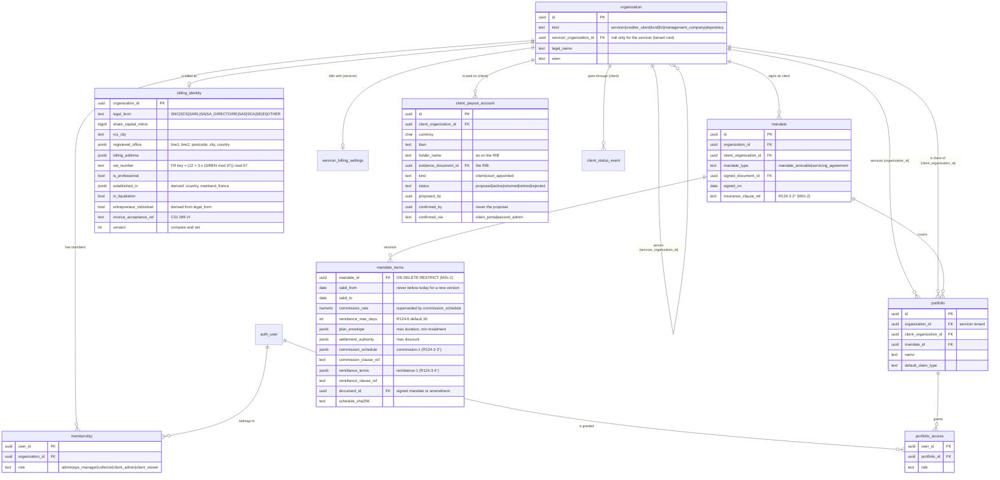

Mandate terms (M2c-2, design §6.1, §8.1–§8.2): each version holds the commission schedule (`commission-1`: basis, rules
flat / marginal / bracket, minimum per file) and the remittance terms (`remittance-1`: frequency, netting and claw-back
clauses, payment term of a due invoice ≤ 45 days, hold-back reserved), each with its clause reference, and the signed
document. A version in force never changes (only its end may move, never into the past) and is never deleted; a new one
starts today at the earliest and ends the one in force that day (`set_mandate_terms`, compare and set on the latest
version). Validators in SQL (`private.commission_schedule_error`, `private.remittance_terms_error`) and Python
(`collectoo_worker.remittance.terms`, pydantic) agree on 5,000 generated cases each. Versions written before M2c-2 were
back-filled with one flat rule at their rate and no clause references: they read « incomplete » until new terms are set.
A boarding batch is confirmed only when the version in force is complete, both billing identities are complete, the
client is a professional established in mainland France and its accounts are in EUR (`private.batch_confirmation_blockers`).

### 3.2 Parties and contacts

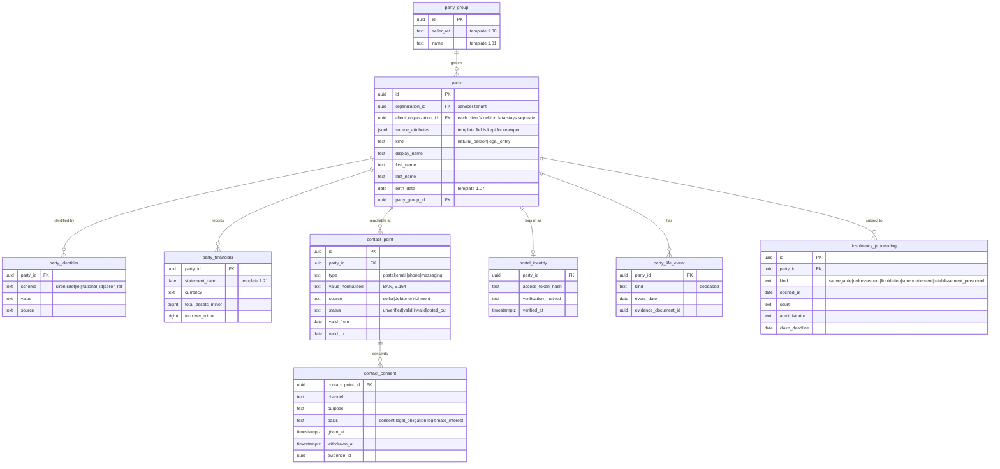

### 3.3 Claims, contracts, ownership

```mermaid
erDiagram
    portfolio ||--o{ account : contains
    account ||--o{ account_party : "involves"
    party ||--o{ account_party : "plays role in"
    account ||--o{ claim_item : "made of"
    account ||--o{ contract_terms : "versions"
    account ||--o{ schedule_line : "amortises"
    claim_type ||--o{ account : types
    claim_type ||--o{ rule_pack : "governed by"
    rule_pack ||--o{ rule_pack_version : versions
    account ||--o{ account_rule_pack : "assigned"
    rule_pack_version ||--o{ account_rule_pack : "applies"
    account ||--o{ account_event : "has"
    account ||--o{ claim_ownership_period : "owned over time"
    portfolio_transfer ||--o{ claim_ownership_period : "creates"
    account ||--o{ forbearance_measure : "seller history"
    account ||--o{ limitation_event : "interrupts/suspends"
    account {
        uuid id PK
        uuid organization_id FK "derived from portfolio"
        uuid client_organization_id FK "derived from portfolio"
        uuid portfolio_id FK
        jsonb source_attributes "template fields kept for re-export"
        uuid claim_type_id FK
        text external_ref "template 3.01"
        text currency
        text legal_regime "pre_ccd2|ccd2|consumer_mortgage|commercial|civil"
        text status "see state machine"
        uuid boarding_batch_id FK
        date seller_limitation_date "template 3.29"
    }
    account_party {
        uuid account_id FK
        uuid party_id FK
        text role "borrower|co_borrower|guarantor|protection_provider"
        text capacity "consumer|professional|legal_entity"
        text liability "joint_several|several|capped"
        bigint cap_minor
    }
    claim_item {
        uuid id PK
        uuid account_id FK
        text kind "instalment|invoice|rent_period|judgment_head|loan_principal"
        text ref
        date issue_date
        date due_date
        bigint original_minor
    }
    contract_terms {
        uuid account_id FK
        date valid_from
        date valid_to
        date contract_date "template 3.02"
        text governing_law "template 3.03"
        numeric rate "template 3.14"
        text rate_index "template 3.18"
        int margin_bp "template 3.17"
        text day_count
        text payment_frequency "template 3.20"
        date maturity "template 3.07"
    }
    schedule_line {
        uuid account_id FK
        int seq
        date due_date
        bigint capital_minor
        bigint interest_minor
        bigint insurance_minor
        text source "imported|rebuilt"
    }
    claim_type {
        uuid id PK
        text code "consumer_instalment_loan|b2b_invoice|..."
        text family "bank_credit|civil_commercial"
    }
    rule_pack {
        uuid id PK
        text code
    }
    rule_pack_version {
        uuid id PK
        uuid rule_pack_id FK
        date effective_from
        date effective_to
        text yaml_sha256
        jsonb legal_references
    }
    account_rule_pack {
        uuid account_id FK
        uuid rule_pack_version_id FK
        date valid_from
    }
    account_event {
        uuid id PK
        uuid account_id FK
        text kind "due|acceleration|formal_notice|judgment|judgment_served|judgment_enforceable|default_status|surendettement_admissible|collective_proceeding_opened"
        date event_date
        uuid evidence_document_id
        text source
    }
    claim_ownership_period {
        uuid account_id FK
        uuid owner_organization_id FK
        uuid servicer_organization_id FK
        text mandate_type "mandate_amicable|servicing_agreement|owned"
        date valid_from
        date valid_to
        uuid portfolio_transfer_id FK
    }
    portfolio_transfer {
        uuid id PK
        uuid seller_organization_id FK
        uuid buyer_organization_id FK
        date cut_off_date
        date transfer_date
        bigint price_minor
    }
    forbearance_measure {
        uuid account_id FK
        text type "template 3.39"
        date end_date "template 3.40"
        bigint forgiven_minor "template 3.42"
    }
    limitation_event {
        uuid account_id FK
        text kind "interruption|suspension"
        date event_date
        text legal_ref
    }
```

### 3.4 Collateral

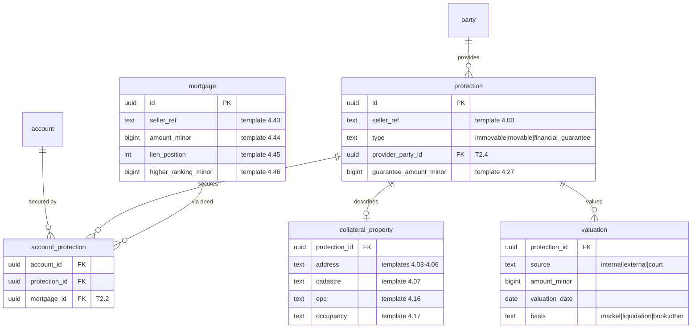

### 3.5 Ledger and payments

```mermaid
erDiagram
    ledger_account ||--o{ ledger_posting : "receives"
    ledger_entry ||--|{ ledger_posting : "balanced set"
    ledger_entry |o--o| ledger_entry : "reverses"
    account ||--o{ ledger_account : "has components"
    payment ||--o{ ledger_entry : "allocated by"
    payment ||--o{ receipt : "acknowledged by (versions)"
    bank_account ||--o{ bank_statement : "reported in"
    bank_account ||--o{ payment : "credited on"
    bank_statement ||--o{ bank_transaction : contains
    bank_transaction ||--o| payment : "debtor credit"
    payment ||--o{ payment_match : "matched"
    payment ||--o{ client_notification : "told to the client"
    ledger_entry ||--o| client_notification : "one per entry"
    allocation_run ||--o{ ledger_entry : "posts allocations"
    payment ||--o{ refund_request : "refunded by (one pending at a time)"
    bank_transaction ||--o| bank_debit_link : "classified as"
    bank_debit_link }o--o| payment : "returns or refunds"
    bank_debit_link }o--o| refund_request : "executes / bounces"
    bank_transaction ||--o| bank_duplicate_resolution : "held duplicate decided"
    account ||--o{ direct_payment : "paid to the client directly"
    direct_payment |o--o| ledger_entry : "adjustment"
    account ||--o{ payment_reference : "paid with"
    remittance_run ||--o{ remittance_line : contains
    remittance_line }o--|| ledger_entry : "posts"
    rate_index ||--o{ rate_value : "fixings"
    ledger_account {
        uuid id PK
        uuid organization_id FK
        uuid account_id FK "null for pooled books"
        text book "debtor_receivable|owner_claim|unallocated_payment|client_money_cash|client_payable|servicer_revenue|own_cash"
        text component "principal|capital_outstanding|contractual_interest|late_interest|statutory_indemnity|b2b_flat_indemnity|fees|insurance|procedure_cost|recovery_fee|off_balance_legal_claim"
        text currency
    }
    ledger_entry {
        uuid id PK
        text entry_type "opening|adjustment|cash_in|allocation|forward|cash_out|netting|reversal (M2); accrual|forgiveness|remittance|commission (later)"
        uuid payment_id FK "allocation, forward, cash_out and their reversals"
        date effective_date
        timestamptz posted_at
        uuid reverses_entry_id FK
        uuid rule_pack_version_id FK
        text idempotency_key UK
    }
    ledger_posting {
        uuid entry_id FK
        uuid ledger_account_id FK
        bigint amount_minor "signed, entry sums to 0"
        text currency
    }
    payment {
        uuid id PK
        uuid bank_account_id FK
        uuid bank_transaction_id FK "M2b-2"
        uuid account_id FK "null until matched, never staged"
        text channel "camt053|csv|psp"
        text method "sct|sdd|card|cheque|other"
        bigint amount_minor
        date booking_date
        text status "unmatched|matched|partially_allocated|allocated|refund_pending|refunded|returned"
        text review_reason
    }
    payment_reference {
        uuid id PK
        uuid account_id FK
        text rf "RF + 14 digits, mod 97"
        text status "active|retired"
    }
    receipt {
        uuid id PK
        uuid payment_id FK
        text number "Q-AAAA-NNNNNN: one per payment"
        int version "unique per payment; current = highest"
        text kind "original|update|void"
        uuid account_id "the file it is about (void: the file it cancels)"
        uuid recipient_party_id "the file's borrower"
        jsonb payload "built in SQL from the ledger; amounts as text"
        text payload_sha256
        uuid document_id FK "PDF in the private bucket"
        text pdf_sha256
        timestamptz known_at
    }
    bank_account {
        uuid id PK
        text purpose "client_funds|own (M2c-1)"
        text feed "camt053|csv (own: none)"
        text iban
        text currency
        text status "active|closed"
    }
    bank_statement {
        uuid id PK
        uuid bank_account_id FK
        text format "camt053|csv (= the bank account's feed)"
        text file_sha256 "one statement per file and bank account"
        text status "awaiting_upload|uploaded|imported|rejected|failed"
        date from_date
        date to_date
        bigint opening_booked_minor
        bigint closing_booked_minor
        jsonb counts "what the import did (amounts as text)"
        jsonb bank_check "I9 at import"
        jsonb warnings "missing statement, overlap"
    }
    bank_transaction {
        uuid id PK
        uuid statement_id FK
        text dedup_key UK "per bank account: t: e:<entry>#n c: h:"
        text entry_ref "camt.053 entry reference (Ntry/AcctSvcrRef)"
        text direction "credit|debit"
        bigint amount_minor "> 0"
        date booking_date
        text kind "debtor_credit|batch_unsplit|return|refund_out|other_debit|suspected_duplicate|psp_payout"
        text counterparty_name
        text remittance_text
        text creditor_reference
    }
    client_notification {
        uuid id PK
        uuid client_organization_id
        uuid payment_id
        uuid ledger_entry_id UK "null for payment_held"
        text kind "payment_allocated|payment_forwarded|payment_allocation_reversed|payment_held|payment_forward_reversed|payment_returned"
        text reason "a code, never the ops motif: ops_correction|file_recalled|before_servicing_start|client_ratification|hold_blocks_allocation|bank_return"
    }
    refund_request {
        uuid id PK
        uuid payment_id FK
        bigint amount_minor
        text payee_iban "ISO 13616 checked; the payer's by default"
        text end_to_end_id UK "RFD + 12 hex"
        text reason_code "overpayment|currency_mismatch|no_mandate|unidentified|held_file|account_closed|partial_return|other"
        text status "requested|executed|cancelled|bounced"
    }
    bank_debit_link {
        uuid bank_transaction_id PK
        text kind "return|refund|refund_returned|explained"
        uuid payment_id FK
        uuid refund_request_id FK
        uuid cash_entry_id UK "cash_out, or the reversal of a refund's"
        text method "auto|ops"
    }
    direct_payment {
        uuid id PK
        uuid account_id FK
        bigint amount_minor
        date paid_on "the client's statement"
        uuid_array item_ids "the debts it names"
        uuid evidence_document_id FK
        text status "requested|posted|refused"
    }
    allocation_policy {
        uuid id PK
        uuid client_organization_id "null: servicer default"
        uuid portfolio_id "null: client scope"
        int version
        date effective_from
        text accessory_rank "before_principal|after_principal"
        text unclassified "last|held"
    }
    payment_match {
        uuid payment_id FK
        uuid account_id FK
        text method "rf_structured|rf_text|rf_body|item_ref|iban_memory|manual|rematch"
    }
    remittance_run {
        uuid id PK
        uuid client_organization_id FK
        date period_end
        text status
    }
    remittance_line {
        uuid remittance_run_id FK
        uuid account_id FK
        bigint gross_minor
        bigint commission_minor
        bigint net_minor
    }
    rate_index {
        text code PK "legal_rate_consumer_creditor|legal_rate_other|ecb_mro|euribor_3m"
    }
    rate_value {
        text rate_index FK
        date valid_from
        numeric rate
        text source_ref "arrete or ECB link"
    }
```

**Bank statements (M2b-2, ADR-0013).** A statement of a `client_funds` account is uploaded by an admin or ops manager (« Relevés »), then imported by the worker in one transaction. Each line is kept as the bank reported it (`bank_transaction`, append-only), once per bank account: the same file, or the lines an overlapping statement repeats, add nothing; a known bank reference reported with another amount, direction or date refuses the file. A camt.053 entry is booked once at the level of detail of its first import: the same entry coming back split another way (unsplit, then with its details, or the reverse) refuses the file. A file, or a CSV bank operation (same id, day, amount and direction), already imported for another bank account of the servicer is refused; a CSV line whose fingerprint is on another account is held. Every credit a debtor paid (`debtor_credit`, and an unsplit batch credit) becomes one `payment` (`unmatched`), and each booking day of the statement is booked by one `cash_in` entry (5120 / 4710 pool). Debits (`other_debit`, `refund_out`), `return` lines and CSV `suspected_duplicate` lines are recorded but not booked (M2b-3, M2b-6); the page shows the gap they explain between the bank's closing balance and the ledger cash (I9).

**Reconciliation (M2b-3, ADR-0013, design §8.4).** After each import, the worker's rules decide which file each new payment pays — deterministic, in order, no model:
R1 a valid RF reference in the structured field; R2 an RF in the free text (spaces, case, line breaks tolerated) or its 12 digits alone; R3 invoice or file numbers that all name one file (a date — 2026-11, 11/2026, 05/11/2026 — never names a file; it only designates that file's invoices), backed by a second signal (an IBAN that already paid it; the payer's name at least 60 % close to a party's and sharing two words with it, or one word that no other file of the servicer has; or the exact balance of the cited invoices or of the file, unless every number cited is digits only or a date); R4 an IBAN that paid this open file and no other file — closed files and files it pays elsewhere in the same statement included — within what is left to pay; R5 the exact balance and a name at least 85 % close: a suggestion only; R6 anything else, with up to 3 ranked hints. An amount alone, or a name and an amount, never matches automatically; two files named, or an RF the payer wrote that names none of our files (check digits that fail, another creditor's reference), go to ops — the reference shown as written. Names are compared without titles, legal forms (also spelt « S.A.R.L. ») or accents, ligatures written out (Œ → OE); surname particles (Le, De, Du…) count as words, and an initial must agree with the other name's first names. Two parties with the same two-word name stay a known risk: a mistyped invoice number from one matches the other (ADR-0013). A matched payment is then **gated**: file not confirmed (`account_not_confirmed`: it waits, and is matched again when the batch is confirmed), closed, other currency, before servicing started, held for surendettement or a collective proceeding (`hold_blocks_allocation`), nothing left to pay. Ops work the rest in « Paiements à traiter »: accept the one-tap suggestion (only the file the sheet named: if a rematch proposed another file meanwhile, nothing is assigned and the page says so), choose among the files proposed, search a file, or take a payment off a wrong file (unassign; the rules never propose that file again). The confirmation sheet states what the gating will do (allocated next, or held and why) before anything is sent. Every decision is kept in `payment_match`; the payer's words that named invoices become the payment's designation. A rolled-back batch leaves the payments that waited for its files `no_mandate`, also when it is rolled back while a match run decides them. A hold placed or lifted during a run is never missed (the run and the hold commands lock the file). A run takes at most 50,000 payments and queues the rest.

**Allocation (M2b-4, ADR-0013, design §8.5).** A payment matched to a file with nothing left to decide (`matched`, no review reason) is **ready**; the payment trigger queues the allocation job of its servicer. The job (bounded runs of 10,000 payments, under the servicer's allocation lock) plans each payment with the worker's waterfall — no model: the invoices the payer named first (even not yet due; among them the same legal order), then due invoices oldest due date first (then issue date; equal ones shared pro rata, the leftover cent to the lowest item id), then invoices not yet due; inside each invoice interest first, then the accessories where the policy ranks them (none before M3), principal, the seller's unclassified amounts last — never for consumer loans until ops classify them. What a payment can take from a receivable at its date D is the lowest balance that receivable has from D on, and from an invoice or loan as a whole the lowest balance of all its components together from D on (a negative balancing line counts): the excess is an overpayment. One `allocation` entry per (payment, file), dated the booking date or the servicing start if later, with its plan kept (`private.allocation_plan`: policy, designation, inputs hash) so M3 can re-run allocations by date. Outcomes: `allocated` (nothing left), `partially_allocated` + `overpayment` (the rest stays in 4710 for the payment), or still `matched` with a reason (`nothing_due`, `credit_note_to_apply`, or a gate: closed file, other currency, before servicing start, hold). A file with a credit note that can be compensated with a due invoice holds its payments (`credit_note_to_apply`) until ops apply it from the file page (one `netting` entry, dated when both were due, compensation invoked: 1347) or allocate without it. Ops reverse an allocation from the payment page (a reversal at the allocation's date; the payment then waits, `allocation_reversed`), send a payment to allocation again, release a held payment on the judge's authorisation, forward a payment the client recalled or already counted (`forward` entry, 4710 → 4670), or use an overpayment for another file of the same debtor on his written request. The client is told of every allocation, reversal, forward and held payment (`client_notification`).

**Receipts and the client feed (M2b-5, ADR-0013, design §10).** Every payment linked to a file — allocated, partially allocated, held or otherwise waiting for ops, forwarded — has a **receipt** (« quittance », R124-6): one number per payment (`Q-AAAA-NNNNNN`), and a new **version** whenever what it says changes (an allocation, its reversal, a forward, another file; returns and refunds in M2b-6); a payment taken off its file gets a **void** version, and a new one if it is assigned again (the void always comes first, also when the payment was already on another file when the receipt job ran). A payment waiting for its allocation has none yet (the allocation follows at once), nor one without a file. What a receipt says is built from the ledger: who issues it for which client, the debtor and the file, the payment as the bank reported it, the allocation per invoice and component (« Principal », « Intérêts », « Autres sommes »: the receipt's own words, never the tape's labels), what was not allocated, forwarded or returned — **never a remaining balance** until M3 computes interest — and the payer only when he is certainly a party to the file, by the party's own name (otherwise « Versement d'un tiers »: a joint account, someone's widow, an initial, or a title on a company's name is a third party). The worker renders it as a French PDF, the same bytes whenever it is rendered again (whatever reportlab settings the machine holds), stored with its SHA-256; staff and the client download it. Nothing is sent to debtors before M4 channels. The client reads « **Paiements reçus** » in its space: every payment allocated, reversed, forwarded or held on its files, with the amounts, the invoices paid and that file's receipt (one the reader may read); reading it records the delivery of those notifications (R124-5).

**Money leaving the client-funds account (M2b-6, ADR-0013, design §2 #3, §8.1).** Every statement's debits, and its credits that undo a debit, are classified by the worker after the import (`payments.process_debits`, deterministic, no model): a **return** (R-transaction, chargeback, the bank reversing a credit) is linked to the one payment of the same bank account whose end-to-end id or bank transaction id it carries, when it takes back exactly what is left of the payment; our **refund** (end-to-end id `RFD…`) to its pending request; a credit bringing back our refund to that executed refund. Anything else waits on « Débits et retours » with why (no candidate, two candidates, a partial return, another amount), where ops link it (the payment's remaining amount as the page showed it, compare and set) or explain it (not booked, with a motif; never our refund nor a return whose references name one of our payments, which is linked or stays to classify — a return larger than what is left of its payment stays there, OQ-34; review fix). One line the posting refuses never stops the job: it goes to ops with its code (`payment_returned`, `before_previous_return`, `posting_failed`; `payment_changed` is decided again by the next run). A return **reverses the payment's live allocations and forwards at the return date** (an allocation dated later at its own date): the receivables come back, the client is told of each reversal and of the return (`payment_returned`); then a **cash_out** (Dr 4710 / Cr 5120) at the return date. Taken back in full, the payment is `returned` (final: its receipt gets a last, void version; a pending refund is cancelled); in part, what is left waits for ops (`partial_return`): « Imputer » allocates it again **from the return date**, or ops refund it. A **refund** is asked by ops (« Rembourser »: what is left of the payment, a reason code matching its state — overpayment, other currency, rolled-back batch, unidentified, held file, closed file, rest of a partial return, other — to the payer's IBAN unless another one is given, ISO 13616 checked) and executed in the bank with our `RFD…` reference as the transfer's « référence de bout en bout » (the end-to-end id the job recognises); it is **booked only when its debit appears on a statement** (a `cash_out` at the debit's date), never above what is left of the payment (`LG007`). A refund that comes back unpaid reverses its `cash_out` (after its payment was returned, it waits for ops instead: OQ-33). Fees and other debits are never booked in M2b (founder #20): with the lines ops explain, they are the explained gap between the bank's balance and the ledger cash; an other debit with the amount of a refund waiting for its debit on the same bank account is also listed to classify (our refund executed without its `RFD…` reference), and the statement page reads every unlinked other debit « Non comptabilisé · frais ou à classer ». A CSV line held as a **suspected duplicate** is released as what the import read it as (a debtor's credit or an unsplit batch becomes a payment and a `cash_in` of its statement day, then is matched; a return, our refund or another debit goes to the classification, a credit read as a return included) or confirmed (never booked). A **payment the debtor made to the client directly** is declared by ops from the client's statement (evidence filed on the file): the worker's waterfall splits it at its date (the invoices named first, then the legal order, interest first) and an `adjustment` lowers the receivables (−1100 / +3100); no client money moves, so no receipt and no notification; more than the file owes is refused. Every night (pg_cron), the **payments checks** verify the books per servicer — client money closed per currency, each bank account's cash = what its payments brought in less what went back out, `cash_in` = payments per statement day, each payment's position against its status, no allocated receivable below zero, the owner-claim mirror, one current receipt per identified payment, one notification per entry, statement continuity and the bank balance — and raise ageing alerts (money not allocated after 20 days, refunds pending after 5, debits and duplicates waiting after 3) on « Contrôles ».

**Line kinds:** `debtor_credit` a debtor's transfer, direct debit, card or cheque credit; `batch_unsplit` a batch booking whose details do not add up (a credit is still one payment); `return` the bank undoes an earlier movement (return reason, reversal indicator, return bank transaction code; either direction; also a batch that cannot be split, when the entry or any of its details says so); `refund_out` our refund (end-to-end id `RFD…`); `other_debit` fees and anything else debited; `suspected_duplicate` a CSV line with the day, amount and direction of an earlier line and a similar label (held for ops); `psp_payout` M5.

**« Relevé CSV » — the documented column set** (manual import when the bank sends no camt.053; one format per bank account). Headers are matched without case, accents or punctuation; the header row may follow up to 19 preamble lines; separator `;`, `,`, tab or `|`. What the reader cannot read one way only refuses the file before anything is written, with a stable code:

- **Encoding**, decided over the whole file: UTF-8 from the first byte to the last (a BOM is allowed and dropped), otherwise Windows-1252. UTF-16, a NUL byte, a byte Windows-1252 does not define (0x81, 0x8D, 0x8F, 0x90, 0x9D), or a non-UTF-8 byte in a file that starts with a UTF-8 BOM: `csv_encoding`, with the line.
- **Quoting:** a field may be enclosed in double quotes (to hold the separator; `""` is a quote inside it). No field holds a line break: a row spread over several lines (a quote left open swallows the following rows) is refused (`csv_row`), as is a field over 131,072 characters.
- **Row shape:** each row has the cells of the booking date, the label and the amounts; optional cells missing at the end of a row are empty; cells beyond the header must be empty (an unquoted separator in a label moves the amounts): otherwise `csv_row`.
- **Size:** at most **250,000 lines** (preamble, header and blank lines included) and **64 MiB**, checked before parsing (`file_too_large`; 2.5 times the 100k-line target: the worker holds the parsed lines in memory, about 0.7 KB each, in the process that also runs boarding). A longer export is cut by period.
- **Line numbers:** « ligne N » in a refusal is the line of the file as a text editor or a spreadsheet numbers it (the first line is 1; preamble, header and blank lines count), and each imported line keeps that number (`line_no`), so the SQL refusals name the same line.

| Field | Accepted headers | Required | Format |
|---|---|---|---|
| Booking date | `Date de comptabilisation`, `Date comptable`, then `Date opération`, `Date` | yes | `JJ/MM/AAAA` (also `JJ-MM-AAAA`, `JJ.MM.AAAA`, `AAAA-MM-JJ`). A file with a header of each rank (BPCE exports: `Date de comptabilisation` and `Date opération`) reads the first rank; two of the same rank are refused (`csv_header`) |
| Label | `Libellé`, `Libellé opération`, `Description`, `Intitulé` | yes | text; markers `/DE <payer>`, `/MOTIF <text>`, `/REF <reference>` are read |
| Amount | `Montant` (signed) — or `Débit` and `Crédit` | yes | `1 234,56`, `1.234,56`, `-50,00`, `50,00-`; more decimals than the currency has: refused, never rounded. A `Débit` may be printed negative or positive; a negative `Crédit` is refused |
| Value date | `Date valeur`, `Date de valeur` | no | as the booking date |
| Bank's operation id | `Référence opération`, `Référence banque`, `Réf banque`, `Id opération`, `Identifiant opération`, `Numéro d'opération` | no (recommended) | exact dedup key; a plain `Référence` is not trusted |
| Counterparty | `Contrepartie`, `Nom contrepartie`, `Tiers`, `Émetteur bénéficiaire`; else `/DE` | no | |
| Counterparty IBAN | `IBAN contrepartie`, `IBAN` | no | |
| Currency | `Devise` | no | must be the account's |
| Creditor reference | `Référence créancier`, `Référence RF`; else a valid RF after `/REF` | no | |
| End-to-end id | `Référence de bout en bout`, `End to end`; else a non-RF `/REF` | no | |

A bank account's `csv_profile` names its own headers (`{"columns": {"booking_date": "Date opé"}, "decimal": ","}`). A line is a `return` only when its label **starts** with the bank's operation type and a return word, in either order: `RETOUR`, `RETOURNÉ`, `REJET`, `REJETÉ`, `IMPAYÉ` or `ANNULATION` (optionally followed by `DE`/`DU`) with `VIR`, `VIREMENT`, `PRLV`, `PRÉLÈVEMENT`, `SEPA`, `CHQ`, `CHÈQUE`, `REM`, `REMISE`, `CB` or `CARTE` (« RETOUR VIR SEPA », « REJET DE PRLV », « PRLV SEPA REJETÉ », « IMPAYÉ CHQ »). Words further in the label may be the payer's (« REGLEMENT IMPAYE ») and are never read for this: a debtor's credit is never turned into a non-payment by its motif. A CSV proves no balance: no opening/closing check.

### 3.6 Plans, promises, disputes, holds, legal

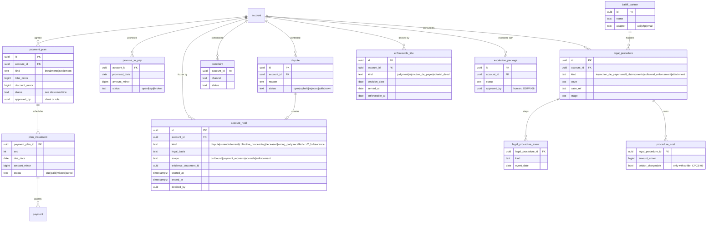

### 3.7 Communications, flows, engagement

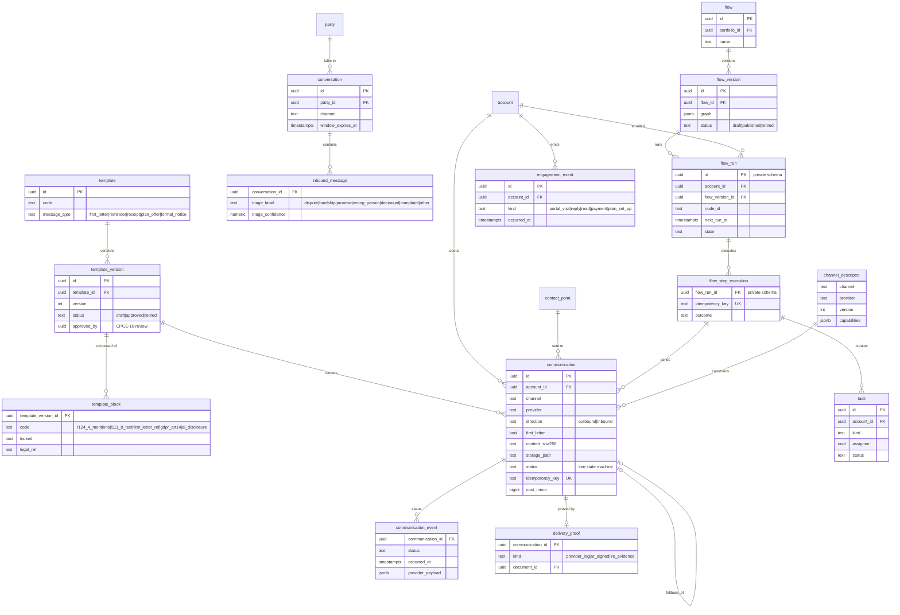

### 3.8 Boarding

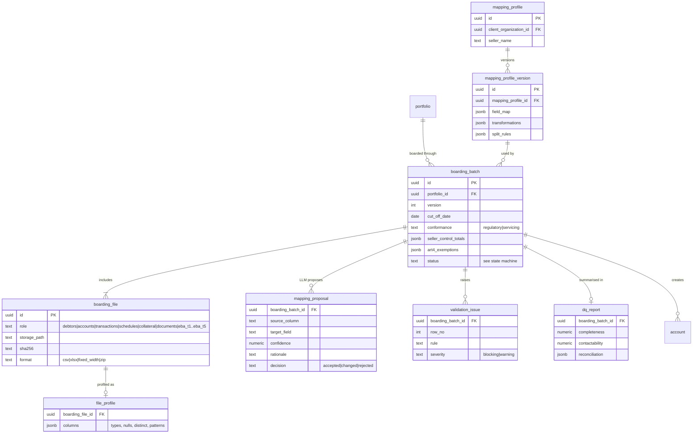

### 3.9 Layer 1 (`eba` schema) and mapping to Layer 2

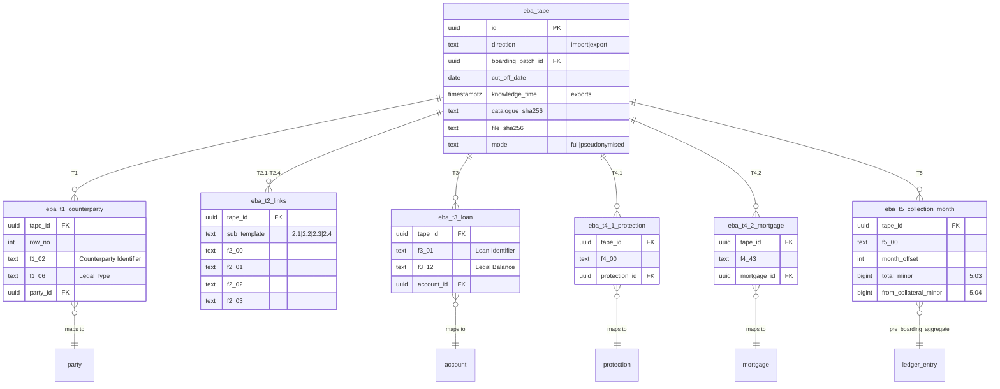

Each `eba` table has one column per catalogue field (`f<id>`, raw text plus typed column where useful); the diagram shows only keys. Mapping rules both ways: `docs/reference/eba_gap_analysis.md` §3–4.

## 4. State machines

### 4.1 Account

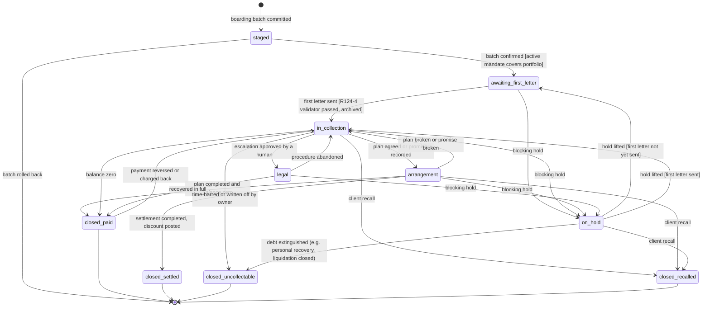

| Rule | Detail |
|---|---|
| Outbound in `awaiting_first_letter` | Only the R124-4 first letter (CPCE-04). Every later step carries the first-letter reference (CPCE-05) |
| Guardrail | Any blocking `account_hold` stops all outbound actions; flows cannot override (CHANNELS §4.1) |
| Hold scopes | `dispute`, `wrong_party`, `recalled`: outbound. `deceased`: **not an account hold** (founder 2026-11-07): outbound to the deceased party's own contact points stops; collection continues against the estate/heirs (`party_role = heir`, notary), so the account moves to an estate workflow. `surendettement` (after admissibility): outbound **and** payment requests, plan instalments suspended (HOLD-01, L722-5). `collective_proceeding`: outbound, payment requests, accruals per rule pack (HOLD-02, INT-10) |
| On-hold return | `on_hold` returns to the state implied by the guards, not blindly to the previous one; plans suspended during a hold resume or are cancelled (Payment Plan machine) |
| Accruals | The engine keeps accruing in every non-closed state unless a hold scope or rule pack says otherwise |
| Ownership change | Not a state: a new `claim_ownership_period` row. A sale to a new owner with another servicer closes servicing via `closed_recalled` |

### 4.2 Payment plan

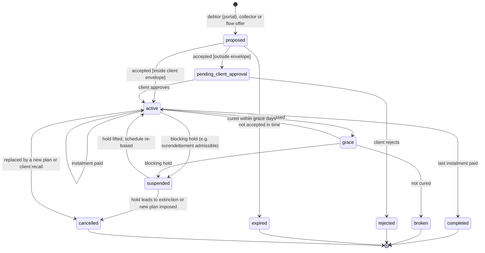

| Rule | Detail |
|---|---|
| Envelope | From `mandate_terms.plan_envelope` and `settlement_authority` (max duration, min instalment, max discount). Inside → automatic (rule, not model: GDPR-06) |
| Settlement | `kind = settlement`: on `completed`, post a forgiveness entry for the agreed discount |
| Client information | Any proposal other than immediate payment is reported to the client unless the mandate says otherwise (CPCE-06) |
| Amounts | Instalment amounts come from the engine's statement at agreement date; never typed or LLM-generated |
| Broken | Emits `plan_broken`; the account returns to `in_collection` |

### 4.3 Communication

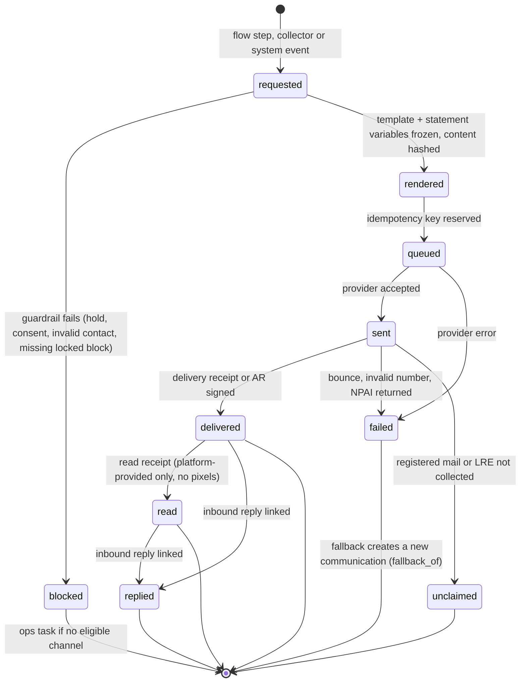

| Rule | Detail |
|---|---|
| Pre-send gate | Same gate for first try and fallback: holds, contact validity, consent (LRE for non-professionals → else paper LRAR; LRE-01), locked blocks renderable on the channel, then business caps (CHANNELS §4.1) |
| First letter | `first_letter = true` requires the R124-4 validator on the rendered content; the exact rendered content and proof are archived (CPCE-04) |
| GDPR | First communication on any channel carries the art. 14 block or link (GDPR-01) |
| Proof | Rendered content (`content_sha256`, `storage_path`) and every provider event are append-only |
| Contact effect | Hard bounce, invalid number, NPAI → `contact_point.status = invalid`; channel restrictions → channel health, not the contact |
| Tracking | `read` only from platform receipts; e-mail open pixels off by default (GDPR-08) |

### 4.4 Boarding batch

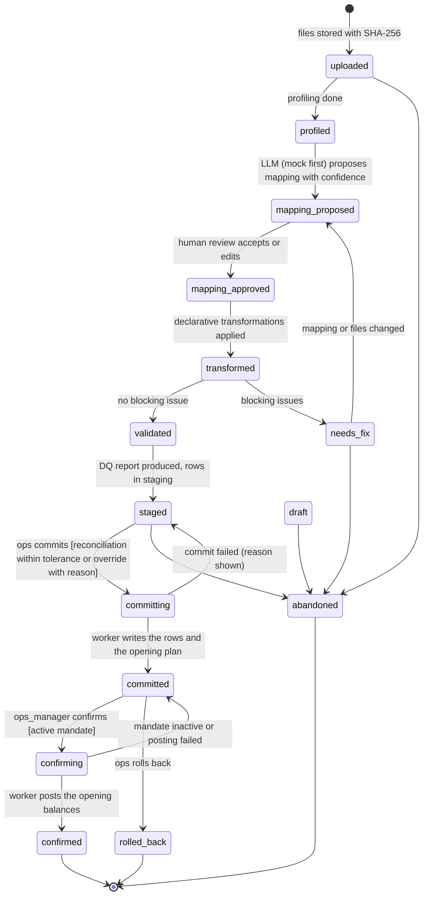

| Rule | Detail |
|---|---|
| Commit | Requested by ops (checks: rights, cut-off date, reason when totals differ), then run by a worker job in one transaction (M2a-3: ~20 s at 50k loans, above the API's 8 s); a refused commit goes back to `staged` with its reason. Writes Layer-2 rows with `boarding_batch_id`; accounts in `staged`; computes the opening plan and checks it against the DQ report (`opening_plan`); nothing reaches the ledger; no outbound activity |
| Rollback | Allowed only before confirmation; deletes the batch's Layer-2 rows (no ledger row exists yet) |
| Confirm | Requires an active `mandate` covering the portfolio (R124-3, CPCE-03), at the request and again when the worker runs; the worker posts one opening entry per account (components, effective date = cut-off; Σ = DQ reconciled outstanding minus the accounts already in the portfolio, which are not boarded again), moves accounts to `awaiting_first_letter` and starts flows (ADR-0012) |
| Abandon | Any step before commit (not while the commit job runs); prepared staging rows are deleted |
| Versioning | Re-boarding the same tape creates `version + 1`; mapping profiles are versioned and reused per seller/client |
| Mandatory fields | Severity from the catalogue and `conformance` (gap analysis §3.3) |

### 4.5 Bank statement (M2b-2)

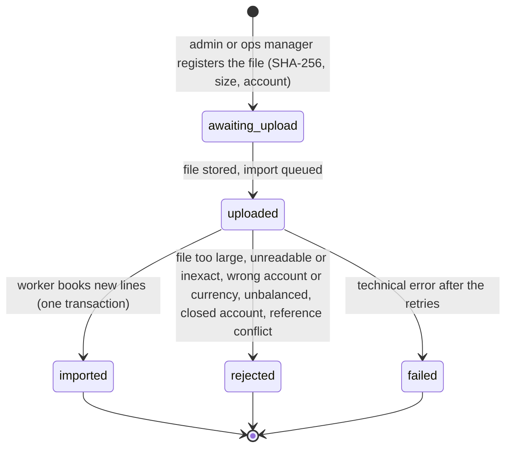

| Rule | Detail |
|---|---|
| Same file | The same SHA-256 for the same bank account is one statement: uploading it again opens the existing one (a rejected or failed file can be sent again) |
| Same lines | Lines already reported for the bank account are skipped (counted as « déjà importées »); nothing is booked twice |
| Same entry | A camt.053 entry keeps its key with or without a single detail (`e:<ref>#1`); an entry already imported that comes back split another way refuses the file (`entry_detail_differs`) |
| Other account | A file already sent for another bank account of the servicer is refused at upload and at import; so is a CSV whose bank operation (id, day, amount, direction) is on another account (`imported_on_other_account`) |
| Refusal | Nothing of the import is written; the statement keeps a stable code, worded in French on the page |
| Warnings | Opening balance ≠ the closing of the statement covering the day before, or a sequence gap: « relevé manquant ? » (not checked when an imported statement already covers that day); dates overlapping an imported statement |

### 4.6 Payment (M2b-3, M2b-4)

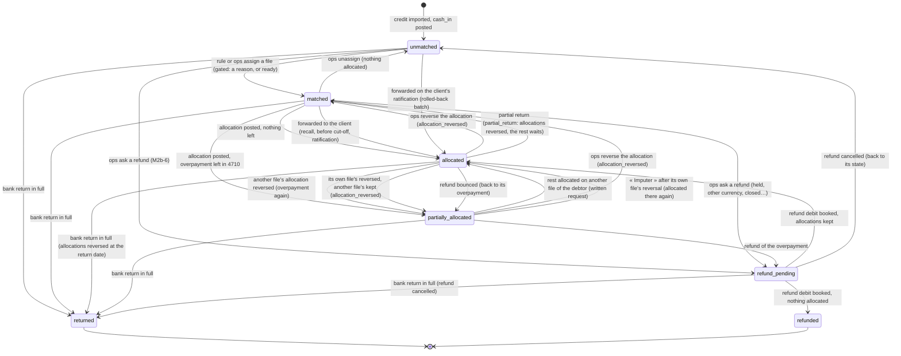

| Status | Ledger position | Review reasons met in M2b-4 |
|---|---|---|
| `matched` | nothing allocated (A = 0) | none (ready: the job allocates), `nothing_due`, `credit_note_to_apply`, `allocation_reversed`, the gates of M2b-3 |
| `partially_allocated` | A > 0, something left (U > 0) | `overpayment`; `allocation_reversed` (its own file's allocation reversed while another file keeps its share: « Imputer » sends it back to its file); none (ops sent the rest to another file, or back to its own: waiting for the job) |
| `allocated` | A > 0 (allocations and forwards), U = 0 | none |
| `refund_pending` (M2b-6) | a refund requested, not executed (U ≥ its amount) | none (the request keeps the state it came from) |
| `refunded` (M2b-6) | A = 0, U = 0, R = amount | none |
| `returned` (M2b-6) | A = 0, U = 0 (final) | none |

M2b-6 adds `partial_return` (a partial bank return reversed every allocation: « Imputer » allocates the rest from the return date, or ops refund it). A payment waits for its refund while one is requested, and only then (a reversal meanwhile is refused); one refund at a time per payment. The nightly checks compare every payment's status with this table.

Gates, first that applies (match runs, the job and the confirmation sheet alike): file not confirmed, closed, other currency, **an active surendettement or collective-proceeding hold, then** booked before the servicing start (review fix: the hold is reported first, so the client is told), nothing left to pay, a credit note to compensate (job only). Ops' decisions add up: « Lever le blocage » (the judge's authorisation) and « Imputer » (the cut-off checked, a credit note not invoked, nothing due checked) each add the gate shown to the payment's released set (`allocation_instruction.releases`, every decision kept in `decisions`), which the job consumes when it allocates; a payment behind two gates passes both. A held file's payments are never forwarded to the client and its credit notes are not applied while the hold is active.

**Receipt** (M2b-5): `v1 original → vN update | void`, each version kept; a new version only when its content changes; `void` when the payment leaves its file, before anything about another file (a later file gives an `update`, same number); a bank return (M2b-6) voids it for good.

**Bank lines** (M2b-6): `return` / `refund_out` lines are `unclassified → return_linked | refund_linked | refund_returned | explained` (the link is final; until then, `bank_debit_review` says why the job left them to ops; `explained` never for a debit, which is linked or stays unclassified: review fix); `other_debit` lines are explained gaps, or `unclassified → refund_linked | return_linked | explained` when listed to classify (the amount of a refund waiting for its debit on the same bank account); `suspected_duplicate` lines are `held → released | duplicate`.

## 5. Open questions (❓ founder)

**Answered by the founder on 2026-11-07** (see `docs/PHASE0_REVIEW.md` §D): Q1 one account per (client, debtor) with invoices as items; Q2 components + balancing line up to `3.12`; Q4 deceased → collect against heirs, insolvency hold only on proof of the Banque de France admissibility decision (or court judgment); Q5 receive and forward; Q7 10 days, per client; Q8 one dossier per loan; Q3 no outbound until the batch is confirmed; Q6 5 business days, silence = proposal expires. Gap-analysis questions: our plans are **not** exported as forbearance (seller's measures only); percentages exported as ratios (`0.05`).

1. **Account grain for invoices:** one account per (client, debtor) with invoices as `claim_item`s (proposed), or one account per invoice?
2. **Opening balance for bank tapes:** collect on `3.12` legal balance, or on `3.09 + 3.10 + 3.11`? (gap analysis Q1)
3. **Staged accounts:** confirm that accounts get no outbound activity until the batch is **confirmed**, not just committed.
4. **Hold on deceased / insolvency flags from the tape (`1.09`, `1.31`, `1.32`):** auto-apply the hold at boarding, or propose and let ops confirm (proposed: propose, ops confirms; outbound blocked while pending)?
5. **Recall:** when a client recalls an account, do we keep servicing payments that arrive afterwards (forward them), or refuse them?
6. **Client approval outside the envelope:** fixed response deadline for the client, and what happens on silence (proposed: proposal expires)?
7. **Grace period for missed plan instalments:** default number of days before a plan is `broken` (proposed: 10 days, configurable per client)?
8. **Co-debtors:** one dossier per loan with all co-borrowers/guarantors as parties (proposed), or one dossier per debtor?
