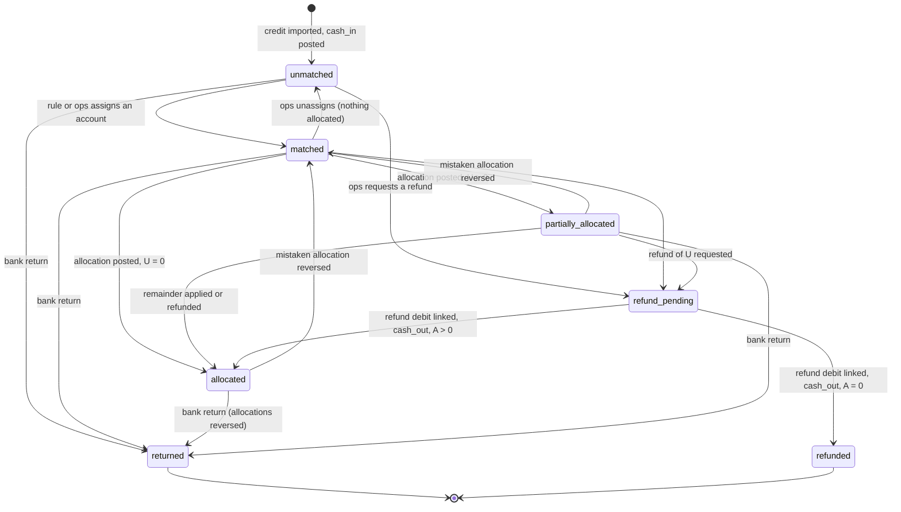

# M2b Payments: synthesized design (M2-06 … M2-11, with M2-12 hooks)

Status: design for the M2b PRs (implementation follows, one PR per slice, §14). Founder decisions §17 answered 2026-11-08 (all defaults); ADR-0013 records the decisions; M2b-1 implemented on branch `m2b1` (merged); M2b-2 on branch `m2b2` (choices where this design was open: ADR-0013, M2b-2 addendum); M2b-3 on branch `m2b3` (ADR-0013, M2b-3 addendum). Produced by a three-design panel (ledger-first, ops-first, compliance-first) and a judge. Checked against branch `m2b`: migrations up to `20261108190000_commit_job.sql`, ADR-0012, `docs/design/m2a-ledger.md`. Every legal text in §3 was re-read by the judge on LibreJustice on 2026-11-08 (version in force, unless another date is given).

---

## 0. Decision in one paragraph

Every credit line of a bank statement on the dedicated client-money account (R124-2) becomes a `payment` row, and the statement day is booked at once: **Dr 5120 `client_money_cash`[bank account] / Cr 4710 `unallocated_payment` (pooled, no client)**, one `cash_in` entry per (statement, booking date). The ledger cash then equals the bank's closing balance from the moment of import. Matching is a decision in the payment sub-ledger, not a ledger move: no "identification" entry. Allocation is **one `allocation` entry per (payment, claim account)** holding the cash leg (Dr 4710 / Cr 4670 client) and the claim legs (Cr 1100 per item × component / Dr 3100), as ADR-0012's mirror rule requires. Anything not allocated (overpayment, held, unidentified) stays in pooled 4710, attributed to its payment by a typed `ledger_entry.payment_id`. Money leaves through `cash_out` (refund, bank return): Dr 4710 / Cr 5120. Mistakes are undone with `ledger_reverse`. The per-payment identity **received = allocated + unallocated + returned** is enforced at posting and at commit (`LG007`), and the client-money identity **Σ5120 + Σ4710 + Σ4670 = 0** holds by construction because every M2b entry keeps the client-money books closed. The allocation order (debtor's designation, then due debts oldest first, interest before principal inside each debt) is computed by a pure Python waterfall in the worker and re-checked set-based in SQL. Receipts (R124-6) are versioned, deterministic PDFs built from the ledger; creditor notifications (R124-5) are one row per allocation entry. Nothing in M2b can post to 7060 (M2-12).

---

## 1. Panel scores

Each criterion is scored out of 10. Weights: money correctness 25 %, legal grounding 20 %, ops usability 15 %, performance 15 %, testability 15 %, simplicity / fit with ADR-0012 10 %.

| Criterion | Ledger-first | Ops-first | Compliance-first |
|---|---|---|---|
| Money correctness and reversibility | **9.5**: typed `payment_id`, closure of the client-money books per entry, per-payment identity, `min over t ≥ D` balance check, `adjustment` locked out of client money | 7.5: per-payment identity only in a shadow `payment_allocation` table; `avail = least(balance at d, now)` can overdraw (counterexample in §2); CSV amounts through the rounding helper | 7: four new books and a new `money_of` value; returns reversed at the original date rewrite client-money history; out-of-order payments allocated on current balances; 5121 seeded before use |
| Legal grounding (quotes checked by the judge) | 8: quotes exact; but credit notes netted automatically although 1347 says « sous réserve d'être invoquée »; remaining balance on the receipt before interest exists; misses the pre-M3 1343-1 problem | 7.5: quotes exact, credit notes manual; misses the pre-M3 problem; R124-5/6 handled per allocation only | **9**: finds the pre-M3 1343-1 problem, 1342-2 ratification, 1305-3, GDPR minimisation, R124-4 first-letter reference; but adopts a contested OQ-7 reading as default and edits an existing worked example |
| Ops usability | 6.5: queue with reasons, weighted score harder to explain, no split, no bulk accept | **9.5**: phone-first queue, one-tap suggestion, age badge, split, bulk accept, explanation of every match | 7: evidence-heavy actions; "auto-allocation off" would pile work on ops |
| Performance at scale | 7.5: one `cash_in` entry per bank line (100k entries); allocation 25–40 s | **8.5**: one cash entry per statement day; 10k chunks; synchronous one-payment RPC | 7.5: aggregated cash; rounds per account; flags 50k PDF time |
| Testability against the ACs | **9**: tests per AC, stateful machine against the oracle, 0 wrong auto-matches | 8.5: differential SQL/Python test, eval mix with ground truth | 8 |
| Simplicity / fit with ADR-0012 | **8**: 1 book, 4 entry types, 1 SQLSTATE; replaces only what it must | 6.5: SQL allocator plus Python twin (conflicts with the M3-15 engine), refactors M2a opening, shadow allocation table, 7 PRs | 6: 4 books, 7 entry types, receipt + receipt_version tables, policy with many references |
| **Weighted total** | **8.2** | **8.0** | **7.5** |

**Base: ledger-first.** Its invariants are the strongest and it changes ADR-0012 the least.

**What the synthesis keeps from each design**
- **Ledger-first (skeleton):** 5120 per bank account; pooled 4710 for every unallocated amount; typed `ledger_entry.payment_id`; `allocation` / `cash_out` / `netting` entry types; `LG007`; closure of the client-money books per entry; `adjustment` loses 4710 and 4670; `min over t ≥ D` available balance; org-level allocation lock; Python plan + set-based SQL posting (M2a opening style); soft `candidate_account_id` for staged accounts; refund requests with our own end-to-end id; receipt and notification amounts read from postings; ISO 11649 vector and transposition proof; most of the test plan and PR slicing.
- **Ops-first:** one `cash_in` entry per statement day (not per line); status orthogonal to `review_reason`; ordered, explainable matching rules (RF in free text, bare reference, IBAN memory); CSV suspected-duplicate hold; `defusedxml`-level XML safety; split of one payment across accounts; bulk accept; the queue UI (age badge, one-tap suggestion, highlighted tokens); "no remaining balance on the receipt before M3"; R124-6 age shown from the booking date; the warning that the `ON CONFLICT` targets of M2a functions must change in the same migration; request for real CAMT samples.
- **Compliance-first:** the pre-M3 problem (unposted interest makes early allocations provisional) turned into a go-live gate; receipt for every identified payment, not only allocated ones; payer named on the receipt only if a party (GDPR minimisation); first-letter reference printed when it exists (R124-4); 1342-2 ratification for payments on rolled-back claims; designation captured "lorsqu'il paie"; unclassified components held back for consumer credit (OQ-18); `payment_held` notification; embedded TTF font for the PDF; GDPR art. 22 posture (no automated decision beyond the legal order).
- **Rejected:** per-line `cash_in` entries (ledger-first); 4710 per client and "identification" entries (ops-first, compliance-first); new books 4191, 4672 and 5121 now (compliance-first); SQL allocator twin (ops-first); returns reversed at the original date (compliance-first); automatic credit-note netting (ledger-first); principal-first waiver and contract-order overrides (compliance-first); change of the €40 position in CALCULATION_RULES (compliance-first); feature flag "auto-allocation off in production" (compliance-first, replaced by a go-live gate); collectors allowed to assign payments (ops-first); undo toast (ops-first).

---

## 2. Contradictions resolved

| # | Question | Ledger-first | Ops-first | Compliance-first | **Chosen** | Why |
|---|---|---|---|---|---|---|
| 1 | Grain of the cash entry | one per bank line | one per statement day | one per statement | **one per (statement, booking date)** | 100k lines become a handful of entries; the bank closing balance is checked per day. The per-payment identity uses the immutable `payment` row (bank fact) plus the payment-tagged entries (§5.3), so nothing is lost. An import error on one line is corrected by a payment-tagged `cash_out`. |
| 2 | Where unallocated and overpaid money sits | pooled 4710, payment-tagged | 4710 per client | 4710 per client + new 4191 "owed to the debtor" | **pooled 4710, payment-tagged** | No identification entry to reverse, no new book or `money_of` value. The payment row says which account and client it concerns. Overpayments are never remitted (M2c remits from 4670 only). |
| 3 | Date of the reversal on a bank return | return date | return date | original date | **return booking date**; the original date stays on the payment | The ledger follows the bank: the debt history shows the payment and its return. Back-dating would rewrite client-money history that M2c may already have remitted and reported. Whether interest runs as if never paid is M3 and OQ-25. Mistaken allocations are still reversed at their original date (all three agree). |
| 4 | Credit notes (negative items) | netted automatically at cut-off | ops action | ops action | **proposed automatically, applied by one ops tap**, dated at the date both items were due (not before servicing start) | 1347: compensation « s'opère, sous réserve d'être invoquée ». Counsel OQ-23 may allow automatic netting later. |
| 5 | Allocation engine | Python + SQL post | SQL window functions + Python twin | Python + SQL re-check | **Python waterfall + set-based SQL posting with re-checks** | One source of truth; M3-15 moves the order into rule packs read by the Python engine (ARCHITECTURE §7). Manual actions are queued and take seconds, not milliseconds. |
| 6 | Amount available on a component at date D | `min_{t ≥ D}` running balance | `least(balance(D), balance(now))` | current balance | **`min_{t ≥ D}` running balance** | Ops-first's formula overdraws: balance 100 at D, a later allocation at D+5 takes 80, an accrual at D+10 adds 100 → `least(100, 120) = 100`, so allocating 100 at D leaves −80 between D+5 and D+9. |
| 7 | Remaining balance on the receipt | yes | no until M3 | no until M3-14 | **no until M3-14** | Without accrued interest it would understate the debt. R124-6 prescribes no content. |
| 8 | Which payments get a receipt | allocated | allocated | every payment attributed to a debtor | **every payment whose account is known** (allocated, partially allocated, held, forwarded), versioned | R124-6: « Une quittance est remise au débiteur pour tout paiement ». An unidentified payment has no known debtor yet. |
| 9 | Allocating in production before M3 posts interest | not addressed | not addressed | flag off until M3-13 | **go-live gate, no flag** | L441-10 II: B2B late penalties « sont exigibles sans qu'un rappel soit nécessaire », so interest is legally due but unposted before M3, and allocating to principal first breaches 1343-1. But keeping money unallocated would also break R124-6's one-month remittance. Collectoo cannot collect before the M4 first letter anyway, so real payments wait for M3-13, which re-allocates back-dated payments (§8.5). |
| 10 | Client overrides of the order | locked interest-first | locked interest-first | creditor waiver or contract clause | **locked interest-first** | Implement what the law requires, nothing more. Whether 1343-1 can be waived is OQ-19. |
| 11 | €40 position | indemnity before principal | n/a | after principal, edit example 3 | **unchanged (CALCULATION_RULES default), no €40 component in M2b** | The €40 arrives in M3; OQ-7 stays open. The policy carries the rank as data. |
| 12 | Seller's unclassified components (3.11, balancing line) | allocated last | allocated last | excluded for consumer credit | **allocated last; for consumer credit, held back until ops classify them** | Consistent with ADR-0012 decision 5 (kept out of the first letter, OQ-18): we do not collect what we have not claimed. |
| 13 | Bank fees and other debits on the dedicated account | not posted, queue | deferred to M2c | new 4672 servicer receivable | **not posted in M2b; an explained gap with an alert** | Booking a top-up needs own cash (5122), which arrives with M2c. |
| 14 | Matching | weighted score | ordered rules | ordered rules with corroboration | **ordered deterministic rules; an invoice reference needs a corroborating signal; IBAN memory allowed** | Explainable to ops and to the debtor; precision first (a wrong match sends a receipt to the wrong person). |
| 15 | Concurrency | org advisory lock | account row locks + synchronous RPC | org advisory lock | **org advisory lock inside worker jobs; RPCs only enqueue** | Simple and safe; the 8 s API limit never applies to posting. |
| 16 | Bulk posting | per function | shared helper, M2a opening moved onto it | per function | **shared set-based helper for the new M2b types only**; M2a opening keeps its code (only its `ON CONFLICT` target changes) | Smaller blast radius on merged M2a code. |
| 17 | Holds | minimal `account_hold` | `account.status = on_hold` only | minimal `account_hold` | **minimal `account_hold`** (DOMAIN §3.6 columns) | HOLD-01 (L722-5) must block allocation now. |
| 18 | Notification grain | per allocation entry | per allocation | per payment | **per allocation entry, plus one `payment_held`** | Exactly-once from a unique `ledger_entry_id`; R124-5 also covers a payment held for the client. |
| 19 | Who may assign a payment | admin, ops_manager | + collector | ops_manager | **admin, ops_manager** | Precision first; collectors read their portfolios. |
| 20 | RF format | 12-digit sequence | 10 digits with an internal check | 12 random digits | **12 random digits** | Ops-first's internal check makes every RF start with the same check digits (`RF74`): the body is always ≡ 1 mod 97, so the outer check carries no information. Random digits leak no portfolio size; a bare 12-digit body matches by exact lookup (§8.2). |

---

## 3. Legal texts relied on (quoted; read on LibreJustice 2026-11-08)

| Article | Operative sentence (quoted) | What the design does |
|---|---|---|
| [CPCE R124-2](https://librejustice.fr/norm/fr/code-des-procedures-civiles-d-execution/r124-2) al. 2 | « Ce compte doit être exclusivement affecté à la réception des fonds encaissés pour le compte des créanciers. » | 5120 exists only on `bank_account.purpose = 'client_funds'` (guard). Imports from any other IBAN are refused. |
| [CPCE R124-4](https://librejustice.fr/norm/fr/code-des-procedures-civiles-d-execution/r124-4) last al. | « Les références et date d'envoi de la lettre mentionnée au premier alinéa sont rappelées à l'occasion de toute autre démarche auprès du débiteur en vue du recouvrement amiable. » | The receipt prints the first-letter reference and date when one exists (empty until M4). Whether a receipt is a « démarche » is in OQ-22. |
| [CPCE R124-5](https://librejustice.fr/norm/fr/code-des-procedures-civiles-d-execution/r124-5) al. 1 | « La personne chargée du recouvrement informe le créancier qu'elle a obtenu un paiement même partiel de la part du débiteur, à moins que le paiement résulte de l'exécution d'un accord de versement échelonné déjà connu du créancier. » | `client_notification` per allocation entry and per held payment. The instalment-plan exception is not used (one code path). |
| [CPCE R124-6](https://librejustice.fr/norm/fr/code-des-procedures-civiles-d-execution/r124-6) | « Une quittance est remise au débiteur pour tout paiement. » / « Les fonds reçus … donnent lieu, sauf convention contraire, à un reversement dans un délai d'un mois à compter de leur encaissement effectif. » | Receipt per identified payment. Booking date stored as the « encaissement » date for M2c; age badge and alert at 20 days for money not yet allocated (OQ-26). |
| [C. civ. 1342-10](https://librejustice.fr/norm/fr/code-civil/1342-10) | « Le débiteur de plusieurs dettes peut indiquer, lorsqu'il paie, celle qu'il entend acquitter. A défaut d'indication par le débiteur, l'imputation a lieu comme suit : d'abord sur les dettes échues ; parmi celles-ci, sur les dettes que le débiteur avait le plus d'intérêt d'acquitter. A égalité d'intérêt, l'imputation se fait sur la plus ancienne ; toutes choses égales, elle se fait proportionnellement. » | A "debt" = a claim item. Designated items first, then due items by oldest due date, then pro rata on ties, then items not yet due. « Plus d'intérêt d'acquitter » is not encoded (OQ-21). |
| [C. civ. 1343-1](https://librejustice.fr/norm/fr/code-civil/1343-1) al. 1 | « Le paiement partiel s'impute d'abord sur les intérêts. » | Inside each item, the `interest` family first. Not configurable (OQ-19). |
| [C. civ. 1254](https://librejustice.fr/norm/fr/code-civil/1254) (version repealed 2016-10-01, quoted only for OQ-19) | « Le débiteur d'une dette qui porte intérêt … ne peut point, sans le consentement du créancier, imputer le paiement qu'il fait sur le capital par préférence aux arrérages ou intérêts » | Not relied on. The current 1343-1 does not repeat the consent wording, hence OQ-19. (The number 1254 now holds an unrelated 2025 article.) |
| [C. civ. 1305-3](https://librejustice.fr/norm/fr/code-civil/1305-3) | « Le terme profite au débiteur, s'il ne résulte de la loi, de la volonté des parties ou des circonstances qu'il a été établi en faveur du créancier ou des deux parties. » | A designated item not yet due is honoured. |
| [C. civ. 1342-1](https://librejustice.fr/norm/fr/code-civil/1342-1) | « Le paiement peut être fait même par une personne qui n'y est pas tenue, sauf refus légitime du créancier. » | A payer who is not a party never blocks a match; the payer is recorded as the bank gives it. |
| [C. civ. 1342-2](https://librejustice.fr/norm/fr/code-civil/1342-2) | « Le paiement fait à une personne qui n'avait pas qualité pour le recevoir est néanmoins valable si le créancier le ratifie ou s'il en a profité. » | A payment on a rolled-back claim or a claim outside any mandate is refunded, or forwarded only with the client's recorded ratification (OQ-29). |
| [C. civ. 1342-4](https://librejustice.fr/norm/fr/code-civil/1342-4) | « Le créancier peut refuser un paiement partiel même si la prestation est divisible. » | Partial payments are accepted; no refusal logic is built. |
| [C. civ. 1313](https://librejustice.fr/norm/fr/code-civil/1313) | « Le paiement fait par l'un d'eux les libère tous envers le créancier. » | Payments by any co-debtor reduce the one account; matching considers every party. |
| [C. civ. 1302-1](https://librejustice.fr/norm/fr/code-civil/1302-1) | « Celui qui reçoit par erreur ou sciemment ce qui ne lui est pas dû doit le restituer à celui de qui il l'a indûment reçu. » | Overpayments and unidentifiable funds are refunded to the payer, never passed to the client. |
| [C. civ. 1343-3](https://librejustice.fr/norm/fr/code-civil/1343-3) | « Le paiement, en France, d'une obligation de somme d'argent s'effectue en euros. » (other currencies for international operations, foreign judgments, or by agreement between professionals) | A payment whose currency differs from the claim's is never allocated automatically; no FX in M2b (OQ-27). |
| [C. civ. 1347](https://librejustice.fr/norm/fr/code-civil/1347) al. 2 | « Elle s'opère, sous réserve d'être invoquée, à due concurrence, à la date où ses conditions se trouvent réunies. » | Credit notes are applied by an ops action, dated when both items were due (OQ-23). |
| [C. com. L441-10](https://librejustice.fr/norm/fr/code-de-commerce/l441-10) II (version from 2026-09-01) and [D441-5](https://librejustice.fr/norm/fr/code-de-commerce/d441-5) | « Les pénalités de retard sont exigibles sans qu'un rappel soit nécessaire. Tout professionnel en situation de retard de paiement est de plein droit débiteur … d'une indemnité forfaitaire pour frais de recouvrement » · « … est fixé à 40 euros. » | B2B interest is due before M3 posts it: the go-live gate (decision 16). The €40 is not a component in M2b; its rank stays OQ-7. |
| [CMF L133-25](https://librejustice.fr/norm/fr/code-monetaire-et-financier/l133-25) III and [L133-25-1](https://librejustice.fr/norm/fr/code-monetaire-et-financier/l133-25-1) | « Le payeur présente sa demande de remboursement avant l'expiration d'une période de huit semaines à compter de la date à laquelle les fonds ont été débités. » · « … le payeur jouit d'un droit au remboursement inconditionnel … » | Direct debits (M5) can come back weeks later: every allocation is reversible at the return date; M2c needs a hold-back or claw-back (OQ-25). |
| [CMF L133-24](https://librejustice.fr/norm/fr/code-monetaire-et-financier/l133-24) | « … au plus tard dans les treize mois suivant la date de débit … » | Same return path, up to 13 months later. |
| [C. conso L722-5](https://librejustice.fr/norm/fr/code-de-la-consommation/l722-5) al. 1–2 (same wording in the version from 2026-11-20) | « … emportent interdiction pour celui-ci … de payer, en tout ou partie, une créance autre qu'alimentaire … née antérieurement à la suspension ou à l'interdiction » · « Le débiteur peut toutefois saisir le juge des contentieux de la protection afin qu'il l'autorise … » | A `surendettement` hold blocks allocation: the payment is held; ops refunds it or allocates it with the judge's authorisation as evidence (OQ-24). |
| [C. com. L622-7](https://librejustice.fr/norm/fr/code-de-commerce/l622-7) I and III | « … interdiction de payer toute créance née antérieurement au jugement d'ouverture » · « Tout acte ou tout paiement passé en violation des dispositions du présent article est annulé à la demande de tout intéressé ou du ministère public, présentée dans un délai de trois ans … » | A `collective_proceeding` hold blocks allocation the same way (OQ-24). |
| [Loi 89-462 art. 21](https://librejustice.fr/norm/fr/loi-n-89-462-du-6-juillet-1989-tendant-a-ameliorer-les-rapports-locatifs-et/21) | « La quittance porte le détail des sommes versées par le locataire en distinguant le loyer et les charges. » · « Si le locataire effectue un paiement partiel, le bailleur est tenu de délivrer un reçu. » | The receipt lists the allocation per item; whether the rent/charges split applies to a collector is OQ-28. |
| [GDPR art. 22](https://librejustice.fr/norm/eu/reglement-ue-2016-679-du-parlement-europeen-et-du-conseil-du-27-avril-2016/22)(1) | « La personne concernée a le droit de ne pas faire l'objet d'une décision fondée exclusivement sur un traitement automatisé, y compris le profilage, produisant des effets juridiques la concernant … » | Matching and allocation are fixed rules applying the debtor's own designation and the legal order; every ambiguous case goes to a human; no model, no LLM, no profiling. |

ISO 11649 (RF creditor reference) is a standard, not law. The vector `RF18 5390 0754 7034` validates; so do this document's examples.

---

## 4. Naming

| Concept | DOMAIN | ARCH / COMPLIANCE / ROADMAP | **Chosen** |
|---|---|---|---|
| Dedicated account purpose | `client_money` | `client_funds` (ARCH §8, CPCE-02 test) | **`client_funds`**; DOMAIN aligned in M2b-1 |
| Statement | `bank_statement` | — | **`bank_statement`** |
| Statement line | `bank_statement_line` | `bank_transaction` (ARCH §9; ROADMAP "dedup by bank transaction ID") | **`bank_transaction`** |
| Match record | `reconciliation_match` | — | **`payment_match`** (immutable history of auto and manual decisions) |
| Entry types | `allocation`, `remittance`, … | — | **`cash_in`, `allocation`, `forward`, `cash_out`, `netting`** |

ADR-0013 ("Payments, allocation and client money") records this, the ledger extension and the decisions of §2. It is written in M2b-1.

---

## 5. Ledger extension (migration `…_payments_ledger.sql`, M2b-1, forward-only)

### 5.1 Book, entry types, columns

```sql
alter table public.ledger_book drop constraint ledger_book_dimension_check,
  add constraint ledger_book_dimension_check check (dimension in ('claim','owner','client','pooled','bank'));
insert into public.ledger_book values
  ('client_money_cash','5120','Compte dédié aux fonds de tiers (R124-2)','bank','client', 1, false);
-- 5121 PSP clearing: M5. 5122 own cash, 6270 fees: M2c. Fail closed until used.

insert into public.ledger_entry_type values
  ('cash_in',   'Encaissement',                          array['client_money_cash','unallocated_payment'], false),
  ('allocation','Imputation',                            array['unallocated_payment','client_payable','debtor_receivable','owner_claim'], false),
  ('forward',   'Reversement au mandant sans imputation',array['unallocated_payment','client_payable'], true),
  ('cash_out',  'Retour ou restitution',                 array['unallocated_payment','client_money_cash'], true),
  ('netting',   'Application d''un avoir',               array['debtor_receivable'], true);
-- Client money can no longer move through a generic correction:
update public.ledger_entry_type set allowed_books = array['debtor_receivable','owner_claim'] where code = 'adjustment';

alter table public.ledger_account add column bank_account_id uuid,
  add constraint ledger_account_bank_fk foreign key (bank_account_id, organization_id, currency)
      references public.bank_account (id, organization_id, currency);
-- ledger_account_shape replaced: client_money_cash => bank_account_id not null, every other dimension null;
-- every other book => bank_account_id is null. (Unseeded books stay refused: `else false`.)
drop index public.ledger_account_pooled_uq;
create unique index ledger_account_pooled_uq on public.ledger_account
  (organization_id, book, currency, client_organization_id, owner_organization_id, portfolio_id, component, bank_account_id)
  nulls not distinct where claim_item_id is null;
-- SAME migration: private.ledger_post and private.post_opening_balances are replaced with the new
-- ON CONFLICT target (index inference fails otherwise). Bodies unchanged; M2a tests re-run in the PR.

alter table public.ledger_entry add column payment_id uuid references public.payment (id),
  add constraint ledger_entry_payment_req  check (entry_type not in ('allocation','forward','cash_out') or payment_id is not null),
  add constraint ledger_entry_payment_only check (payment_id is null or entry_type in ('allocation','forward','cash_out','reversal')),
  add constraint ledger_entry_cash_in_src  check (entry_type <> 'cash_in' or (source_type = 'bank_statement' and source_id is not null));
  -- M5 widens this to source_type 'psp_event' (one cash_in per PSP event, book 5121).
create index ledger_entry_payment_idx on public.ledger_entry (payment_id) where payment_id is not null;
```

Functions replaced (`create or replace`, small diffs):
- `ledger_post`: new conflict target; refuses the five new types (posted only by the set-based functions of §9, like `opening`).
- `post_opening_balances`: new conflict target only.
- `ledger_reverse` and `ledger_entry_guard`: a reversal copies and must keep the target's `payment_id`.
- `ledger_account_guard`: a 5120 account's bank account belongs to the same organization and currency, has `purpose = 'client_funds'` and `status = 'active'` → else `LG002`.
- `ledger_entry_verify`: the checks of §5.2.
- New `private.ledger_post_set()` (no grant; called only by other definer functions in the same call): reads `pg_temp._lps_entry` / `_lps_line`, which the caller drops and recreates (ADR-0012 temp-schema rule), derives scope and owner set-based, checks books, one client per entry, balance, mirror, gets or creates ledger accounts, writes the request hash, inserts, then `set constraints ledger_entry_balanced immediate`.

New SQLSTATE **`LG007` overdrawn** (payment, allocation or component). Python maps it to `OverdrawnError`.

### 5.2 Invariants and where they are enforced

| # | Invariant | Enforcement |
|---|---|---|
| I1 | Entry balanced per currency; 1100/3100 mirror per component | existing deferred check (ALWAYS) |
| I2 | **Client-money closure:** in every entry, lines on `money_of = 'client'` books (5120, 4710, 4670) sum to zero per currency. Only M2c `commission` will be exempt. | `ledger_entry_verify` → `LG001` |
| I3 | Shapes: `cash_in` = one 5120 debit + one pooled 4710 credit; `allocation` = one pooled 4710 debit, one 4670 credit of the same amount, ≥ 1 credit on 1100, every 1100 line a credit, every 3100 line a debit; `forward` = one pooled 4710 debit + one 4670 credit; `cash_out` = one pooled 4710 debit + one 5120 credit; `netting` = 1100 only | verify → `LG001`; books by `allowed_books` → `LG002` |
| I4 | **Per payment p, at every date t:** `U_p(t) = amount_p·[t ≥ booking_date_p] − Σ (4710 lines of p-tagged entries dated ≤ t) ≥ 0`; per (p, account) the net allocated amount ≥ 0 | verify for p-tagged entries → `LG007` (index on `payment_id`; a payment has a handful of entries) |
| I5 | Identity `amount_p = A_p + U_p + R_p` (A: allocated + forwarded, R: cash_out) | follows from I2–I4 and the immutable payment row |
| I6 | **No overdraft:** for each 1100 account credited by an `allocation` or `netting` entry dated D, `min_{t ≥ D} balance(t) ≥ 0`; a negative item debited by `netting` stays ≤ 0 | verify → `LG007` (window over that ledger account's few postings) |
| I7 | `allocation`, `forward` and `cash_out` dated on or after the payment's booking date and not before the account's servicing start | posting functions; I4 catches a wrong date |
| I8 | **Client money:** Σ5120 + Σ4710 + Σ4670 = 0 per organization and currency at every date | follows from I2; nightly job and property test |
| I9 | **Bank:** for each CAMT bank account and booking date D, `CLBD(D) = balance(5120[bank], D) + Σ signed unposted lines booked ≤ D` | import check and nightly job |
| I10 | No M2b entry type can touch 7060 | `allowed_books` (`LG002`), pgTAP |
| I11 | `cash_in` of (statement, date) = Σ amounts of the payments created from that statement and date | `private.ingest_statement` before insert; nightly |

The posting functions run I4, I6 and the 1343-1 order check (no principal credited on an item while that item's interest still has an available balance after the entry) set-based **under the allocation lock**; the deferred check is the backstop. Concurrency: every job that debits 4710 or credits 1100 takes `pg_advisory_xact_lock(hashtext('payments:' || organization_id))` before reading balances. `cash_in` does not need it (it only adds to U).

---

## 6. Payment sub-ledger schema (`public`, RLS on, read-only policies, writes only by definer functions or the worker)

```sql
bank_account(id, organization_id → servicer, purpose text check (purpose = 'client_funds'),   -- 'own' with M2c
  iban text check (private.iban_valid(iban)), bic, currency → currency, label, feed check in ('camt053','csv'),
  csv_profile jsonb, status active|closed, opened_on, closed_on,
  unique (organization_id, iban, currency), unique (id, organization_id, currency))
  -- trigger: purpose, iban, currency immutable

payment_reference(id, organization_id, account_id → account, rf text check (rf ~ '^RF[0-9]{14}$' and private.rf_valid(rf)),
  status active|retired, created_at, retired_at, retired_reason, unique (organization_id, rf))
  create unique index … (account_id) where status = 'active';           -- one active reference per account

bank_statement(id, organization_id, bank_account_id, format camt053|csv, file_sha256, storage_path, stmt_id,
  electronic_seq_no, from_date, to_date, opening_booked_minor, closing_booked_minor, status, counts jsonb,
  warnings jsonb, error, created_by, idempotency_key, unique (bank_account_id, file_sha256))

bank_transaction(id, organization_id, bank_account_id, statement_id, line_no, dedup_key,
  direction credit|debit, amount_minor bigint check (amount_minor > 0), currency, booking_date, value_date,
  reversal_indicator bool, bank_tx_code, acct_svcr_ref, end_to_end_id, tx_id, mandate_ref,
  counterparty_name, ultimate_counterparty_name, counterparty_iban, remittance_text, creditor_reference,
  return_reason, original_end_to_end_id, batch_entry_ref,
  kind debtor_credit|return|refund_out|psp_payout|other_debit|batch_unsplit|suspected_duplicate,
  unique (bank_account_id, dedup_key))                                    -- facts: append-only trigger

payment(id, organization_id, bank_account_id, bank_transaction_id unique,         -- psp_event_id unique in M5
  channel camt053|csv|psp, method sct|sdd|card|cheque|other,
  amount_minor bigint check (> 0), currency, booking_date, value_date,          -- immutable (trigger)
  payer_name, payer_iban, end_to_end_id, remittance_text, creditor_reference,
  status, review_reason,                                                        -- §7
  account_id → account (null until matched; never a staged account),
  candidate_account_id uuid,                                                    -- soft, no FK (may be staged)
  client_organization_id, portfolio_id,                                         -- copied from the account, for RLS
  designation jsonb,       -- {item_ids[], source: remittance_text|document|portal, evidence_document_id, captured_at}
  match_method, matched_at, created_at, updated_at)
  idx (organization_id, review_reason, booking_date) where review_reason is not null; (account_id);
      (payer_iban); (end_to_end_id); (organization_id, status)

payment_match(id, payment_id, account_id, method rf_structured|rf_text|rf_body|item_ref|iban_memory|manual|rematch,
  rule_version, evidence jsonb, decided_by, decided_at)                         -- append-only history
payment_match_candidate(payment_id, rank, account_id, signals jsonb)            -- derived, replaced each run
private.payer_account_link(organization_id, payer_iban, account_id, confirmed_count, last_seen,
  primary key (organization_id, payer_iban, account_id))
bank_debit_link(bank_transaction_id pk, payment_id, kind return|refund|import_correction, refund_request_id, decided_by)
refund_request(id, payment_id, amount_minor > 0, payee_iban, end_to_end_id unique ('RFD' || short id),
  reason, status requested|executed|cancelled, requested_by, created_at)

allocation_policy(id, organization_id, client_organization_id null, portfolio_id null, version, effective_from,
  accessory_rank before_principal|after_principal,      -- indemnity/charge/cost families; none exist before M3 (OQ-7)
  unclassified last|held,                               -- forced 'held' for consumer-credit regimes (OQ-18)
  created_by, created_at)                               -- immutable versions; most specific scope wins
allocation_run(id, organization_id, trigger import|manual|rematch|release, status, summary jsonb, started_at, finished_at)
private.allocation_plan(run_id, payment_id, account_id, effective_date, policy_id, inputs_hash)
private.allocation_plan_line(run_id, payment_id, account_id, claim_item_id, component, amount_minor > 0, seq)

account_hold(id, organization_id, account_id, kind dispute|surendettement|collective_proceeding|recalled|wrong_party,
  legal_basis, scope text[], evidence_document_id, started_at, ended_at, decided_by)
  -- evidence required for surendettement and collective_proceeding (founder 2026-11-07: hold only on proof);
  -- M2b reads only these two kinds for allocation; M4 adds outbound guardrails

receipt(id, organization_id, client_organization_id, portfolio_id, payment_id, number, version,
  kind original|update|void, recipient_party_id, payload jsonb, payload_sha256, template_version,
  renderer_version, known_at, document_id, pdf_sha256, issued_at,
  unique (payment_id, version), unique (organization_id, number, version))     -- append-only; current = max(version)

client_notification(id, organization_id, client_organization_id, portfolio_id, account_id, payment_id,
  ledger_entry_id unique null, kind payment_allocated|payment_forwarded|payment_allocation_reversed|payment_held,
  reason, created_at, delivered_at)
  create unique index … (payment_id, account_id) where kind = 'payment_held';
```

- `change_log` triggers on `bank_account`, `payment_reference`, `payment`, `allocation_policy`, `account_hold`, `refund_request`. `bank_transaction` and `receipt` are append-only facts with their own actor and time (same exemption as the ledger).
- `pg_trgm` enabled; GIN index on `party.display_name`; expression indexes on normalised `claim_item.ref` and `account.external_ref`.
- Amounts in every jsonb payload are text (M1e rule: no JS numbers).

**RLS** (init-plan pattern of M2a; new helper `private.money_staff_org_ids()` = organizations where the caller is admin or ops_manager at aal2):

| Data | Who reads it |
|---|---|
| `bank_account`, `bank_statement`, `bank_transaction`, `bank_debit_link`, `refund_request`, `allocation_run`, unmatched payments | admin, ops_manager (third-party payer data) |
| `payment`, `payment_match*` with a portfolio | admin, ops_manager; collectors with `portfolio_id = any(readable_portfolio_ids())` |
| `payment_reference`, `receipt`, `account_hold` | `can_read_portfolio` (clients included) |
| `client_notification` | the client organization's members, and staff |
| `allocation_policy` | staff; clients read their own scope |
| Ledger: accounts with `portfolio_id is null` on books 5120, 4710, 4670 | **changed:** staff only via `money_staff_org_ids()`, clients their own 4670 (closes M2a risk #6) |

pgTAP: isolation per table and role, and a direct INSERT by `authenticated` refused on each table.

---

## 7. State machines

**Statement:** `uploaded → importing → imported`; `importing → rejected` (file balance OPBD + Σ booked ≠ CLBD, IBAN or currency not the bank account's, not a `client_funds` account, duplicate file); `importing → failed` (technical; retried, then dead-letter). A continuity gap (OPBD ≠ previous CLBD, or a missing `ElctrncSeqNb`) is a warning « relevé manquant ».

**Payment.** `status` summarises the ledger position; `review_reason` (nullable) puts it in the queue. A nightly job checks both against the ledger.



Guards checked against the ledger: `allocated ⇒ A > 0 ∧ U = 0`; `partially_allocated ⇒ A > 0 ∧ U > 0`; `refunded ⇒ A = 0 ∧ U = 0 ∧ R = amount`; `returned ⇒ A = 0 ∧ U = 0`.

**Review reasons:** `no_match`, `ambiguous`, `overpayment`, `account_not_confirmed`, `no_mandate` (batch rolled back), `account_closed`, `currency_mismatch`, `before_servicing_start`, `hold_blocks_allocation`, `nothing_due`, `credit_note_to_apply`, `partial_return`. Debit lines follow `unclassified → return_linked | refund_linked | correction_linked | deferred_m2c`.

**Receipt:** `v1 original → vN update | void`. Every version is append-only; a new version is issued only when the payload hash changes.

**Account status** is not changed by payments in M2b (closing on a zero balance waits for M3 accruals).

---

## 8. Postings, worked example, algorithms

### 8.1 Postings per event

| Event | Entry | Lines (+ debit / − credit) | Effective date |
|---|---|---|---|
| Credits of one statement day | `cash_in` | +5120[bank] Σ / −4710[pool] Σ | booking date |
| Allocation of p to account a | `allocation` (payment_id p) | +4710[pool] A / −4670[client] A / −1100[item, comp] aᵢ… / +3100[owner, portfolio, comp] Σ | `greatest(booking date, servicing start)` |
| Payment for a recalled claim, or ratified (1342-2) | `forward` | +4710[pool] / −4670[client] | action date |
| Credit note applied | `netting` | +1100[credit item, principal] / −1100[invoice, principal] | latest due date of the two, not before servicing start |
| Mistaken allocation | `reversal` | negated lines | the target's date |
| Bank return / chargeback | `reversal` of each live allocation, then `cash_out` | negated lines; +4710[pool] / −5120[bank] | return booking date |
| Refund of an overpayment or unidentified funds | `cash_out` (reason `refund`) | +4710[pool] / −5120[bank] | booking date of the refund debit |
| Wrong line on a CSV import | `cash_out` (reason `import_correction`) | +4710[pool] / −5120[bank] | that line's booking date; refused by I4 if anything is allocated |
| Debtor paid the client directly | `adjustment` (reason, evidence) | −1100[item, comp] / +3100[comp] | date of the client's statement |
| Overpayment / held / unidentified | no entry | stays in pooled 4710, tagged by payment | — |

### 8.2 Worked example (EUR, minor units)

**Setup** (openings posted by M2a at the cut-off 2026-09-30, bank account CF-EUR):

| Account | Client = owner | Item | Component | Opening |
|---|---|---|---|---|
| M-0042 (B2B), RF `RF60 4821 9305 7612` | Martin SAS | F-101 due 06-10 | principal | +150 000 |
| | | F-102 due 07-15 | principal | +80 000 |
| | | F-103 due 08-20 | principal | +40 000 |
| | | F-104 due 12-15 (not yet due) | principal | +30 000 |
| | | AV-105 credit note on F-101 | principal | −20 000 |
| L-9 (consumer credit), RF `RF72 7302 6188 4529` | Lilas Finance | loan | accrued_interest | +12 000 |
| | | | principal | +500 000 |
| | | | other_balances (3.11, unclassified) | +3 000 |

**E0 `netting`** (proposed by the job as `credit_note_to_apply`, applied by ops on 10-10, dated 09-30): +20 000 1100[AV-105, principal]; −20 000 1100[F-101, principal]. F-101 is now 130 000; AV-105 is 0.

**Statement of 2026-10-12** (OPBD 0, CLBD 727 500), three credits:
- P1 200 000, Ustrd « VIR MARTIN-DURAND REGLT F-103 rf60 4821 9305 7612 » → rule R2 (RF in the text) → M-0042; « F-103 » is an item of that account → designation.
- P2 520 000, structured `CdtrRefInf` `RF72730261884529` → rule R1 → L-9.
- P3 7 500, Ustrd « REMBOURSEMENT », unknown IBAN → `no_match`, queue.

**E1 `cash_in`** (10-12): +727 500 5120[CF-EUR]; −727 500 4710[pool].

**E2 `allocation` P1 → M-0042** (10-12). Designated F-103 first (40 000), then due items oldest first: F-101 (130 000), F-102 (30 of its 80 000); F-104 is not due and not reached.

| Line | Ledger account | amount_minor |
|---|---|---|
| 1 | 4710 pool | +200 000 |
| 2 | 4670 Martin | −200 000 |
| 3 | 1100 F-103 principal | −40 000 |
| 4 | 1100 F-101 principal | −130 000 |
| 5 | 1100 F-102 principal | −30 000 |
| 6 | 3100 Martin / PM / principal | +200 000 |

Σ = 0; principal mirror −200 000 + 200 000 = 0; client books +200 000 − 200 000 = 0. Left on M-0042: F-102 50 000, F-104 30 000.

**E3 `allocation` P2 → L-9** (10-12). Interest first (1343-1), then principal; `other_balances` is held back (consumer credit, not yet classified):

| Line | Ledger account | amount_minor |
|---|---|---|
| 1 | 4710 pool | +512 000 |
| 2 | 4670 Lilas | −512 000 |
| 3 | 1100 L-9 accrued_interest | −12 000 |
| 4 | 1100 L-9 principal | −500 000 |
| 5 | 3100 Lilas / PL / accrued_interest | +12 000 |
| 6 | 3100 Lilas / PL / principal | +500 000 |

U(P2) = 8 000 → `partially_allocated`, `review_reason = overpayment`. Notifications N1 (E2, Martin) and N2 (E3, Lilas). Receipts Q-2026-000001 v1 (P1) and Q-2026-000002 v1 (P2, « Montant non imputé : 80,00 € »).

**E4 `cash_out`** (10-21): ops requests a refund to the payer's IBAN with end-to-end id `RFD7Q2K9`; the debit appears on the 10-21 statement and is linked automatically: +8 000 4710[pool]; −8 000 5120[CF-EUR]. P2 → `allocated`; receipt Q-2026-000002 v2 (« dont 80,00 € restitués le 21/10/2026 »).

**Position after E4:**
- 5120 = 727 500 − 8 000 = **719 500** = bank CLBD of 10-21 (I9).
- 4710 pool = −727 500 + 200 000 + 512 000 + 8 000 = **−7 500** = U(P3).
- 4670 Martin −200 000; 4670 Lilas −512 000.
- I8: 719 500 − 7 500 − 200 000 − 512 000 = **0**.
- Per payment: P1 200 000 = 200 000 + 0 + 0; P2 520 000 = 512 000 + 0 + 8 000; P3 7 500 = 0 + 7 500 + 0.

**Variant A, mistaken match** (P1 belonged to M-0077): reversal R(E2) dated 10-12 (6 negated lines, payment_id P1) → U(P1) = 200 000; E2′ allocation to M-0077 dated 10-12. Receipt Q-2026-000001 v2 (new recipient; v1 superseded). Notifications: `payment_allocation_reversed` (R(E2)) and `payment_allocated` (E2′).

**Variant B, bank return** (debit 200 000 booked 11-03 with `RvslInd`, original end-to-end id = P1's): R(E2) dated 11-03, then `cash_out` 11-03: +200 000 4710[pool]; −200 000 5120. P1 → `returned`; receipt v2 `void`; `payment_allocation_reversed` (reason `return`). U(P1) is 0 before and after 11-03 (I4 holds).

### 8.3 Import (M2-07, job `payments.import {statement_id}`)

1. **Upload.** The browser uploads to Storage with a signed URL from `create_statement_upload`; `submit_statement_import` (idempotent, dedups by file SHA-256) enqueues the job. Both RPCs take milliseconds.
2. **CAMT.053 parser** (`collectoo_worker.payments.camt053`), versions .001.02/.04/.06/.08 read by local name. `lxml.iterparse` with `resolve_entities=False`, `no_network=True`, `huge_tree=False`, elements cleared as it goes (constant memory; XXE and entity bombs refused).
   - Per `Stmt`: `Id`, `ElctrncSeqNb`, `Acct/Id/IBAN` and currency (must equal an active `client_funds` bank account), OPBD and CLBD.
   - Per `Ntry`: `Amt`, `CdtDbtInd`, `RvslInd`, `Sts` (only `BOOK`; `PDNG`/`INFO` skipped), `BookgDt`, `ValDt`, `AcctSvcrRef`, `BkTxCd`.
   - Per `TxDtls`: `Refs` (`AcctSvcrRef`, `EndToEndId` with `NOTPROVIDED` → null, `TxId`, `MndtId`), `TxAmt`, `Dbtr`/`UltmtDbtr` name, `DbtrAcct` IBAN, every `Ustrd`, `Strd/CdtrRefInf/Ref`, `RtrInf/Rsn/Cd`, `RtrInf/OrgnlEndToEndId` (or `Refs` of the original).
   - **Batch bookings:** one `bank_transaction` per `TxDtls` if Σ `TxAmt` = `Ntry/Amt`; otherwise one line of kind `batch_unsplit` (queue; ops splits).
   - **Amounts:** decimal text → `Decimal` → minor units by the currency exponent; more decimals than the exponent are **refused, never rounded** (do not use `money.to_minor_units`, which rounds).
   - **File balance:** OPBD + Σ credits − Σ debits = CLBD, else `rejected`; nothing is written.
3. **CSV:** the M1 readers (separator and encoding sniffing, Latin-1), French decimals with the same refusal rule, one column profile per bank account (presets: generic, BNP, Société Générale, Crédit Agricole, Qonto label styles), libellé parser for `/DE`, `/MOTIF`, `/REF`. No balance proof (the page says so).
4. **Dedup key** per bank account, first that applies: `TxDtls/Refs/AcctSvcrRef`; `Ntry/AcctSvcrRef#index`; the mapped bank id column (CSV); otherwise `h:` + sha256(booking date | value date | direction | amount | currency | counterparty IBAN | end-to-end id | normalised remittance) + occurrence number of that fingerprint on that booking date in the file (two identical €50 transfers stay two lines).
5. **CSV safety net:** a new CSV line whose (booking date, amount, direction) equals a line from another import with a trigram-similar label becomes `suspected_duplicate`: no payment, no cash, until ops decide (`resolve_duplicate`).
6. **Load:** COPY into `private.bank_import_stage`, then `private.ingest_statement(id)` in chunks of 20k lines per transaction: insert `bank_transaction … on conflict (bank_account_id, dedup_key) do nothing`; one `payment` per new `debtor_credit`; one `cash_in` per booking date (`cash_in:<statement>:<date>`, I11); classify debits (return codes in `BkTxCd` `RRTN`/`RPCR`/…, `RtrInf`, `RvslInd` → `return`; end-to-end id `RFD…` → `refund_out`; others → `other_debit`). PSP payouts (M5) become `psp_payout`.
7. Enqueue `payments.match` and `payments.process_debits`.

**Cost:** parsing O(n) streaming; inserts O(n log N). Estimate for 100k lines: parse 5–10 s, ingest 5–10 s (a few cash entries instead of 100k). The upload RPCs take milliseconds.

### 8.4 Matching (M2-08, job `payments.match`; deterministic, explainable, no LLM)

**Load once per job:** active and retired RF references; normalised item and account references (upper case, alphanumerics only, ≥ 5 characters with at least one digit) of workable accounts; party names per account (every role); open balances per account and item (index-only scan of `ledger_posting_balance_idx`); `payer_account_link`.

**Rules in order** (a rule only sees lines the previous rules left):

| # | Rule | Decision |
|---|---|---|
| R1 | Structured `CdtrRefInf` is a valid RF found in `payment_reference` (active or retired) | auto |
| R2 | RF in the free text: regex tolerant to spaces, case and line breaks (`R\s*F\s*\d\s*\d(\s*[0-9A-Z]){1,21}`), checksum valid and found; or a bare 12-digit token equal to a known reference body | auto; two different valid references → `ambiguous` (ops may split) |
| R3 | Item or account reference tokens that all resolve to **one** workable account of this servicer, **and** one corroborating signal: payer IBAN already confirmed on that account, payer name trigram similarity ≥ 0.6 with a party, or amount = open balance of the cited items or of the account | auto; the cited items become the **designation**. Without corroboration → suggestion. Same token in several accounts → `ambiguous` |
| R4 | Payer IBAN linked to exactly one open account by ≥ 1 earlier confirmed match, and amount ≤ that account's open balance | auto |
| R5 | Amount = an account or item balance and name similarity ≥ 0.85 | suggestion only |
| R6 | Anything else | queue with up to 3 ranked candidates and the signals that ranked them |

Never on the amount alone. Every match writes `payment_match` (method, rule version, evidence) and upserts `payer_account_link`.

**Gating after a match:**

| Situation | Outcome |
|---|---|
| Account `staged` | `account_not_confirmed`; `candidate_account_id` kept; `rematch` at batch confirmation |
| Batch rolled back | `no_mandate`: refund, or forward with the client's ratification (1342-2) |
| Account `closed_recalled` | ops forwards (founder 2026-11-07: recall → forward) |
| Other closed status | `account_closed` |
| Currency ≠ claim currency | `currency_mismatch` |
| Booking date < servicing start | `before_servicing_start`: ops checks with the client whether the tape already counts it, then allocates at the cut-off or forwards |
| Active `surendettement` or `collective_proceeding` hold | `hold_blocks_allocation` + `payment_held` notification |
| Allocatable balance ≤ 0 | `nothing_due` |

**Cost:** R1–R4 are hash joins, O(n + T + R) for n lines, T tokens, R references; R5 is O(n·k), k ≤ 20 amount-blocked candidates; the trigram search runs only on the remainder. 100k lines against 500k references: estimated 10–20 s in the worker.

### 8.5 Allocation waterfall (M2-09, pure Python `collectoo_worker.payments.allocation`)

```
allocate(amount, slots[(item, due_date, issue_date, component, family, avail > 0)], policy, designation, as_of)
  order families inside an item: interest → (indemnity, charge, cost if policy.accessory_rank = before_principal)
                                  → principal → (accessories if after_principal) → unclassified (unless held)
  debts = designated items (in designation order)
        + items with due_date ≤ as_of, by due_date, then issue_date
        + items not yet due, by due_date
  equal sort keys form one tie group
  for group in debts while remaining > 0:
     demand = Σ avail(group)
     if remaining ≥ demand: take all, each item in family order
     else: share_i = floor(remaining · demand_i / demand)        -- Python int, exact
           + 1 cent to the largest remainders (ties by item id), Σ shares = remaining
           each item spends its share in family order
  return lines, remainder                                         -- remainder = U, never > 0 unless every slot is empty
```

- **Available amount** of a slot at D = `min_{t ≥ D}` of that 1100 account's running balance (§2 #6). Items or components at or below zero (credit notes, overpaid, negative balancing line) have no slot.
- **Effective date** D = `greatest(booking_date, servicing start)`, never in the future.
- **Several payments on one account in a run:** processed in Python in (booking date, statement line) order, decrementing the in-memory slots. A payment dated before an existing allocation is still safe (I6); M3-13 re-allocates by date once interest exists.
- **Designation** comes from item references in the remittance text (R3), or an ops entry whose evidence is dated on or before the payment (« lorsqu'il paie »); the excess over the designated items follows the legal order.
- **Policy** = the most specific of portfolio, client, servicer default. Interest-first, designation-first and due-before-not-due are not configurable (OQ-19). Consumer-credit regimes force `unclassified = held`.
- **Complexity:** O(k log k) per payment, k = slots (3–10 for loans, more for B2B accounts with many invoices).

**Job `payments.allocate {run_id}`:**
1. Take the allocation lock (§5.2).
2. Read target payments (`matched` or `partially_allocated` with U > 0, no blocking reason) and their U from the ledger.
3. Read slots set-based: per (item, component), balance at D and `min` of later running balances (window on `ledger_posting_balance_idx`; ~300k rows at 50k accounts, 1–2 s).
4. Python: netting proposals, allocation plan, `inputs_hash` = sha256(payment, slots, policy version).
5. COPY into `private.allocation_plan*`.
6. `private.post_allocations(run_id)`, chunks of 10k payments per transaction: set-based pre-checks (I4, I6, 1343-1, same client per entry, currency, servicing start, holds, plan hash); entries through `ledger_post_set` (key `alloc:<run>:<payment>:<account>`, `engine_version = 'alloc-1'`, `inputs_hash`); payment status; `client_notification`; `pgmq.send('payments', {type: 'receipts', payment_ids})` in the same transaction.

Estimate for 50k payments: ~50k entries and ~350k postings, ~20–30 s in the worker (M2a: ~20 s for 300k postings). Every RPC only enqueues.

**M3-15:** the order source becomes the active rule-pack version; `allocate` and its property tests stay unchanged.

---

## 9. Commands, jobs, Python

**RPCs** (`public`, SECURITY DEFINER, explicit role check at aal2, idempotency through `private.command_log`, French error messages, each under the 8 s limit: they check and enqueue):

| RPC | Roles | Effect |
|---|---|---|
| `register_bank_account`, `close_bank_account` | admin | — |
| `create_statement_upload`, `submit_statement_import` | admin, ops_manager | signed URL; enqueue import |
| `assign_payment(key, payment, splits[{account, amount_text?}], designation?, reason)` | admin, ops_manager | sets the match; enqueues allocation (a split posts one entry per account; Σ ≤ U) |
| `accept_suggestions(key, payment_ids ≤ 200)` | admin, ops_manager | bulk accept of top candidates |
| `unassign_payment(key, payment, reason)` | admin, ops_manager | only while nothing is allocated |
| `reverse_allocation(key, payment, account, reason)` | admin, ops_manager | reversal at the original date; payment back to `matched` |
| `release_hold_payment(key, payment, evidence_document_id, reason)` | admin, ops_manager | allocate a held payment with the judge's or juge-commissaire's authorisation |
| `forward_payment(key, payment, client, reason, evidence_document_id)` | admin, ops_manager | recalled claim or ratification (1342-2) |
| `request_refund(key, payment, amount_text, payee_iban?, reason)` | admin, ops_manager | ≤ U − pending refunds |
| `link_debit(key, bank_transaction, payment, kind)`, `resolve_duplicate(key, bank_transaction, is_duplicate)` | admin, ops_manager | — |
| `apply_credit_note(key, credit_item, target_item?)` | admin, ops_manager | `netting` |
| `record_direct_payment(key, account, items, amount_text, date, evidence_document_id, reason)` | admin, ops_manager | `adjustment` |
| `place_account_hold`, `lift_account_hold` | admin, ops_manager | evidence required for surendettement and collective proceedings |
| `set_allocation_policy`, `retire_payment_reference` | admin | validated new version / new reference issued |
| `client_payment_feed(p_client, p_after)` | client members, staff | read; amounts from postings, as text |

**Jobs** (queue `payments` + `payments_dlq`, `private.job_run` exactly-once pattern; data errors 22xxx, 23xxx, LGxxx not retried, as in M2a): `import`, `match`, `rematch` (enqueued by `complete_batch_confirmation`, which also issues RF references set-based), `process_debits`, `allocate`, `receipts` (200 per message), `invariants` (nightly: I4–I9, I11, status vs ledger, one current receipt per identified payment, one notification per allocation entry, pooled 3100 = −Σ1100 of the claims owned (M2a risk #5), no 1100 of a positive item below zero), `suspense_ageing` (daily: alert at 20 days without allocation).

**Python:** package `collectoo_worker.payments` (`rf`, `camt053`, `csv_import`, `matching`, `allocation`, `receipts`), handlers in `jobs/payments.py`, `ledger.model` gains the book and types, the in-memory oracle tracks payments; `synth camt053` generator; `worker/evals/reconciliation/`.

---

## 10. Receipts (M2-10) and creditor notifications (M2-11)

**Receipt job** runs after any change to an identified payment's position (allocation, hold, forward, refund, reversal, return).
- **Payload** built in SQL from the ledger at `known_at` = job start, canonical jsonb, `payload_sha256`:
  - number (`Q-AAAA-NNNNNN` from a per-organization yearly counter; not claimed gapless) and version;
  - issuer: servicer name and address, « agissant pour le compte de » the client (`legal_name`);
  - debtor and account reference; payer as named by the bank **only if the payer is a party to the account**, otherwise « versement d'un tiers » (GDPR art. 5(1)(c) minimisation);
  - amount, currency, method, booking and value dates, bank reference;
  - allocation per item and component (from the postings of live allocation entries), « Montant non imputé », refunded amounts, hold status in neutral words;
  - first-letter reference and date when one exists (R124-4; empty until M4).
  - **No remaining balance** until M3-14 (decision 13).
- **New version only on change:** same `payload_sha256` as the current version → nothing issued (idempotent). A return issues a `void` version.
- **Rendering:** reportlab, `rl_config.invariant = 1`, an embedded TTF font committed to the repo (DejaVu Sans; covers names outside WinAnsi), PDF metadata dates taken from the payload, no clock and no random ids: PDF bytes = f(payload, template_version, renderer_version). reportlab pinned in `uv.lock`.
- **Storage:** private bucket, `documents/receipts/{org}/{year}/{number}-v{version}.pdf`, a `document` row with SHA-256, the `receipt` row.
- **Copy:** French, locked template; no LLM; no mention the law does not require.
- **Delivery** (« remise ») needs M4 channels or the M5 portal: generated and stored only until then (go-live gate).

**Notifications:** a `client_notification` row is inserted in the same transaction as each allocation, forward or allocation reversal (unique `ledger_entry_id` gives exactly-once), plus one `payment_held` per (payment, account) when a matched payment is held. Amounts are not copied: `client_payment_feed` reads them from the referenced entry's postings, which never change. Delivery (portal, webhook) is M7.

---

## 11. How M2-12 (client-money segregation, CPCE-02) is respected

1. Debtor cash enters the ledger only through 5120, whose ledger account requires an active `bank_account` with `purpose = 'client_funds'` (guard, `LG002`); statements from any other IBAN are rejected at import.
2. Client-money books are closed in every entry (I2), so cash = suspense + client payables (I8) at every date.
3. No M2b entry type lists 7060 (I10); collections credit 4670 of the client of the account. pgTAP: an allocation line on 7060 → `LG002`.
4. Client money moves only through `cash_in` and payment-tagged entries; `adjustment` can no longer touch 4710 or 4670.
5. Overpayments and unidentified funds stay in pooled 4710 and are never remittable (M2c remits from 4670 only).
6. M2c adds `commission` (4670 → 7060) as the only exemption to I2, the remittance, own cash 5122 for fees and top-ups, and the direct-debit hold-back (risk R4).

---

## 12. Back-office UI (French, phone-first; Playwright screenshots mobile + desktop per page)

1. **`/backoffice/encaissements` — Relevés.** Upload (bank account, file, CSV preset). One card per import: lines, credits, debits, duplicates ignored, « imputés automatiquement 96 % », « à traiter 37 », balance badge (« Solde de clôture ✓ » or « écart 120,00 € expliqué par 2 débits à classer »), « relevé manquant » warning.
2. **`/backoffice/encaissements/a-traiter` — File d'exceptions.** One card per payment: amount, age badge « J+12 » from the booking date, payer, libellé with detected tokens highlighted, reason chip. Best suggestion as one button: « Imputer sur M-0042 · Martin SAS · solde 800,00 € », then a confirmation sheet stating the effect. Filters (reason, client, amount, age), oldest first; multi-select bulk accept on desktop.
3. **`/backoffice/encaissements/[id]` — Paiement.** Bank facts, match trace (« RF trouvée dans le libellé : RF60 4821 9305 7612 ✓ »), allocation table from the ledger, receipt versions (PDF link, hash), notifications, history. Actions: Imputer, Répartir, Désimputer (reason), Rembourser, Lier un retour, Reverser au client, Lever le blocage (evidence).
4. **`/backoffice/dossiers/[id]`** (minimal, read-only): reference, client, RF in groups of four, balances (`account_balances`), holds, payments and receipts; « Appliquer l'avoir » when credit notes are pending.
5. **`/backoffice/parametres/comptes-bancaires`** (admin) and **`/backoffice/parametres/imputation`** (versions, scope, the legal lock shown: « Intérêts avant capital (art. 1343-1 C. civ.) — non modifiable »).

---

## 13. Test plan by acceptance criterion

| AC | Tests |
|---|---|
| **M2-06** RF validates mod 97; one active reference per account | Hypothesis: `rf_make` → `rf_valid`; every single-character substitution and every adjacent transposition of the body rejected (97 is prime and divides neither d·10^k nor 9(a−b)·10^k); SQL/Python parity on 10k random strings; ISO vector `RF18539007547034`. pgTAP: second active reference → 23505; invalid → 23514; confirmation issues exactly one per account; staged accounts have none; retired reference still resolves; backfill of confirmed accounts; RLS and write refusal. |
| **M2-07** parse CAMT.053 incl. batch bookings and returns; importing twice creates no duplicates | Synthetic CAMT .02 and .08 from `synth camt053` with a manifest: batch with and without `TxDtls` (Σ mismatch → `batch_unsplit`), returns (AC04, MD06, MS03), `RvslInd`, `PDNG` skipped, several `Ustrd`, `NOTPROVIDED`. Same file twice → rejected as duplicate; overlapping statement → only new lines; identical twins on one day → 2 lines; ledger hash unchanged after re-import. Unbalanced file, wrong IBAN, non-`client_funds` account, entity-bomb XML → rejected, nothing written. CSV presets with French decimals; suspected duplicates. Property: decimal text ↔ minor units round trip; extra decimals refused. |
| **M2-08** ≥ 95 % auto-matched; others in the queue | `worker/evals/reconciliation/` 100k-line synthetic statement with ground truth: 45 % structured RF, 25 % RF in text (spaces, lower case, line breaks), 5 % bare body, 15 % item references with a corroborating payer name, 6 % repeat IBAN, 4 % deliberately unmatchable (name + amount only, RF typo, no information, item reference shared by two accounts). CI asserts auto ≥ 95 %, **zero wrong auto-matches**, each queued line with its expected reason, and prints the report. Property: a tie never auto-matches. Rematch at confirmation moves `account_not_confirmed` payments. |
| **M2-09** allocation never exceeds component balances; Σ allocated = payment or the remainder is an overpayment; ⚖️ OQ-7 | Hypothesis on `allocate`: Σ lines + remainder = amount; 0 ≤ line ≤ avail; remainder > 0 only if every slot is exhausted; no principal while interest of the same item remains; designated items exhausted first; due before not due; pro-rata shares exact and within 1 cent of the real share, ties by id; invariant under input permutation; consumer `unclassified` never allocated; a policy with principal before interest cannot be expressed (validator). `RuleBasedStateMachine` against Postgres (import, match, allocate, split, reverse, forward, refund, return, netting, direct payment) checking I1–I11 after each step against the in-memory oracle. pgTAP: allocation above a balance → `LG007`; 7060 line → `LG002`; `adjustment` on 4710 → `LG002`; allocation on a staged account or before servicing start refused; two sessions serialized by the lock. OQ-7: the indemnity rank is data (`accessory_rank`); no €40 component exists before M3. |
| **M2-10** every allocated payment has exactly one receipt; regeneration gives the same hash | After a run, every identified payment has exactly one receipt number with one current version; regenerating the stored payload in a separate process gives `pdf_sha256`; golden payload and PDF hashes pinned to template and renderer versions; reversal → v2, return → `void`; payload amounts equal the postings; French text snapshot; the receipts job is idempotent. |
| **M2-11** each allocated payment emits one client notification event | Exactly one `payment_allocated` per allocation entry (unique index + integration count); a reversal emits `payment_allocation_reversed`; held payments emit one `payment_held`; client B never sees client A's rows (RLS); feed amounts equal the postings. |
| **M2-12** (hooks) | pgTAP: 5120 on a non-`client_funds` account → `LG002`; closure violation → `LG001`; Hypothesis: Σ5120 = −(Σ4710 + Σ4670) at every date after any sequence. |
| Scale | CI: 50k-line CAMT import and 50k allocations end to end (100k import in the benchmark script); timings in `docs/benchmarks/payments.md`; each RPC under `statement_timeout = 8s`. |

---

## 14. PR slicing (each under ~2,000 lines; plan → tests → code → run; screenshots with every UI change)

| PR | Content | ~Lines |
|---|---|---|
| **M2b-1** (M2-06) | Ledger extension (§5: book, bank dimension, entry types, `payment_id`, `LG007`, verify checks, `ledger_post_set`, M2a functions' conflict target, `adjustment` restriction, RLS change on client-money books); `bank_account` + settings page; `payment` (columns of §6; the FK to `bank_transaction` is added in M2b-2); `payment_reference` + RF in Python and SQL + issuance at confirmation + backfill; ADR-0013; DOMAIN naming; pgTAP; oracle update | 1,700 |
| **M2b-2** (M2-07) | `bank_statement`, `bank_transaction`; CAMT and CSV parsers; `synth camt053`; import job, `ingest_statement`, `cash_in`; suspected duplicates; Relevés page | 1,900 |
| **M2b-3** (M2-08) | Matching R1–R6, gating, `payment_match*`, `payer_account_link`, minimal `account_hold`, rematch at confirmation; reconciliation eval (≥ 95 %, 0 wrong); queue page and assign/accept/unassign RPCs | 1,900 |
| **M2b-4** (M2-09, data half of M2-11) | `allocation_policy`, Python waterfall + properties, `post_allocations`, `reverse_allocation`, `forward_payment`, `release_hold_payment`, credit-note proposals and `apply_credit_note`, `client_notification` rows, payment detail and dossier pages, 50k scale test | 2,000 |
| **M2b-5** (M2-10, M2-11) | Receipt payload SQL, deterministic PDF renderer and font, versions, storage, receipts job (backfills earlier allocations), `client_payment_feed`, golden hashes | 1,500 |
| **M2b-6** | Debits: returns, refunds (`refund_request`, `RFD` linking), `cash_out`, receipt `void`, `record_direct_payment`; nightly invariants and ageing alerts; docs: COMPLIANCE enforcement points (CPCE-02/06/07, HOLD-01/02, new OQs), DOMAIN, ARCHITECTURE §8–9, CALCULATION_RULES allocation section, PROGRESS | 1,600 |

---

## 15. Risks

- **R1 Deferred checks at volume.** I4/I6 per entry add ~0.2–0.4 ms each (~10–20 s per 50k allocations). Fallback: statement-level transition-table checks. Measured in M2b-4.
- **R2 Touching merged M2a code** (`ledger_post`, `post_opening_balances`, pooled index). Mitigation: bodies unchanged except the conflict target; the full M2a suite and the 50k confirmation run in M2b-1.
- **R3 Interest not yet posted.** Allocations before M3-13 may pay principal while interest is legally due (L441-10 II, 1343-1). Go-live gate; M3-13 re-allocates back-dated payments by reversal + new entry + new receipt version.
- **R4 Returns after remittance.** A direct-debit refund (8 weeks) or unauthorised-debit claim (13 months) after an M2c remittance makes 4670[client] negative: another client's money would cover it. M2c must hold back or claw back (OQ-25).
- **R5 Real auto-match rate unknown.** French banking apps rarely fill the structured reference; the synthetic 95 % says nothing about real files. Mitigation: R2/R3 cover free text; M4 letters print the RF and an EPC QR code; ask for anonymised real files (decision 19).
- **R6 Wrong automatic match** sends a receipt to the wrong person. Precision-first rules, corroboration for item references, zero-wrong-match gate in CI, every match reversible.
- **R7 Receipt determinism** depends on pinned reportlab and font; `renderer_version` stored; golden hash fails CI on drift.
- **R8 PDF volume.** 50k receipts ≈ 20–40 min of rendering and uploads; chunked parallel jobs; not latency-critical before M4 delivery.
- **R9 CSV dedup** can miss a bank's reformatted labels or a partial last day; the suspected-duplicate hold limits it; CAMT preferred.
- **R10 Personal data** of third-party payers in bank lines: staff-only tables, IBANs masked in the UI, retention OQ-12.
- **R11 Minimal `account_hold`** may need reshaping in M4; it keeps the DOMAIN §3.6 columns.
- **R12 Pooled suspense** hides which client an unmatched amount concerns; client-level suspense reporting uses `candidate_account_id` and `account_id` on the payment.

---

## 16. Open questions for counsel (to add to COMPLIANCE §9; OQ-7, OQ-12, OQ-16 and OQ-18 still apply)

- **OQ-19** — 1343-1: may a creditor waive "interest first" (it can no longer be read from the repealed 1254), and may a debtor's designation put principal before interest?
- **OQ-20** — 1342-10: is paying with an account RF reference, or quoting an invoice number, an « indication » of the debt? Can an instruction given after the payment count?
- **OQ-21** — 1342-10: which objective criteria, if any, express « les dettes que le débiteur avait le plus d'intérêt d'acquitter »? Does « la plus ancienne » mean the earliest due date?
- **OQ-22** — R124-6 receipt: minimum content; deadline; is a PDF or portal delivery a « remise »; recipient when the payer is a third party, co-debtor or guarantor; is a receipt due for payments held, refunded, forwarded, or paid directly to the creditor; does R124-4 last paragraph apply to receipts?
- **OQ-23** — 1347: may the collector invoke compensation of credit notes and overpaid invoices for the creditor, and from what date? Is a credit note rather a price reduction that needs no invocation?
- **OQ-24** — Payments received despite L722-5 or L622-7: hold, refund to the payer, or allocate? Is a receipt due? (L622-7 III: nullity for three years.)
- **OQ-25** — Direct-debit refund right (L133-25 III, L133-25-1) and unauthorised-debit claims (L133-24) against the one-month remittance (R124-6): mandate hold-back or claw-back clause? After a refund, is the payment deemed never made for interest?
- **OQ-26** — R124-6 « encaissement effectif »: does the month run from the booking date while funds are unidentified or unallocated? (Refines OQ-16.)
- **OQ-27** — 1343-3: a claim in a foreign currency paid in euros, or the reverse: which rate and date, or refuse?
- **OQ-28** — Loi 89-462 art. 21: as the landlord's mandataire collecting arrears, do we owe a quittance separating rent and charges, and a « reçu » for partial payments? Today rent items do not separate them.
- **OQ-29** — 1342-2: is the client's ratification enough for us to keep and forward a payment on a claim outside any mandate (rolled-back batch)?

---

## 17. Founder decisions (answered 2026-11-08: all 20 recommended defaults accepted; recorded in ADR-0013)

**Answered by the founder on 2026-11-08: every default in brackets is accepted.** #11 was confirmed after an explanation; #19: synthetic CAMT.053/CSV files only until anonymised real exports arrive.

1. Money on the dedicated account is booked as soon as the bank statement is imported, in a "to be allocated" account, before we know whose file it is. **[yes]**
2. Each file gets one payment reference (RF + 14 digits, printed in groups of four) when its batch is confirmed; files already confirmed get one now. **[yes]**
3. A payment is matched automatically only on a valid RF reference, on an invoice or file number backed by the payer's name, a known IBAN or the exact amount, or on an IBAN that already paid this file and only this one; a name plus amount is only a suggestion. **[yes]**
4. A payment pays first the invoices the debtor names, then the due invoices oldest first (same date: shared pro rata), then invoices not yet due; inside each invoice, interest first, then principal, then the seller's unclassified amounts. **[yes]**
5. Clients and portfolios cannot change "interest before principal" or the legal order; they may only set where future fees and indemnities rank. **[yes]**
6. For consumer loans, the seller's unclassified amounts are not paid by allocation until ops classify them; the extra is treated as an overpayment. **[yes]**
7. Credit notes are proposed automatically and applied with one ops tap, because the law says compensation must be invoked. **[yes]**
8. An overpayment stays with us, is never passed to the client, and is refunded to the payer by ops (or used for another file of the same debtor if the debtor asks in writing). **[yes]**
9. A payment in another currency than the debt is not converted; it goes to ops and is refunded by default. **[yes]**
10. A payment dated before the cut-off goes to ops: if the seller's balance already counts it, we pass it to the client without touching the debt; otherwise we allocate it at the cut-off date. **[yes]**
11. A payment on a file not yet confirmed waits and is matched again automatically at confirmation; if the batch is rolled back, it is refunded unless the client ratifies it. **[yes]**
12. If the debtor is in surendettement (admissible) or a collective proceeding, the payment is held, not allocated, the client is told, and ops refunds it or allocates it with the judge's authorisation. **[yes]**
13. A bank return or chargeback undoes the allocation on the return date, cancels the receipt and informs the client. **[yes]**
14. Every payment linked to a file gets a French PDF receipt (amount, date, allocation per invoice, any unallocated part), with a new version when the allocation changes, and no remaining balance until interest is computed in M3. **[yes]**
15. The payer's name appears on the receipt only if the payer is a party to the file; otherwise it says « versement d'un tiers ». **[yes]**
16. We do not go live with real payments before M3 computes interest, and M3 will re-run earlier allocations by date. **[yes]**
17. The client is told of every payment we allocate (including instalments of a plan it knows) and of every payment we hold for its file. **[yes]**
18. Imports, assignments, refunds and reversals are for admins and ops managers; collectors only see payments of their portfolios; clients see the payment feed, not bank lines. **[yes]**
19. Please send 2–3 anonymised real CAMT.053 or CSV exports from French banks to calibrate matching. **[synthetic only until then]**
20. Bank fees and other debits on the dedicated account are not booked in M2b (shown as explained gaps); ask the bank to charge fees to the operating account. **[yes]**
