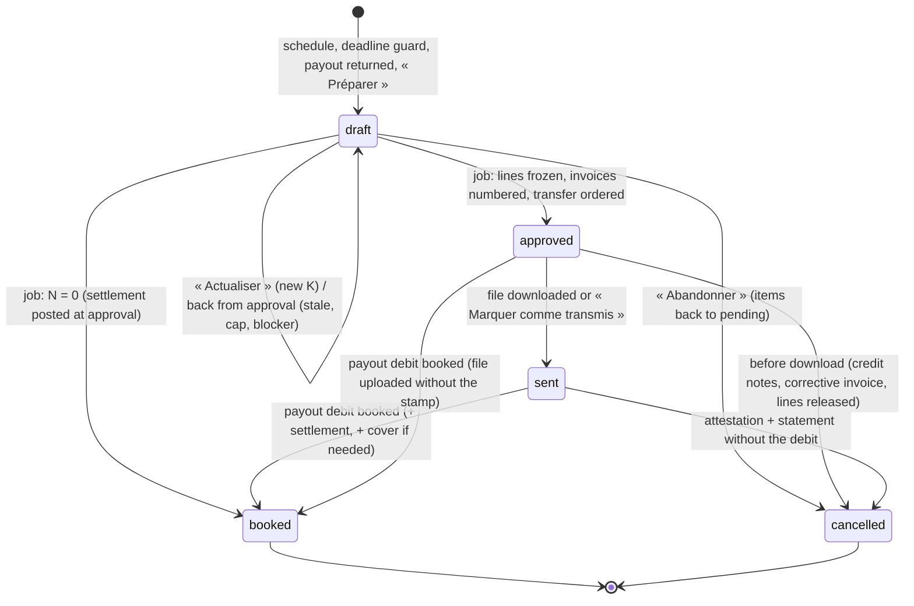

# M2c Remittances, client statements, commission and invoices: synthesized design (M2-12 … M2-15)

Status: design for the M2c PRs (implementation follows, one PR per slice, §21). Founder decisions §24 are pending. Produced by a three-design panel (compliance-first, ledger-first, ops-first), a critique of each design, and a judge. Checked against branch `m2b5r` (main merged through M2b-6): migrations up to `20261110120000_debits_refunds.sql` (the plan-robustness migration `20261110130000` is in progress; M2c migrations come after it), ADR-0012, ADR-0013 with its addenda through M2b-6, `docs/design/m2b-payments.md` §11 and §14–§16. The judge re-read on LibreJustice, on 2026-11-09, every legal text quoted in §3 (version in force that day unless another date is given). Texts relied on from M2b §3 and not re-read are marked "(M2b §3)". Nothing here is implemented.

---

## 0. Decision in one paragraph

The ledger gets a second **fund**, and every entry stays closed inside each fund: the **dedicated-account fund** (5120, 4710, 4670 and a new **4679** « Sommes revenant au cabinet sur le compte dédié ») and the **servicer's fund** (new 5122 own cash, 4111 commission receivable, 4112 advances, 44571 / 44574 VAT, 4689, 7060, 6270, 6780). Money crosses between the two funds only through **4679 / 4689, which mirror each other in every entry**, as 1100 / 3100 do. The client-money exemption that ADR-0013 planned for « commission » is dropped: no exemption at all.

A **remittance run** belongs to one (client, currency); there is at most one pending run per pair. It takes every 4670 movement waiting in a **pending queue**, which a ledger trigger feeds and the run reads under the servicer's allocation lock, so each entry is remitted exactly once. Commission comes from the mandate's **versioned schedule**: data with its clause reference (R124-3 3°), computed by a pure Python engine as the difference of a per-file cumulative function. Approval, by one admin or ops manager at aal2, issues per mandate a **commission invoice**, plus a credit note for commission on collections undone since. Invoices and credit notes share one gapless yearly series per servicer. Approval also orders the net transfer and produces the **client statement** (PDF + CSV) and a deterministic **pain.001** that ops upload to the bank.

**Nothing leaves 5120 before the bank's debit.** When the payout's debit is on the statement, the ledger books:
- the remittance (Dr 4670 / Cr 5120);
- the **compensation** of the commission (netting clause), of credit-note refunds and of advances (claw-back clause): Dr 4670 / Cr 4679 ‖ Dr 4689 / Cr 4111 / Cr 4112.

VAT then moves from pending to due. The servicer's share is swept to its own account afterwards, so clients are always paid first.

If a collection that was already remitted is reversed, the servicer **advances** the amount at once (Dr 4679 / Cr 4670 ‖ Dr 4112 / Cr 4689) and tops the account up from own cash. The return is never netted silently against the client's new collections. A commit-time guard keeps every client's 4670 out of debit (`LG008`).

Without a netting clause, the gross amount is remitted and the invoice is payable to the own account. The R124-6 deadline is tracked per line on a conservative calendar, and a guard prepares a run before any deadline comes close.

---

## 1. Scope and non-scope

| Roadmap | What M2c builds | Acceptance criterion → proven in |
|---|---|---|
| **M2-12** client-money segregation (completion) | Two funds and the 4679/4689 mirror; books 5122, 4111, 4112, 44571, 44574, 6270, 6780; 13 entry types with fixed shapes; own bank account (`bank_account.purpose = 'own'`); one paying dedicated account per currency; import classification of our own debits and credits; fees, top-ups, sweeps, advances, OQ-34 excess; per-client running balance with a commit-time guard; redefined nightly identities | « servicer revenue accounts never receive principal collections directly » → pgTAP `016`, property machine (§18) |
| **M2-13** commission rules per mandate | `mandate_terms.commission_schedule` (schema `commission-1`, clause ref), validators (SQL + Python parity), pure engine, VAT and calendar rule packs, golden cases | « unit tests on mandate examples; commission stored per remittance line » → golden cases, `remittance_line.commission_minor` |
| **M2-14** remittance runs | `remittance_terms` (R124-3 4°); per-line R124-6 deadline and guard; pending queue; drafts, approval job, cancellation; statement PDF + CSV; transfers, pain.001, booking from the statement; returned payouts; returns after remittance | « run is idempotent; statement totals = collected − commission; deadline breach raises an alert » → §18 |
| **M2-15** commission invoice | One invoice (and credit note) per (run, mandate); gapless yearly series per servicer; VAT on encaissements (pending → due); 242 nonies A, L441-9, R123-237/238 mentions; deterministic PDF; structured payload; settlement sub-ledger | « invoice totals match the remittance statement; numbering is gapless per tenant » → §18 |
| CPCE-03 (completion) | Billing identities, payout accounts with dual control, client status events, R124-3 2°/3°/4° references; batch confirmation refused when the money terms or identities are incomplete | pgTAP `017` |

**Not in M2c, and why:**
- **Hold-back reserves.** Lawful only « sauf convention contraire » (R124-6). Card and SEPA direct debit, the rails that need them, arrive with M5. The `remittance-1` schema reserves the key; the validator refuses it until then.
- **Bank APIs, EBICS, pain.002, import of own-account statements.** Ops download the file and upload it at their bank. 5122 records only movements seen on the dedicated account, plus client payments proven by ops.
- **E-invoicing through a plateforme agréée.** It is required for micro and PME issuers from 2027-09-01 (§3). The invoice payload is stored structured, so a later slice maps it.
- **Non-EUR currencies, clients outside mainland France, non-professional clients.** These need other VAT and invoice rules (OQ-42). They are refused when a batch is confirmed (founder #13).
- **Fixed fees, success fees, per-run minimums, re-billed disbursements, commission on payments made to the client directly.** The schema leaves room for them.
- **Re-invoicing under corrected terms.** M2c offers a manual credit note only (risk R2).
- **Interest on late remittance.** None is computed (1996, §3).
- **The servicer's general accounting** (FEC, VAT return). The platform keeps the servicing and client-money sub-ledger and exports invoices and entries for the accountant.
- **Email or webhook delivery** (M4/M7). Documents are downloaded from the client space.
- **Phase C** waterfalls.

---

## 2. Panel scores and contradictions resolved

### 2.1 Scores (out of 10; weights as M2b: money 25 %, legal 20 %, ops 15 %, performance 15 %, testability 15 %, simplicity 10 %)

| Criterion | Compliance-first | Ledger-first | Ops-first |
|---|---|---|---|
| Money correctness | 7.5: four exempt crossing shapes; one multi-client withdrawal entry; I13 refuses real bank debits at booking; implicit netting of remitted returns; 4110 as a single running balance | **8.5**: two funds and the mirror, no exemption; but approval can overpay, claw-back happens without a clause, a shortfall is only an alert, and `bank_debit_link` cannot hold its bookings | 7.5: 5129 reclass with no exemption and a 4672 in-transit book; cancellation breaks I12, net-0 runs are undefined, the cash check is weak |
| Legal grounding | **8.5**: widest reading; overstates R124-2; misses R123-238, insolvency, 289 VI, the 45-day periodic term | 7.5: overstates R124-2 and 260/2012; wrong source for e-invoicing dates; L441-10 at 60 days | 7.5: truncates 289 I 3; misses L441-9 escompte, R123-237 on receipts, L622-7 |
| Ops usability | 7 | 7 | **9**: phone-first queue, effect sheets, alerts that lead to an action |
| Performance | 7.5 | 7 (rescans history) | **8** (open-item queue) |
| Testability | 8.5 | 8.5 | 8.5 |
| Simplicity / fit with ADR-0012/0013 | 7.5 | 7 (many books) | 7.5 |
| **Weighted** | **7.8** | **7.7** | **7.95** |

No single base:
- **The ledger skeleton is ledger-first's**: two funds, mirror pair, VAT pending → due, commission per line, compensation as an entry.
- **The run flow and pages are ops-first's**: open-item queue, drafts, approval job, alerts that lead to an action, accounting export.
- **The legal frame is compliance-first's**: clause-driven netting, per-line deadline, the telescoping commission function, credit notes allocated LIFO, deterministic pain.001, the statement content.

Rejected:
- the S identity with exempt shapes (compliance-first);
- 5129 and 4672 (ops-first): 5129 would make 5120 differ from the bank and change I9 and the import checks;
- commission per item with largest-remainder shares (ledger-first): marginal tiers would give a wrong file total after a reversal;
- per-invoice and per-run minimums (ledger-first, ops-first);
- the never-reset numbering (ledger-first, ops-first: BOFiP allows a yearly series, see §3);
- settlement at approval (ledger-first, ops-first).

### 2.2 Contradictions resolved

| # | Question | Compliance-first | Ledger-first | Ops-first | **Chosen** | Why |
|---|---|---|---|---|---|---|
| 1 | Where servicer money sits on the dedicated account | S = Σ5120+Σ4710+Σ4670, four exempt shapes | pooled 4679 (client fund) mirrored by 4689 (servicer fund) | 5129 servicer share per bank account | **4679 / 4689** | Every entry closed per fund, no exemption. 5120 stays equal to the bank (I9 and the import checks unchanged). −4679 shows the servicer's money on the account at every date. |
| 2 | When the commission is set off | withdrawal booked at the SRV debit | at approval | at approval (reclass) | **at the payout's debit; at approval when nothing is transferred** | Matches « compensation lors de chaque reversement » (clause wording, OQ-37). VAT becomes due on a provable date. Cancelling before the debit needs no reversal. The servicer is swept only after clients are paid. |
| 3 | Book for « virement ordonné » | — | — | 4672 | **none**: 4670 stays owed until the debit; the transfer row says « ordonné » | The debt is extinguished by the payment, not by the order. |
| 4 | Finding new items | watermark K under the lock | effective-date cut-off | cursor + queue | **pending queue fed by an ALWAYS trigger on 4670 postings, read under the allocation lock**; K stored for display | Independent of clocks and back-dated effective dates. O(new items). Completeness by construction (ops critique #11, compliance critique D1). |
| 5 | Run grain | (client, currency) | (client, currency) | client per ops selection | **(client, currency), one pending run; one invoice and one credit note per (run, mandate)** | 4670 is per client. Netting, claw-back and due terms are per mandate (ledger critique #17). |
| 6 | No netting clause | gross + due invoice | invoice mode | refused | **gross + due invoice, payable to the own account** | Refusing would make collected money unremittable: an R124-6 breach (ops critique #3). |
| 7 | Return of a remitted collection | advance only the excess over 4670 | alert; ops decide | net in next run; advance if 4670 debit | **automatic advance of the whole reversed amount, recovery only under a claw-back clause** | Netting it against new collections is a compensation the law makes subject to invocation or agreement (1347, 1348-2). Compliance critique A4, ledger critique #2. |
| 8 | Commission arithmetic | telescoping per file | exact per item + largest remainder | half-up per line, credit = −original | **telescoping per (file, tier key)** | A file's commission equals f(net collected) whatever the split into runs. A reversal gives back exactly what f says, including across marginal tiers. Integers only. |
| 9 | Minimums | per file, capped | per invoice | per line + per run | **per file, capped so the TTC never exceeds what the file brought in** | A per-run minimum would rise with our own extra runs (ops critique #8). |
| 10 | Numbering | yearly `FC-AAAA` | never reset | never reset | **one yearly series per servicer, invoices and credit notes, `FC-AAAA-NNNNNN`** | BOFiP §90 contemplates numbering per year; §110 rules out per-client series. The accountant confirms (OQ-43). |
| 11 | Frequency | twice monthly | twice monthly | weekly | **twice monthly by default, weekly per mandate, + deadline guard** | Half as many invoices as weekly; the guard keeps every line within its deadline. |
| 12 | Blockers | many reasons block the run | `no_money_terms` blocks the run | checked at approval | **readiness gated at batch confirmation; only payee and client-status reasons block a payout; a commission problem never does** | Our paperwork gap must not become an R124-6 breach (compliance critique B8, ledger critique #20). |
| 13 | Dedicated accounts per currency | one | pooled 4679 ignores it | per run | **one active `client_funds` account per (servicer, currency)** | Money on a second account could never be remitted (ledger critique #9). |
| 14 | Shortfall control | cover by callers | alert only | P0 alert | **explicit cover in every path + per-client running balance with a deferred commit guard (`LG008`)** | Forgetting the cover in a new path fails at commit instead of using another client's money (compliance critique C2). |
| 15 | Approval transaction | 200 runs in one | job per run | job per run | **job, one transaction per run** | One stale run never rolls back 199 (compliance critique D2, ops critique #12). |
| 16 | IBAN control | second staff | second staff | proposer ≠ approver | **client admin confirms in the client space at aal2; otherwise a second servicer admin** | Two staff can be fooled by the same spoofed email; a one-admin servicer could not onboard anyone (ops critique #32). |
| 17 | Refunds in the file | yes | yes | — | **yes, with `refund_request.execution_mode`** | One upload; a refund in a file can no longer be executed by hand (ledger critique #26). |
| 18 | pain.001 version | .03 | .09 | .09 | **.09 by default, .03 per bank account** | The bank's guide decides. |
| 19 | Statement: money received and not remitted | not shown | shown | counts only | **shown: totals per file and reason, no payer data** | C. civ. 1993 « quand même ce qu'il aurait reçu n'eût point été dû au mandant » (OQ-40). |

---

## 3. Legal basis

### 3.1 Texts relied on (quoted; read on LibreJustice 2026-11-09)

| Text | Operative words (quoted) | What M2c does |
|---|---|---|
| [CPCE R124-2](https://librejustice.fr/norm/fr/code-des-procedures-civiles-d-execution/r124-2) al. 2–3 | « Elles justifient également être titulaires d'un compte … Ce compte doit être exclusivement affecté à la réception des fonds encaissés pour le compte des créanciers. » · « La justification … est assurée par déclaration écrite … au procureur de la République … » | It is an obligation to hold a dedicated account. M2c keeps servicer money off it as soon as it can: the sweep follows the payouts, fees are the servicer's cost, top-ups are ordered the same day. That every short stay breaches R124-2 is ⚖️ (OQ-35). Thresholds are product defaults. |
| [CPCE R124-7](https://librejustice.fr/norm/fr/code-des-procedures-civiles-d-execution/r124-7) | « 1° Ne pas se conformer aux obligations prévues à l'article R. 124-2 ; 2° Omettre l'une des mentions prévues à l'article R. 124-4 … » | A late remittance is not this contravention. Breaches of R124-6 are recorded as violations by product choice. |
| [CPCE R124-3](https://librejustice.fr/norm/fr/code-des-procedures-civiles-d-execution/r124-3) | « … qu'après avoir conclu une convention écrite avec le créancier dans laquelle il lui est donné pouvoir de recevoir pour son compte. » · « 2° Les conditions et les modalités de la garantie … » · « 3° Les conditions de détermination de la rémunération à la charge du créancier ; 4° Les conditions de reversement des fonds encaissés pour le compte du créancier. » | The commission schedule (3°) and the remittance terms (4°) are mandate data, each with its document and clause reference; the insurance clause (2°) too. Netting, claw-back, a weekly frequency or a shorter delay come only from a clause. Batch confirmation requires them. |
| [CPCE R124-5](https://librejustice.fr/norm/fr/code-des-procedures-civiles-d-execution/r124-5) al. 1 | « La personne chargée du recouvrement informe le créancier qu'elle a obtenu un paiement même partiel de la part du débiteur … » | Met per payment since M2b-4/5. The statement adds to it and does not replace it. |
| [CPCE R124-6](https://librejustice.fr/norm/fr/code-des-procedures-civiles-d-execution/r124-6) al. 2 | « Les fonds reçus par la personne chargée du recouvrement donnent lieu, sauf convention contraire, à un reversement dans un délai d'un mois à compter de leur encaissement effectif. » | Deadline per line (§9.2), guard, alerts, breach rows. No frequency, amount or threshold can extend it. |
| [CPCE L111-8](https://librejustice.fr/norm/fr/code-des-procedures-civiles-d-execution/l111-8) al. 2 | « Les frais de recouvrement entrepris sans titre exécutoire restent à la charge du créancier … Toute stipulation contraire est réputée non écrite, sauf disposition législative contraire. » | No M2c entry type may touch 1100/3100 (`allowed_books`). The fee is charged to the client only. |
| [C. civ. 1993](https://librejustice.fr/norm/fr/code-civil/1993) | « Tout mandataire est tenu de rendre compte de sa gestion, et de faire raison au mandant de tout ce qu'il a reçu en vertu de sa procuration, quand même ce qu'il aurait reçu n'eût point été dû au mandant. » | The statement is the account. It includes « Sommes reçues sur vos dossiers et non reversées » (OQ-40). |
| [C. civ. 1996](https://librejustice.fr/norm/fr/code-civil/1996) | « Le mandataire doit l'intérêt des sommes qu'il a employées à son usage à dater de cet emploi ; et de celles dont il est reliquataire à compter du jour qu'il est mis en demeure. » | No automatic interest on late remittance. One client's money never serves another client or the servicer. Shortfall periods are logged (OQ-38). |
| [C. civ. 1999](https://librejustice.fr/norm/fr/code-civil/1999) | « Le mandant doit rembourser au mandataire les avances et frais que celui-ci a faits pour l'exécution du mandat, et lui payer ses salaires lorsqu'il en a été promis. » · « … lors même que l'affaire n'aurait pas réussi … » | An advance (4112) is owed back by the client. Whether covering a return is such an « avance » is ⚖️ (OQ-38). Whether commission stays due on a collection later undone is OQ-39. |
| [C. civ. 1302-1](https://librejustice.fr/norm/fr/code-civil/1302-1) | « Celui qui reçoit par erreur ou sciemment ce qui ne lui est pas dû doit le restituer à celui de qui il l'a indûment reçu. » | The fallback basis for recovering a remitted amount that came back (⚖️). Founder #8 (M2b) is unchanged. |
| [C. civ. 1345](https://librejustice.fr/norm/fr/code-civil/1345) al. 1–2 | « Lorsque le créancier … refuse de recevoir le paiement qui lui est dû ou l'empêche par son fait, le débiteur peut le mettre en demeure … » · « La mise en demeure du créancier arrête le cours des intérêts … » | A client without a usable payout IBAN past D-5 is sent a letter by ops, recorded next to the line (template later). |
| [C. civ. 1347](https://librejustice.fr/norm/fr/code-civil/1347), [1347-1](https://librejustice.fr/norm/fr/code-civil/1347-1), [1348-2](https://librejustice.fr/norm/fr/code-civil/1348-2) | « Elle s'opère, sous réserve d'être invoquée, à due concurrence … » · « … la compensation n'a lieu qu'entre deux obligations fongibles, certaines, liquides et exigibles. » · « Les parties peuvent librement convenir d'éteindre toutes obligations réciproques, présentes ou futures, par une compensation ; celle-ci prend effet à la date de leur accord ou, s'il s'agit d'obligations futures, à celle de leur coexistence. » | Netting only under the mandate's clause (a conservative policy grounded in R124-3 4° and 1348-2), never invoked automatically. Only issued invoices and posted advances are set off. The clause template fixes the date: « lors de chaque reversement » (OQ-37). |
| [C. civ. 2003](https://librejustice.fr/norm/fr/code-civil/2003) | « Le mandat finit : Par la révocation du mandataire, Par la renonciation de celui-ci au mandat, Par la mort, la tutelle des majeurs ou la déconfiture, soit du mandant, soit du mandataire. » | `client_status_event` ends the mandate: a final run and a final statement. |
| [C. pén. 314-1](https://librejustice.fr/norm/fr/code-penal/314-1) | « L'abus de confiance est le fait par une personne de détourner, au préjudice d'autrui, des fonds … qui lui ont été remis et qu'elle a acceptés à charge de les rendre … » | Why no client's money ever covers another client's debit or the servicer's needs, and why commission leaves client money only by an issued invoice and its compensation. |
| [CPC 641](https://librejustice.fr/norm/fr/code-de-procedure-civile/641) al. 2 | « Lorsqu'un délai est exprimé en mois … ce délai expire le jour du dernier mois … qui porte le même quantième … A défaut d'un quantième identique, le délai expire le dernier jour du mois. » | « Un mois » is computed this way by analogy (OQ-36). No weekend or holiday extension is applied. |
| [CMF L133-9](https://librejustice.fr/norm/fr/code-monetaire-et-financier/l133-9), [L133-13](https://librejustice.fr/norm/fr/code-monetaire-et-financier/l133-13) I | « … le moment de réception est réputé être le jour convenu. » · « Si le moment de réception n'est pas un jour ouvrable pour le prestataire de services de paiement du payeur, l'ordre de paiement est réputé avoir été reçu le jour ouvrable suivant. » · « … crédité sur le compte du prestataire de services de paiement du bénéficiaire au plus tard à la fin du premier jour ouvrable suivant le moment de réception … » | Latest execution date = the business day before the last business day on or before the deadline (§9.2). |
| [CMF L314-1](https://librejustice.fr/norm/fr/code-monetaire-et-financier/l314-1) II 6°, III 3° | « 6° Les services de transmission de fonds » · « N'est pas considérée comme un service de paiement : … 3° La réalisation d'opérations de paiement allant du payeur au bénéficiaire, par l'intermédiaire d'une personne habilitée par contrat à négocier ou à conclure la vente ou l'achat de biens ou de services pour le compte du payeur uniquement ou du bénéficiaire uniquement » | Not code: whether collecting and remitting under R124 is a regulated payment service is flagged to counsel before go-live (OQ-45). |
| [Reg. (UE) 260/2012 art. 5](https://librejustice.fr/norm/eu/reglement-ue-n-260-2012-du-parlement-europeen-et-du-conseil-du-14-mars-2012/5) 1 d, 7 | « … lorsqu'un utilisateur de services de paiement qui n'est pas un consommateur ou une microentreprise, initie … des virements individuels … qui ne sont pas transmis individuellement mais sont regroupés pour la transmission, les formats de message visés au point 1) b) de l'annexe soient utilisés. » · « … n'exigent pas … qu'ils indiquent le code BIC … » | An obligation on the bank, and only for non-micro users. pain.001 is our choice anyway. The BIC is optional. |
| [Reg. 260/2012 art. 5 quater](https://librejustice.fr/norm/eu/reglement-ue-n-260-2012-du-parlement-europeen-et-du-conseil-du-14-mars-2012/5-quater) 1, 6, 7 | « … avant que le payeur ne se voie offrir la possibilité d'autoriser le virement concerné. » · « … les moyens de renoncer à recevoir le service assurant la vérification lorsqu'ils soumettent plusieurs ordres de paiement sous une forme groupée. » · « … les fonds soient virés sur un compte de paiement non détenu par le bénéficiaire … » | Payee name = the RIB holder. We do not opt out (founder #15, OQ-50). A bank no-match or close-match blocks that payout. |
| [CGI 256](https://librejustice.fr/norm/fr/code-general-des-impots/256) I; [261 C](https://librejustice.fr/norm/fr/code-general-des-impots/261-c) 1° c; [259](https://librejustice.fr/norm/fr/code-general-des-impots/259) 1°, 2° (all valid to 2027-01-01) | « Sont soumises à la taxe sur la valeur ajoutée les … prestations de services effectuées à titre onéreux par un assujetti agissant en tant que tel. » · « … paiements, virements, créances … à l'exception du recouvrement de créances » · « Le lieu des prestations de services est situé en France : 1° Lorsque le preneur est un assujetti … et qu'il a en France : a) Le siège de son activité économique … 2° Lorsque le preneur est une personne non assujettie, si le prestataire : a) A établi en France le siège de son activité économique … » | The commission is taxable; the collection exemption does not apply; French VAT applies for French clients. The remitted funds are the creditor's (« pour son compte », R124-3) and are not our turnover. |
| [CGI 278](https://librejustice.fr/norm/fr/code-general-des-impots/278) (valid to 2027-01-01); [CIBS L213-151](https://librejustice.fr/norm/fr/code-des-impositions-sur-les-biens-et-services/l213-151) (version from 2027-01-01) | « Le taux normal de la taxe sur la valeur ajoutée est fixé à 20 %. » · « Taux normal \| 20 % \| 8,5 % » (métropole \| Guadeloupe, Martinique, Réunion) | `vat_rate` rows with validity dates and references. Clients outside mainland France are refused (OQ-42). |
| [CGI 269](https://librejustice.fr/norm/fr/code-general-des-impots/269) 1 a bis, 2 c | « … pour les prestations de services qui donnent lieu à l'établissement de décomptes ou à des encaissements successifs, au moment de l'expiration des périodes auxquelles ces décomptes ou encaissements se rapportent » · « Pour les prestations de services … lors de l'encaissement des acomptes, du prix, de la rémunération ou, sur option du redevable, d'après les débits. » | Service period = previous run → this run. VAT is booked pending (44574) at issue and moved to due (44571) on settlement; at issue when the servicer opted for débits. |
| [CGI 272](https://librejustice.fr/norm/fr/code-general-des-impots/272) 1 | « … imputée ou remboursée … lorsque ces ventes ou services sont par la suite résiliés ou annulés … L'imputation ou la restitution est subordonnée à la justification … de la rectification préalable de la facture initiale. » | A credit note names the invoice it rectifies. Whether a returned collection « annule » the service is OQ-39. |
| [CGI 289](https://librejustice.fr/norm/fr/code-general-des-impots/289) I 1 a, I 3, I 4, I 5, IV, V, VI, VII 1° | « … pour un autre assujetti, ou pour une personne morale non assujettie … » · « La facture est, en principe, émise dès la réalisation de la livraison ou de la prestation de services. » · « Elle peut être établie de manière périodique … pour lesquelles la taxe devient exigible au cours d'un même mois civil. Cette facture est établie au plus tard à la fin de ce même mois. » · « L'assujetti doit conserver un double de toutes les factures émises. » · « Tout document … qui modifie la facture initiale … et qui fait référence à la facture initiale de façon spécifique et non équivoque est assimilé à une facture. » · « … pour autant que le montant de taxe à payer ou à régulariser soit déterminé en euros … » · « L'authenticité de l'origine, l'intégrité du contenu et la lisibilité de la facture doivent être assurées … » · « Leur transmission et mise à disposition sont soumises à l'acceptation du destinataire. » · « … des contrôles documentés et permanents … permettent d'établir une piste d'audit fiable … » | One invoice per (run, mandate), issued at approval. Credit notes name the invoice. EUR only. The PDF and its SHA-256 are kept. Electronic delivery needs the client's recorded acceptance (mandate clause), otherwise post. The audit trail is invoice → run → lines → entries → payments, plus a written procedure (COMPLIANCE Ops row). |
| [CGI 289 bis](https://librejustice.fr/norm/fr/code-general-des-impots/289-bis) I; [loi 2022-1157 art. 26](https://librejustice.fr/norm/fr/loi-n-2022-1157-du-16-aout-2022-de-finances-rectificative-pour-2022-1/26) III A, B (version from 2026-02-21) | « L'émission, la transmission et la réception des factures électroniques s'effectuent en recourant à une plateforme agréée. » · « … s'appliquent aux factures émises à compter du 1er septembre 2026 … » · « Toutefois, pour les factures émises par les assujettis relevant des catégories des microentreprises et des petites et moyennes entreprises … à compter du 1er septembre 2027. Un décret peut fixer une date ultérieure, qui ne peut être postérieure au 1er décembre 2027. » · « L'appartenance à une catégorie s'apprécie … au 1er janvier 2025, sur la base du dernier exercice clos avant cette date ou, en l'absence d'un tel exercice, sur celle du premier exercice clos à compter de cette date. » | PDF invoices remain lawful for a micro or PME issuer until 2027-09-01. The plateforme agréée slice comes before (§20, OQ-44). |
| [CGI 290 A](https://librejustice.fr/norm/fr/code-general-des-impots/290-a) I | « Les données relatives au paiement des opérations … pour lesquelles la taxe est exigible à l'encaissement en application du 2 de l'article 269 … sont communiquées à l'administration … par la plateforme agréée choisie par l'assujetti. » | Payment data per invoice, kept in `commission_settlement` (§6), so e-reporting is a mapping. |
| [CGI ann. II 242 nonies A](https://librejustice.fr/norm/fr/code-general-des-impots-annexe-ii/242-nonies-a) I and its note | 1° « Le nom complet, le numéro d'identification mentionné au premier alinéa de l'article R. 123-221 du code de commerce et l'adresse de l'assujetti et de son client » · 2° « Le numéro individuel d'identification attribué à l'assujetti … » · 6° « Sa date d'émission » · 7° « Un numéro unique basé sur une séquence chronologique et continue ; la numérotation peut être établie dans ces conditions par séries distinctes lorsque les conditions d'exercice de l'activité de l'assujetti le justifient … » · 8° « … la quantité, la dénomination précise, le prix unitaire hors taxes et le taux de taxe … » · 8° bis « … exclusivement de prestations de services … » · 9° « Tous rabais, remises, ristournes ou escomptes acquis et chiffrables … » · 10° « La date à laquelle est effectuée, ou achevée, … la prestation de services … dans la mesure où une telle date est déterminée et qu'elle est différente de la date d'émission … » · 11° « Le montant de la taxe à payer et, par taux d'imposition, le total hors taxe et la taxe correspondante mentionnés distinctement » · 11° bis « … “ Option pour le paiement de la taxe d'après les débits ” » · note: « … s'appliquent aux factures émises à compter du 1er septembre 2026. Toutefois, ces dispositions ne s'appliquent qu'à compter du 1er septembre 2027 pour les factures émises par les assujettis relevant des catégories des microentreprises et des petites et moyennes entreprises … » | Invoice template (§14). The newer mentions (client SIREN, 8° bis) are printed now. |
| [BOFiP BOI-TVA-DECLA-30-20-20-10](https://librejustice.fr/norm/fr/tva-regimes-d-imposition-et-obligations-declaratives-et-comptables-regles-relatives-a-l-etablissement-des-factures/90) §80, §90, §110 | §90 « … que la numérotation soit effectuée chronologiquement au fur et à mesure de l'émission des factures ; qu'elle soit continue ; et que le dispositif retenu … garantisse que deux factures émises la même année ne puissent pas porter le même numéro. Il est conseillé … un préfixe … » · §110 « … l'existence de clients établis dans plusieurs États ne justifie pas, en principe, à elle seule la création d'une série de facturation par client … » | One series per servicer, a yearly counter with the year in the number, a prefix. No per-client series. |
| [C. com. L441-9](https://librejustice.fr/norm/fr/code-de-commerce/l441-9) I (version to 2026-12-31; the version from 2027-01-01 keeps these sentences) | « Tout achat de produits ou toute prestation de service pour une activité professionnelle fait l'objet d'une facturation. » · « La facture mentionne la date à laquelle le règlement doit intervenir. Elle précise les conditions d'escompte applicables en cas de paiement à une date antérieure …, le taux des pénalités exigibles le jour suivant la date de règlement … ainsi que le montant de l'indemnité forfaitaire pour frais de recouvrement … » · « Le règlement est réputé réalisé à la date à laquelle les fonds sont mis, par le client, à la disposition du bénéficiaire … » · « La facture mentionne le numéro du bon de commande lorsqu'il a été préalablement établi par l'acheteur. » | Payment date, « Pas d'escompte pour paiement anticipé », penalty rate and the €40 on every invoice to a professional. Optional PO number. |
| [C. com. L441-10](https://librejustice.fr/norm/fr/code-de-commerce/l441-10) I, II (version from 2026-09-01) | « Sauf dispositions contraires … le délai de règlement des sommes dues ne peut dépasser trente jours après la date … d'exécution de la prestation demandée. » · « Le délai convenu … ne peut dépasser soixante jours après la date d'émission de la facture. » · « En cas de facture périodique … le délai convenu entre les parties ne peut dépasser quarante-cinq jours après la date d'émission de la facture. » · « … ne peut toutefois fixer un taux inférieur à trois fois le taux d'intérêt légal, ce taux est égal au taux d'intérêt appliqué par la Banque centrale européenne à son opération de refinancement la plus récente majoré de 10 points de pourcentage. » · « … le créancier ne peut invoquer le bénéfice de ces indemnités lorsque l'ouverture d'une procédure … interdit le paiement … » | A due invoice: the mandate's term (validated ≤ 45 days after issue), otherwise 30 days after the service end (K). The penalty text is a servicer setting, validated ≥ 3 × the legal rate when contractual. |
| [C. com. D441-5](https://librejustice.fr/norm/fr/code-de-commerce/d441-5) | « … est fixé à 40 euros. » | Printed on invoices to professionals. |
| [C. com. R123-237](https://librejustice.fr/norm/fr/code-de-commerce/r123-237), [R123-238](https://librejustice.fr/norm/fr/code-de-commerce/r123-238) | « … sur ses factures … ainsi que sur toutes correspondances et tous récépissés concernant son activité et signés par elle ou en son nom : 1° Le numéro unique d'identification … 2° La mention RCS suivie du nom de la ville où se trouve le greffe … 3° Le lieu de son siège social ; 4° Le cas échéant, qu'elle est en état de liquidation … 9° … “ entrepreneur individuel ” ou … “ EI ” » · « … la dénomination sociale, précédée ou suivie immédiatement et lisiblement : … " société par actions simplifiées " ou des initiales " SAS " … b) De l'énonciation du montant du capital social … » | Issuer block on invoices, credit notes and statements, **and on receipts** (M2b-5 receipts carry only the name today). |
| [C. com. L123-22](https://librejustice.fr/norm/fr/code-de-commerce/l123-22), [R123-174](https://librejustice.fr/norm/fr/code-de-commerce/r123-174) al. 2 | « Les documents comptables sont établis en euros et en langue française. Les documents comptables et les pièces justificatives sont conservés pendant dix ans. … sans blanc ni altération d'aucune sorte … » · « Tout enregistrement comptable précise l'origine, le contenu et l'imputation de chaque donnée ainsi que les références de la pièce justificative qui l'appuie. » | French, EUR, kept 10 years, never purged (OQ-49). Every M2c entry names its document (`source_type` / `source_id`). |
| [C. com. L622-7](https://librejustice.fr/norm/fr/code-de-commerce/l622-7) I, III; [L641-9](https://librejustice.fr/norm/fr/code-de-commerce/l641-9) I | « … interdiction de payer toute créance née antérieurement au jugement d'ouverture, à l'exception du paiement par compensation de créances connexes. » · « Tout acte ou tout paiement passé en violation … est annulé … dans un délai de trois ans … » · « Les droits et actions du débiteur concernant son patrimoine sont exercés pendant toute la durée de la liquidation judiciaire par le liquidateur. » | When the **client** is in a proceeding, debts born before the opening are not set off, and in liquidation the payouts go to the liquidator's confirmed account (OQ-41). |

**VAT recodification.** The notes under CGI 256, 259, 261 C, 278, 269, 272, 289, 289 bis and 290 A say these provisions « sont abrogées à compter du 1er janvier 2027 », except the paragraphs listed in art. 15 of ordonnance 2025-1247. For example, 289 « 3 du I, IV et VII » and 269 « premier et dernier alinéas du c du 2 » are « maintenues en vigueur » until regulatory re-enactment. So:
- no CGI article number is printed in fixed invoice text;
- every legal reference is dated data (`vat_rate`, rule packs);
- the 2027 pack is reviewed before 2027-01-01 (a CI tripwire).

Relied on from M2b §3, not re-read: CMF L133-24, L133-25, L133-25-1; C. conso L722-5; C. civ. 1342-2.

### 3.2 What the law does not require (so M2c does not build it as law)
1. **No frequency, statement period or minimum transfer.** Only the one-month limit. A minimum amount may never carry money past the deadline.
2. **No prescribed statement form.** 1993 asks for an account. PDF + CSV is a product choice.
3. **No hold-back** except by a clause (« sauf convention contraire »).
4. **No gapless numbering except for invoices and credit notes.** Runs, files and statements only need unique numbers.
5. **No per-client invoice series** (BOFiP §110).
6. **No four-eyes approval, IBAN dual control or payee check** in our law. These are fraud controls (founder #10, #11). Verification of payee is the bank's service (5 quater).
7. **No bank API, and pain.001 is not our legal obligation** (art. 5 binds banks, for non-micro users).
8. **No e-invoicing before 2027-09-01** for a micro or PME issuer.
9. **No VAT on the remitted funds**, only on our remuneration.
10. **No legal rate, cap or minimum on the commission.** R124-3 3° asks the convention to state the conditions; L111-8 forbids charging them to the debtor.
11. **No automatic interest on late remittance** (1996, mise en demeure).
12. **No signature on invoices.** Integrity (289 V) is met by the stored SHA-256, append-only rows and documented controls (289 VII 1°).

### 3.3 How the COMPLIANCE rows are met
- **CPCE-02**:
  - both funds closed per entry;
  - 7060 reachable only by a commission document against 4111;
  - the servicer's money is visible on 4679, swept after payouts, and fees and shortfalls are the servicer's debt;
  - `LG008`;
  - one paying dedicated account per currency.
- **CPCE-03**:
  - money terms with clause references;
  - confirmation gate;
  - payout account with dual control.
- **CPCE-06** unchanged: the statement adds to it.
- **CPCE-07**: the receipt gets the R123-237/238 issuer block.
- **CPCE-08**:
  - per-line deadline;
  - guard at D-5 business days;
  - breach rows;
  - alerts on identified but unallocated money (OQ-26).

---

## 4. Naming

| Concept (FR) | Code | Note |
|---|---|---|
| Reversement | `remittance_run`, number `RV-AAAA-NNNNNN` (unique, not gapless) | DOMAIN name kept; one per (client, currency) |
| Ligne de reversement | `remittance_line` | one ledger entry that moved 4670 |
| À reverser | `private.remittance_pending` | the queue |
| Relevé de reversement | statement (`document.kind` `remittance_statement_pdf` / `_csv`) | 1993 « rendre compte » |
| Facture / avoir de commission | `commission_invoice` (`kind invoice \| credit_note`), `commission_invoice_line` | DOMAIN name kept |
| Règlement d'une facture ou d'une avance | `commission_settlement` | per-document sub-ledger |
| Barème | `mandate_terms.commission_schedule` (`commission-1`) | supersedes `commission_rate` |
| Conditions de reversement | `mandate_terms.remittance_terms` (`remittance-1`) | R124-3 4° |
| Compte de reversement du mandant | `client_payout_account` | dual control |
| Identité de facturation | `billing_identity`, `servicer_billing_settings` | |
| Avance au mandant | `client_advance` | |
| Virement émis | `bank_transfer` (`payout` RMT, `sweep` SWP, `top_up` TOP, `refund` RFD) | end-to-end ids: prefix + 12 hex |
| Fichier de virements | `transfer_file` (pain.001) | |
| Comptabilisation d'une ligne bancaire | `bank_line_booking` | one bank line → n entries |

ADR-0014, "Remittances, commission, invoices and own cash", records this naming and §2. It is written in M2c-1. It supersedes ADR-0013's sentence « Only M2c `commission` will be exempt ».

---

## 5. Ledger extension (M2c-1, forward-only migration `…_remittance_funds.sql`)

### 5.1 Books

| Code | Number | Label (FR) | Fund (`money_of`) | Dimension | Side |
|---|---|---|---|---|---|
| `client_money_cash` | 5120 | Compte dédié aux fonds de tiers (R124-2) | client | bank (`client_funds`) | +1 (exists) |
| `unallocated_payment` | 4710 | Encaissements à imputer | client | pooled | −1 (exists) |
| `client_payable` | 4670 | Sommes dues au mandant | client | client | −1 (exists) |
| **`due_to_servicer`** | 4679 | Sommes revenant au cabinet sur le compte dédié | client | pooled (servicer, currency) | −1 |
| **`due_from_client_funds`** | 4689 | Créance du cabinet sur le compte dédié | servicer | pooled | +1 |
| **`own_cash`** | 5122 | Compte propre du cabinet — mouvements enregistrés | servicer | bank (`own`) | +1 |
| **`commission_receivable`** | 4111 | Mandants — factures et avoirs de commission | servicer | client | +1 |
| **`client_advance_receivable`** | 4112 | Mandants — avances à récupérer | servicer | client | +1 |
| **`vat_collected`** | 44571 | TVA collectée exigible | servicer | pooled | −1 |
| **`vat_pending`** | 44574 | TVA collectée sur commissions non réglées | servicer | pooled | −1 |
| `servicer_revenue` | 7060 | Commissions | servicer | client | −1 (exists; `client_visible` → false, no rows yet) |
| **`bank_fees`** | 6270 | Frais bancaires du compte dédié | servicer | pooled | +1 |
| **`servicer_losses`** | 6780 | Pertes à la charge du cabinet | servicer | pooled | +1 |

The numbers are our labels; the accountant maps them. 5122 is not the own account's bank balance (risk R12).

### 5.2 Entry types (`allowed_books`; shapes checked in `ledger_entry_verify`, `LG001`; + debit / − credit)

| Type | Label | Shape | Date | Posted by | Reversal |
|---|---|---|---|---|---|
| `commission_invoice` | Facture de commission | +4111[c] TTC / −7060[c] HT / −44574 VAT (−44571 when the servicer opted for débits); the VAT line is absent if 0 | issue date | approval | **never** (`LG003`): credit note |
| `commission_credit_note` | Avoir sur commission | −4111[c] TTC / +7060[c] HT / +44574 v₁ / +44571 v₂ (the pending part of the corrected invoices first) | issue date | approval, `issue_credit_note` | never |
| `client_settlement` | Compensation avec le reversement | C fund: +4670[c] D / −4679 D ‖ S fund: +4689 D / −4111[c] Dc / −4112[c] Da; one VAT pair +44574 v / −44571 v; D = Dc + Da ≠ 0; Dc may be negative (credit-note refund paid) | payout debit date, or approval when nothing is transferred | debit booking / approval | never (survives a returned payout, §9.7) |
| `remittance` | Reversement au mandant | +4670[c] N / −5120[b] N | debit booking date | debit booking | when the payout comes back (return date) |
| `servicer_sweep` | Virement au compte propre | +4679 S / −5120[b] S ‖ +5122[own] S / −4689 S | debit date | debit booking | if returned |
| `servicer_top_up` | Approvisionnement par le compte propre | +5120[b] T / −4679 T ‖ +4689 T / −5122[own] T | credit date | credit booking | if returned |
| `bank_fee` | Frais bancaires sur le compte dédié | +4679 F / −5120[b] F ‖ +6270 F / −4689 F | fee date | job (`CHRG`/`FEES`) or ops | ops, with a motif (fee refunded or misclassified) |
| `client_advance` | Avance au mandant | +4679 A / −4670[c] A ‖ +4112[c] A / −4689 A | date of its cause | cover functions (§13) | admin, with a motif, when its cause is undone |
| `servicer_loss` | Perte à la charge du cabinet | +4679 X / −5120[b] X ‖ +6780 X / −4689 X | return date | ops (`link_debit` kind `loss`, OQ-34) | admin, with a motif |
| `client_payment_own` | Règlement du mandant sur le compte propre | +5122[own] P / −4111[c] / −4112[c]; VAT pair | value date on the proof | ops, with evidence | ops reversal |
| `client_payment_dedicated` | Règlement du mandant reçu sur le compte dédié | +5120[b] P / −4679 P ‖ +4689 P / −4111[c] / −4112[c]; VAT pair | credit date | ops (`link_debit` kind `client_payment`) | ops reversal |
| `client_refund_own` | Remboursement au mandant depuis le compte propre | +4111[c] R / −5122[own] R | proof date | ops, with evidence | ops reversal |
| `advance_write_off` | Abandon d'avance | +6780 W / −4112[c] W | decision date | admin, with a motif | never |

- **No M2c type touches 1100, 3100 or 4710** (1100/3100: L111-8; 4710: unallocated money is never remitted, M2b founder #8).
- **7060 is reached only through the two commission types**, against 4111 of the same client.
- **No M2b type reaches a servicer-fund book or 4679** (I10′).
- `ledger_post` refuses all M2c types; they go through `ledger_post_set`.
- Every M2c entry carries `source_type` / `source_id`, i.e. its document (R123-174):
  - `commission_invoice` for the two commission types;
  - `remittance_run` for `client_settlement`;
  - `bank_transfer` for remittances, sweeps and top-ups;
  - `bank_transaction` for fees, losses and client payments;
  - `client_advance` for advances;
  - `document` for the ops-recorded types (payments, refunds, write-offs).
- Idempotency keys are derived from runs and lines, never from rows created in the same transaction:
  - `inv:<run>:<mandate>`, `crn:<run>:<mandate>`, `settle:<run>`;
  - `remit:<transfer>`, `sweep:<transfer>`, `topup:<line>`, `fee:<line>`, `loss:<line>`;
  - `adv:<cause entry>`, `adv:payout:<transfer>`.

### 5.3 SQL sketch

```sql
insert into public.ledger_book values
  ('due_to_servicer',           '4679',  'Sommes revenant au cabinet sur le compte dédié', 'pooled', 'client',   -1, false),
  ('due_from_client_funds',     '4689',  'Créance du cabinet sur le compte dédié',         'pooled', 'servicer',  1, false),
  ('own_cash',                  '5122',  'Compte propre du cabinet — mouvements enregistrés', 'bank', 'servicer', 1, false),
  ('commission_receivable',     '4111',  'Mandants — factures et avoirs de commission',    'client', 'servicer',  1, false),
  ('client_advance_receivable', '4112',  'Mandants — avances à récupérer',                 'client', 'servicer',  1, false),
  ('vat_collected',             '44571', 'TVA collectée exigible',                         'pooled', 'servicer', -1, false),
  ('vat_pending',               '44574', 'TVA collectée sur commissions non réglées',      'pooled', 'servicer', -1, false),
  ('bank_fees',                 '6270',  'Frais bancaires du compte dédié',                'pooled', 'servicer',  1, false),
  ('servicer_losses',           '6780',  'Pertes à la charge du cabinet',                  'pooled', 'servicer',  1, false);
update public.ledger_book set client_visible = false where code = 'servicer_revenue';
alter table public.bank_account drop constraint bank_account_purpose_check,
  add constraint bank_account_purpose_check check (purpose in ('client_funds', 'own'));
-- ledger_account_shape replaced: 5122 like 5120 (bank_account_id only); 4111/4112 like 4670 (client only);
-- 4679/4689/44571/44574/6270/6780 pooled (all dimensions null). Unseeded books still refused (else false).
-- ledger_account_guard: 5120 → active 'client_funds' account; 5122 → active 'own' account; same org and currency (LG002).
-- register_bank_account (redefined): a second ACTIVE client_funds account in the same currency is refused (founder #14);
-- a servicer that already has two (none in production) gets the run blocker several_client_funds_accounts.
-- close_bank_account (redefined): an own account named in servicer_billing_settings or with transfers in flight is refused.
```

### 5.4 Invariants and where they are enforced

| # | Invariant | Enforcement |
|---|---|---|
| I2′ | In every entry, per currency: the client-fund lines (5120, 4710, 4670, 4679) sum to 0, and so do the servicer-fund lines (5122, 4111, 4112, 44571, 44574, 4689, 7060, 6270, 6780) | `ledger_entry_verify` (groups by `money_of`) → `LG001`; fail-fast in `ledger_post_set` |
| I12 | Mirror: Σ4679 + Σ4689 = 0 in every entry, per currency | verify → `LG001` |
| I3′ | Shapes of §5.2 | verify → `LG001`; books → `LG002` |
| I8′ | Σ5120 + Σ4710 + Σ4670 + Σ4679 = 0 per servicer and currency at every date | follows from I2′; nightly `client_money_identity` redefined |
| I10′ | 7060 only by the two commission types; no M2c type touches 1100/3100/4710; no M2b type touches a servicer-fund book or 4679 | `allowed_books` (`LG002`) |
| I13 | **Client payable never in debit:** 4670[c] ≤ 0 per (client, currency) at every commit | `private.client_payable_balance` (running balance kept by the ALWAYS statement trigger on 4670 postings) + a deferred constraint trigger on it → **new SQLSTATE `LG008`** (Python `ClientMoneyShortError`); nightly: balance = postings |
| I14 | **Completeness:** −Σ4670[c] = Σ pending items of c + Σ gross (N + D) of c's approved runs not yet booked | nightly violation; checked again at approval |
| I15 | Every item entry is in exactly one of: the pending queue, or one live `remittance_line` | PK on pending, partial unique index on lines; nightly |
| I16 | Run arithmetic: gross = Σ lines; net = gross − D ≥ 0; transfer = net; settlement = D; invoice lines = Σ line commissions | approval pre-check; nightly |
| I17 | Invoices: seq 1…n per (servicer, series, year) without gap, issue dates non-decreasing with seq; TTC = HT + VAT; one entry equal to each document | counter row lock + ALWAYS guard + nightly |
| I18 | Settlement sub-ledger: per document, open = TTC − Σ settlements ≥ 0 (a credit note's excess = a refund owed); Σ open invoices − Σ refunds owed = 4111[c]; Σ open advances = 4112[c]; 44574 = Σ pending VAT of documents | settlement function + nightly |
| I19 | Per dedicated account: 5120[b] = payments in − returns and refunds − payouts − sweeps − fees − losses + top-ups + client payments received there | nightly `bank_cash_identity` (redefined; the M2b version would flag the first payout) |
| I20 | A transfer is booked at most once; a debit of a transfer already booked or cancelled is never booked automatically | unique keys; debit job |
| I21 | R124-6: every positive item is paid (payout debited, or settled when N = 0) by its latest execution date | daily alerts; `remittance_deadline_breach` rows |
| I9 | Unchanged: 5120 = the bank's closing balance ± unbooked lines | import check and nightly; `bank_unposted` reads `bank_line_booking` too |

### 5.5 Locks, triggers and redefined functions
- **Allocation lock** `payments:<org>`:
  - `ledger_post_set` now takes it for every entry that has a 4670 line, decided by the lines and not by the entry type;
  - `ledger_reverse` already takes it.

  Both are the only writers of 4670 (`adjustment` lost 4670 in M2b), so reading the pending queue under this lock sees exactly the committed set.
- **Remit lock** `remit:<org>`: taken by every writer of 4679 (settlement, sweep, top-up, fee, advance, loss, client payment on the dedicated account) and by file generation.
- **Lock order:** allocation lock → remit lock → invoice counter (always last).
- **New ALWAYS statement trigger on `ledger_posting`**, for 4670 postings:
  - upserts `private.client_payable_balance`;
  - inserts into `private.remittance_pending` every entry whose type is an item kind (§9.1). `client_settlement` and planned `remittance` entries are excluded; the debit job inserts an unplanned payout itself.
  - The migration backfills both tables from the existing 4670 postings (none in production).
- **Redefined:**
  - `ledger_entry_verify` (I2′, I12, I3′);
  - `ledger_post_set` (new types, the lock decided by lines, `bank_account_id` on 5122 lines);
  - `ledger_entry_guard` (no reversal of the commission types or of `advance_write_off`);
  - `ledger_account_shape` / `ledger_account_guard`;
  - `bank_unposted`;
  - `run_payment_checks`;
  - the ledger read policies (§6.2);
  - `private.post_debit_links` and `reverse_allocation`, and every other path that reverses an allocation or forward: they now call `private.cover_remitted_reversals()` before returning (§13).
- **The M2b pgTAP and integration suites and the 50k runs are re-run in M2c-1.**

---

## 6. Data model (`public` unless noted; RLS on; writes only by SECURITY DEFINER functions or the worker)

### 6.1 Schema

```sql
-- Identity printed on invoices, statements, receipts (242 nonies A 1°–2°, R123-237/238). Invoices freeze a copy.
billing_identity(organization_id pk → organization, legal_form text, share_capital_minor bigint null,
  rcs_city text null, registered_office jsonb, billing_address jsonb,         -- {line1, line2, postcode, city, country}
  vat_number text null check (FR key = (12 + 3·(SIREN mod 97)) mod 97),
  is_professional boolean, established_in jsonb,                              -- country, mainland France derived from postcode (not 971–976, 98x)
  in_liquidation boolean default false, entrepreneur_individuel boolean default false,
  invoice_acceptance_ref text null,                                           -- 289 VI: clause or recorded acceptance of PDF invoices
  updated_by, updated_at)                                                     -- change_log

servicer_billing_settings(organization_id pk, invoice_prefix text default 'FC',
  own_bank_account_id → bank_account(purpose own), vat_on_debits boolean default false,     -- 11° bis
  penalty_text text not null,             -- default « taux de la BCE majoré de 10 points » (L441-10 II); contractual rate ≥ 3 × legal rate
  bank_cutoff jsonb)                      -- per paying account: submission cut-off (Paris time) for same-day execution

client_payout_account(id, organization_id, client_organization_id, currency, iban check (private.iban_valid(iban)), bic null,
  holder_name text not null,              -- as on the RIB (payee name for the bank's name check)
  evidence_document_id not null,          -- the client's RIB, a document of that client
  kind client|court_appointed,            -- court_appointed: administrator or liquidator (L641-9)
  status proposed|active|returned|retired|rejected, proposed_by, proposed_at,
  confirmed_by, confirmed_at, confirmed_via client_portal|second_admin,
  check (confirmed_by is distinct from proposed_by))
  create unique index … (client_organization_id, currency) where status = 'active';

client_status_event(id, organization_id, client_organization_id, kind proceeding_opened|liquidation|death|guardianship|mandate_ended,
  effective_date, evidence_document_id not null, recorded_by, recorded_at, note)   -- append-only

-- Mandate terms: versioned (existing exclusion constraint), immutable once in force or referenced by a line.
alter table mandate add insurance_clause_ref text;                               -- R124-3 2°
alter table mandate_terms add commission_schedule jsonb, add commission_clause_ref text,   -- 3°
  add remittance_terms jsonb, add remittance_clause_ref text,                    -- 4° (frequency, netting, claw-back, due days)
  add document_id uuid, add schedule_sha256 text;
-- existing remittance_max_days stays the single source of the delay (1..30); commission_rate kept, superseded.
-- mandate_terms FK to mandate becomes ON DELETE RESTRICT; ALWAYS guard: no update or delete once valid_from ≤ Paris today
-- or once a remittance_line references it (except setting valid_to); new versions only with valid_from ≥ Paris today.
-- One-off, documented back-fill: commission_schedule = one flat rule at commission_rate; clause refs null → the mandate
-- is "incomplete" (§9.1).

vat_rate(code, territory 'FR-metro', rate numeric(6,4), valid_from, valid_to, legal_ref)   -- seeded from rule pack vat/fr
business_calendar(day date, scope 'FR-conservative'|bank_account_id, closed boolean, label)  -- TARGET closing days + French public holidays, 2026–2031

private.client_payable_balance(organization_id, client_organization_id, currency, balance_minor bigint,
  primary key (client_organization_id, currency))          -- deferred constraint trigger: balance_minor ≤ 0 at commit (LG008)
private.remittance_pending(ledger_entry_id pk, organization_id, client_organization_id, currency, kind, amount_minor,
  posted_at, draft_run_id null)                             -- reserved by a draft; deleted when frozen into a line

remittance_run(id, organization_id, client_organization_id, currency, number, status draft|approved|sent|booked|cancelled,
  trigger schedule|deadline|payout_returned|manual, prepared_at, known_at /* K */, previous_run_id,
  gross_minor, commission_ht_minor, commission_vat_minor, credit_ttc_minor, advance_recovered_minor, settlement_minor /* D */,
  net_minor /* N */, earliest_latest_execution_date, requested_execution_date, late_reason, payout_account_snapshot jsonb,
  blocking_reasons text[], engine_version 'commission-1', inputs_hash, statement_payload jsonb, statement_sha256,
  statement_pdf_document_id, statement_csv_document_id, csv_sha256, approved_by, approved_at, booked_on,
  cancelled_by, cancel_reason, cancel_attestation jsonb)
  create unique index … (client_organization_id, currency) where status in ('draft','approved','sent');   -- one pending run

private.remittance_draft_line(run_id, line_no, …)           -- replaceable; copied into remittance_line at approval

remittance_line(run_id, line_no, ledger_entry_id, kind allocation|allocation_reversal|forward|forward_reversal|
    client_advance|payout_returned|unplanned_payout,
  account_id null, portfolio_id null, mandate_id null, mandate_terms_id null, payment_id null, receipt_number null,
  encaissement_date, effective_date, deadline, latest_execution_date,
  amount_minor bigint /* signed, + = owed to the client; equals the immutable 4670 posting (guard) */,
  basis jsonb /* per family, minor units as text */, tier_key text, commission_minor bigint /* signed HT */,
  commission_state charged|pending|none, invoice_id null, rule_ref jsonb, released boolean default false,
  primary key (run_id, line_no))
  create unique index … (ledger_entry_id) where not released;    -- exactly once
  create index … (account_id, tier_key) where not released;       -- tier history

commission_invoice(id, organization_id, client_organization_id, mandate_id, run_id null, kind invoice|credit_note,
  series, year int, seq int, number text /* FC-2026-000001 */, issue_date, service_from, service_to, currency 'EUR',
  ht_minor, vat_rate numeric(6,4), vat_minor, ttc_minor, settlement netted|due, due_date null, po_number null,
  payload jsonb, payload_sha256, template_version, renderer_version, document_id, pdf_sha256, ledger_entry_id unique,
  created_at, unique (organization_id, series, year, seq))                     -- append-only (ALWAYS)
commission_invoice_line(invoice_id, line_no, designation_fr, mandate_id, claim_type_code, rule_id, families text[],
  base_minor, tiers_text, ht_minor, vat_rate)
commission_credit_alloc(credit_note_id, line_no, original_invoice_id, account_id, tier_key, ht_minor, vat_minor)  -- LIFO
private.invoice_counter(organization_id, series, year, last_seq, last_issue_date, primary key (organization_id, series, year))

commission_settlement(id, organization_id, client_organization_id, document_kind invoice|credit_note|advance, document_id,
  entry_id null, kind compensation|credit_note|payment_own|payment_dedicated|refund|write_off, amount_minor,
  vat_moved_minor, settled_on, run_id null)                                    -- append-only; 290 A data source

client_advance(id, organization_id, client_organization_id, mandate_id null, currency, amount_minor,
  cause remitted_reversal|payout_overrun|double_payout, cause_entry_id, entry_id unique, top_up_transfer_id null,
  created_at)                                                                  -- append-only; open amount from settlements

bank_transfer(id, organization_id, debtor_bank_account_id, kind payout|sweep|top_up|refund, run_id null, refund_request_id null,
  payee_name, payee_iban, payee_bic null, amount_minor > 0, currency 'EUR', end_to_end_id unique, remittance_info,
  requested_execution_date, status ordered|in_file|booked|returned|cancelled, transfer_file_id null, entry_id unique null,
  return_entry_id unique null, created_at, updated_at)                         -- change_log
transfer_file(id, organization_id, debtor_bank_account_id, number, msg_id unique, pmt_inf_id, pain_version, created_at_iso,
  requested_execution_date, nb_of_txs, ctrl_sum_minor, file_sha256, storage_path,
  status generated|downloaded|sent|superseded|rejected, first_downloaded_by, first_downloaded_at, download_count,
  sent_marked_by, sent_marked_at, superseded_by null)
bank_line_booking(bank_transaction_id, seq, kind payout|sweep|top_up|payout_returned|unplanned_payout|fee|loss|client_payment,
  transfer_id null, entry_id unique, amount_minor, method auto|ops, reason, decided_by, decided_at,
  primary key (bank_transaction_id, seq))                  -- deferred check: Σ amounts = the line's amount; append-only

remittance_deadline_breach(id, organization_id, client_organization_id, ledger_entry_id, payment_id, deadline,
  latest_execution_date, paid_on null, blocked_reason null, detected_at)       -- append-only
remittance_late_approval(run_id, ledger_entry_id, organization_id, client_organization_id, latest_execution_date,
  requested_execution_date, late_reason not null, approved_by, created_at, primary key (run_id, ledger_entry_id),
  check (latest_execution_date < requested_execution_date))  -- append-only; M2c-4 review: every line approved after
                                                              -- its latest execution date (the settlement date when N = 0)

alter table refund_request add execution_mode text not null default 'manual' check (execution_mode in ('manual','file')),
  add transfer_id uuid unique null;                         -- in a file: no manual execution; booked by the M2b RFD link only
alter table bank_transaction add payment_info_id text;     -- camt.053 NtryDtls/Btch/PmtInfId
-- kind (debit) += 'transfer_out' (our RMT/SWP id, or a debit to our own IBAN);
-- kind (credit) += 'own_transfer_in' (from a registered own IBAN or our TOP id), 'client_transfer_in' (from a client's
-- payout IBAN). None is ever a debtor payment. Interest credits (BkTxCd) stay 'other' to ops (OQ-46).
```

Amounts in every jsonb payload are text (M1e rule).

### 6.2 RLS and writers (new helper `private.client_whole_org_ids()`: client organizations where the caller is a member with no portfolio restriction)

| Data | Readers |
|---|---|
| `remittance_run`, `remittance_line`, `commission_invoice` (+ lines, credit allocations), `commission_settlement`, `client_advance`, statement and invoice documents | money staff; client members with whole-client access, for runs at status ≥ approved (OQ-48) |
| `bank_transfer`, `transfer_file`, `bank_line_booking`, bucket `transfer-files`, `remittance_deadline_breach`, `client_status_event`, `servicer_billing_settings`, private tables | money staff |
| `remittance_late_approval` (M2c-4 review) | money staff; the client's members read their own rows |
| `client_payout_account` | money staff; client admins of that client (IBAN masked in the UI) |
| `billing_identity` | staff; client members read their own and their servicer's |
| `mandate_terms` (new columns), `vat_rate`, `business_calendar` | as today / authenticated |
| Ledger rows of 4679, 4689, 5122, 4111, 4112, 44571, 44574, 7060, 6270, 6780 | **money staff only** (explicit book lists; closes the `staff_org_ids` / `client_visible` path of `20261109090000`, compliance critique C6) |
| Ledger entries without a portfolio | money staff; clients only their own entries of types `forward`, `reversal`, `remittance`, `client_settlement`, `client_advance` |

Collectors read none of this. Writes go through definer commands (aal2, idempotency key + request hash, compare and set, `lock_timeout 2s`, pg-safeupdate-proof WHERE clauses) or worker jobs. `change_log` is on `billing_identity`, `servicer_billing_settings`, `client_payout_account`, `mandate_terms`, `remittance_run` and `bank_transfer`. Append-only facts:
- `remittance_line`: only `released` may change, false → true, by the cancel function;
- `commission_invoice` and its lines;
- `commission_settlement`;
- `client_advance`;
- `bank_line_booking`;
- `transfer_file`: only the download and sent stamps may change.

pgTAP covers isolation per table and role, and refuses a direct INSERT or UPDATE by `authenticated` on each table.

---

## 7. Postings and worked example (EUR, minor units; continues `m2b-payments.md` §8.2 after E4)

### 7.1 Postings per event

| Event | Entry | Lines (+ debit / − credit) | Date |
|---|---|---|---|
| Run approved: commission | `commission_invoice` per mandate | +4111[c] TTC / −7060[c] HT / −44574 VAT | issue date (Paris, after the counter lock) |
| Run approved: commission on collections undone | `commission_credit_note` per mandate | −4111[c] / +7060[c] / +44574 or +44571 | same |
| Payout debited (or approval when N = 0) | `remittance` + `client_settlement` | +4670[c] N / −5120 N; +4670[c] D / −4679 D ‖ +4689 D / −4111[c] Dc / −4112[c] Da; +44574 v / −44571 v | debit booking date |
| Servicer's share swept | `servicer_sweep` | +4679 / −5120 ‖ +5122 / −4689 | debit date |
| Remitted collection reversed | M2b reversal, then `client_advance` | +4679 A / −4670[c] A ‖ +4112[c] A / −4689 A | reversal date |
| Payout booked beyond what 4670 still owed | `client_advance` (cause `payout_overrun`) | same shape, for the excess | debit date |
| Top-up arrives | `servicer_top_up` | +5120 / −4679 ‖ +4689 / −5122 | credit date |
| Fee on the dedicated account | `bank_fee` | +4679 / −5120 ‖ +6270 / −4689 | fee date |
| Payout returned by the client's bank | reversal of `remittance` + pending item `payout_returned` | negated lines | return date |
| Return larger than what is left of the payment (OQ-34) | M2b part as today + `servicer_loss` for the excess | +4679 / −5120 ‖ +6780 / −4689 | return date |

### 7.2 Worked example

**Start (21/10/2026, after E4):**
- 5120[CF-EUR] = 719 500 = the bank's closing balance.
- 4710 = −7 500 (P3, unidentified).
- 4670 Martin = −200 000 (E2: P1 booked Mon 12/10 on M-0042: F-103 40 000, F-101 130 000, F-102 30 000, principal).
- 4670 Lilas = −512 000 (E3: P2 booked 12/10 on L-9: interest 12 000, principal 500 000).

**Synthetic mandate terms (TO VALIDATE):**
- MAND-MARTIN-2026: 15 % flat on everything allocated; netting clause art. 7.2; claw-back clause art. 7.4; twice monthly; 30 days.
- MAND-LILAS-2026: marginal per file, 10 % up to 5 000,00 € collected then 6 %, minimum 30,00 € per file; netting clause art. 6.3; no claw-back clause.
- VAT 20 %, servicer on encaissements.

**Deadlines (§9.2).** P1 and P2: E = 12/10 → least(12/10 + 30 d = 11/11, 12/10 + 1 month = 12/11) = **Wed 11/11/2026**, a public holiday. The last business day on or before it is Tue 10/11, so the latest execution date is **Mon 09/11**.

**Runs of Mon 02/11** (scheduled on the 1st, a Sunday, so the next business day). The drafts were prepared at 05:47 (K). Approval at 09:30 asks for execution on 03/11.

| Run | Lines | Commission | Documents | D | N |
|---|---|---|---|---|---|
| RV-2026-000001 Martin | E2 +200 000 (M-0042) | f(200 000) = 30 000 HT | **FC-2026-000001**: 30 000 + 6 000 = 36 000 TTC | 36 000 | **164 000** |
| RV-2026-000002 Lilas | E3 +512 000 (L-9) | 10 % × 500 000 + 6 % × 12 000 = 50 720 HT (≥ 3 000 minimum) | **FC-2026-000002**: 50 720 + 10 144 = 60 864 TTC | 60 864 | **451 136** |

| Entry (02/11) | Lines |
|---|---|
| C1 `commission_invoice` FC-1 | +36 000 4111[Martin] / −30 000 7060[Martin] / −6 000 44574 |
| C2 `commission_invoice` FC-2 | +60 864 4111[Lilas] / −50 720 7060[Lilas] / −10 144 44574 |

Client money does not move at approval.
- **File TF-2026-000001** (debtor CF-EUR, execution 03/11): RMT Martin 164 000, RMT Lilas 451 136; NbOfTxs 2; CtrlSum 6151.36.
- **Cash check:** the last closing balance, 719 500, less nothing in flight, is ≥ 615 136.
- **Per-client cap:** N + D = 200 000 ≤ −4670[Martin] = 200 000, and 512 000 ≤ 512 000.

**Statement of 03/11:** two debits, linked by their RMT ids.

| Entry (03/11) | Lines |
|---|---|
| E5 `remittance` | +164 000 4670[Martin] / −164 000 5120 |
| E6 `client_settlement` RV-1 | +36 000 4670[Martin] / −36 000 4679 ‖ +36 000 4689 / −36 000 4111[Martin] ‖ +6 000 44574 / −6 000 44571 |
| E7 `remittance` | +451 136 4670[Lilas] / −451 136 5120 |
| E8 `client_settlement` RV-2 | +60 864 4670[Lilas] / −60 864 4679 ‖ +60 864 4689 / −60 864 4111[Lilas] ‖ +10 144 44574 / −10 144 44571 |

The sweep SWP 96 864 is ordered when those debits are booked: TF-2026-000002, executed 04/11. **E9 `servicer_sweep` (04/11):** +96 864 4679 / −96 864 5120 ‖ +96 864 5122 / −96 864 4689.

**Tue 10/11:** P6 300 000 for Martin's file M-0077 (same mandate) is booked. The `cash_in` is followed by E10 `allocation` (4670[Martin] −300 000).

**Thu 12/11: the bank takes P1 back** (full return linked by its end-to-end id, M2b-6). The return posts three entries:
- R(E2) at 12/11: +200 000 4670[Martin] / −200 000 4710, receivables restored;
- the `cash_out`: +200 000 4710 / −200 000 5120;
- **A1 `client_advance`** in the same transaction, because E2 is in a booked run: +200 000 4679 / −200 000 4670[Martin] ‖ +200 000 4112[Martin] / −200 000 4689.

Without A1, 4670[Martin] would read −100 000: P1's return silently netted against P6, a compensation no clause allows. With A1, P6 stays owed in full. A top-up of 200 000 is ordered from the own account.

**Fri 13/11:** the credit from the own IBAN carrying the TOP id is booked as T1 `servicer_top_up`: +200 000 5120 / −200 000 4679 ‖ +200 000 4689 / −200 000 5122.

**Run RV-2026-000003 Martin (Mon 16/11).**
- **Lines:**
  - E10 +300 000: M-0077 basis 0 → 300 000, commission **45 000**;
  - R(E2) −200 000: M-0042 basis 200 000 → 0, commission **−30 000**;
  - A1 +200 000: basis 0.
- **Gross:** 300 000.
- **Documents:**
  - **FC-2026-000003**: 45 000 + 9 000 = 54 000 TTC.
  - **FC-2026-000004**, credit note on FC-2026-000001: −30 000 HT, −6 000 VAT (FC-1 fully credited, so its whole VAT), −36 000 TTC.
  - FC-1 was settled on 03/11, so its VAT is due: the credit note debits 44571, and the 36 000 is a refund owed to Martin.
- **Plan (§9.6):**
  - excess = 36 000;
  - take = min(open invoices 54 000, gross + excess = 336 000) = 54 000;
  - claw-back: take_adv = min(open advances 200 000, 336 000 − 54 000) = 200 000;
  - **N = 336 000 − 54 000 − 200 000 = 82 000**;
  - D = 54 000 + 200 000 − 36 000 = 218 000;
  - N + D = gross.

| Entry | Lines |
|---|---|
| C3 `commission_invoice` FC-3 (16/11) | +54 000 4111[Martin] / −45 000 7060[Martin] / −9 000 44574 |
| C4 `commission_credit_note` FC-4 (16/11) | −36 000 4111[Martin] / +30 000 7060[Martin] / +6 000 44571 |
| E11 `remittance` (17/11) | +82 000 4670[Martin] / −82 000 5120 |
| E12 `client_settlement` RV-3 (17/11) | +218 000 4670[Martin] / −218 000 4679 ‖ +218 000 4689 / −18 000 4111[Martin] / −200 000 4112[Martin] ‖ +9 000 44574 / −9 000 44571 |
| E13 `servicer_sweep` (18/11) | +218 000 4679 / −218 000 5120 ‖ +218 000 5122 / −218 000 4689 |

**Positions (client fund; I8′ = 5120 + 4710 + 4670 + 4679):**

| After | 5120 = bank | 4710 | 4670 Martin | 4670 Lilas | 4679 | I8′ |
|---|---|---|---|---|---|---|
| 21/10 (E4) | 719 500 | −7 500 | −200 000 | −512 000 | 0 | 0 |
| 03/11 (E5–E8) | 104 364 | −7 500 | 0 | 0 | −96 864 | 0 |
| 04/11 (E9) | 7 500 | −7 500 | 0 | 0 | 0 | 0 |
| 10/11 (P6, E10) | 307 500 | −7 500 | −300 000 | 0 | 0 | 0 |
| 12/11 (return, A1) | 107 500 | −7 500 | −300 000 | 0 | +200 000 | 0 |
| 13/11 (T1) | 307 500 | −7 500 | −300 000 | 0 | 0 | 0 |
| 17/11 (E11, E12) | 225 500 | −7 500 | 0 | 0 | −218 000 | 0 |
| 18/11 (E13) | 7 500 | −7 500 | 0 | 0 | 0 | 0 |

**Servicer fund at the end:** 5122 +114 864 (96 864 − 200 000 + 218 000); 7060 −95 720 (Martin −45 000, Lilas −50 720); 44571 −19 144; 4111, 4112, 4689 and 44574 all 0. Σ = 0, and the VAT is 20 % of the revenue.

**Martin's check:** he received 164 000 + 82 000 = 246 000. Net collections are 300 000 and commission is 54 000 TTC, so 246 000 ✓. The advance is recovered in full.

**Deadline of P6:** E 10/11 → 10/12/2026, latest execution Wed 09/12. RV-3 was executed on 17/11.

### 7.3 Variants
- **No claw-back clause** (Lilas-style terms for Martin): take_adv = 0.
  - N = 282 000, and 4112[Martin] keeps 200 000.
  - Ops send a « Demande de remboursement d'avance » (a letter, not an invoice: no VAT). Martin's repayment to the own account is booked as `client_payment_own`.
  - Martin then received 446 000 and owes 200 000, so 246 000 ✓.
- **No netting clause:**
  - RV-1 Martin pays N = 200 000 and FC-1 is `due`, payable to the own account.
  - Due date ≤ 45 days after issue: the mandate's term, otherwise K + 30 days.
  - Martin's payment is booked as `client_payment_own` (VAT pending → due). A payment he sends to the dedicated account by mistake is booked as `client_payment_dedicated`, then swept.
- **Payout returned** (Martin's IBAN closed; the credit undoing RMT arrives 05/11):
  - E5 is reversed at 05/11, so 4670[Martin] is −164 000 again;
  - E6 stays, because the compensation took place;
  - pending item `payout_returned` +164 000, no commission, deadline 11/11 (latest execution 09/11);
  - the payout account becomes `returned`, which blocks payouts until it is replaced or reconfirmed;
  - P0 alert, and the next run is proposed at once.
  - If the bank returns less than N (charges deducted), the full reversal is booked and the difference becomes a `bank_fee`.
- **Bank fee** of 12,00 € on 30/11: `bank_fee` +1 200 4679 / −1 200 5120 ‖ +1 200 6270 / −1 200 4689.
  - 4679 is in debit, so the servicer owes the account. If no settled commission covers it, a top-up is ordered; otherwise the next sweep is 1 200 smaller.

---

## 8. Commission rules (M2-13)

### 8.1 Schedule `commission-1` (per `mandate_terms` version, with `commission_clause_ref`)

```yaml
schema: commission-1
clause_ref: "Convention MAND-LILAS-2026, art. 6 — Rémunération"    # R124-3 3°, required
basis:
  families: all            # all | subset of [principal, interest, indemnity, charge, cost, unclassified]
  forwards: {file_recalled: false, before_servicing_start: false, client_ratification: false}
  on_reversal: credit      # credit (default) | keep — only when the clause says the fee stays due (OQ-39)
rules:                     # first match wins; the last rule must match everything
  - id: b2b
    tier_key: b2b          # stable across versions: tiers continue when the terms change
    label_fr: "Factures entre professionnels"
    match: {claim_types: [b2b_invoice]}
    rate: {kind: flat, rate: "0.1500"}
  - id: autres
    tier_key: autres
    label_fr: "Autres créances"
    match: {}              # may also name portfolio_ids, families
    rate: {kind: marginal, tiers: [{up_to_minor: "500000", rate: "0.1000"}, {up_to_minor: null, rate: "0.0600"}]}
    min_per_file_minor: "3000"
```

- **Rate kinds:**
  - `flat`;
  - `marginal`: tiers on what the file brought in under that tier key, net of reversals;
  - `bracket`: one rate chosen by a file attribute fixed at boarding, either `boarded_amount` or `age_days_at_boarding` (servicing start − oldest due date).

  Whole-rate tiers on cumulative collections are refused: the rate would fall as collections rise.
- **Validation:**
  - rates are decimal strings, 0 ≤ rate ≤ 1, at most 4 decimals;
  - tiers ascend from 0 and the last one is unbounded;
  - unknown keys are refused;
  - `holdback` is refused in `remittance-1` until M5.
- **Which version applies:** the one in force on the line's **encaissement date** (§9.2). Versions start only from a future date and are never retroactive. Each needs the signed document and the clause reference.

### 8.2 Remittance terms `remittance-1`

```yaml
schema: remittance-1
clause_ref: "art. 7 — Reversements"       # R124-3 4°, required
frequency: twice_monthly                  # twice_monthly (days [1, 16]) | weekly (weekday)
netting: {clause_ref: "art. 7.2"}         # null → gross remittance, invoice due
clawback: {clause_ref: "art. 7.4"}        # null → advances recovered by a repayment request
invoice_payment_days: 30                  # due invoices; validated ≤ 45 days after issue (L441-10 I)
holdback: []                              # reserved (M5); must be empty
```

The delay is the existing `mandate_terms.remittance_max_days` (1–30): there is only one source.

### 8.3 Engine (`collectoo_worker.remittance.commission`, pure, `Decimal`, engine version `commission-1`)

For each (file, tier key), with c the cumulative commissionable basis (minor units, ≥ 0) over the live lines of earlier runs, then this run's lines in order of (encaissement date, effective date, posted_at, entry id):

```
g(c)  = r·c                                    (flat)
      = Σᵢ rᵢ·max(0, min(c, uᵢ) − lᵢ)           (marginal)
      = r(attribute)·c                           (bracket)
f(c)  = 0 if c = 0, else min( max(m, g(c)), floor(c / (1 + τ)) )      m = min per file (0 if none), τ = VAT rate
line commission = R(f_v(c_after)) − R(f_v(c_before))                  R = round half-up to the cent; v = the line's version
```

- **Amended by the M2c-3 review (ADR-0014):** across versions the commission of a (file, tier key) is a function of its live lines, taken in encaissement-date order (K = min(Σ_v [f_v(C_≤v) − f_v(C_<v)], ⌊C / (1 + τ)⌋)), not of the order runs arrive in; a rounding reserve keeps the TTC billed within the basis across runs; `keep` reversals leave the tier position (CALCULATION_RULES §7). *Amended again by the second review:* the minimum and the rounding are taken once on the file (K = min(R(K° + top), ⌊C / (1 + τ)⌋), K° the versions' exact rates, top the largest shortfall of a version's minimum on the collections up to it), and the reserve counts the invoices the run's documents leave open. *Amended by the third review:* a run takes its lines in event order (effective date, posted_at, entry id), the encaissement date only choosing the version; under `credit` a collection undone in its own run is never priced (both lines 0, no parts); a run with no reversal never takes back what earlier invoices charged at their own VAT rate.
- **Telescoping:** within one version, a file's total commission is R(f(Σ basis)) whatever the split into lines and runs. A reversal gives back exactly what f says, including across marginal tiers, and a full reversal returns the file to 0.
- **The cap** keeps the commission TTC within what the file brought in (ops critique #7).
- **The basis** of an allocation comes from the entry's own 1100 credits per component family. A forward's basis is 0 unless the schedule lists its reason. A reversal's basis is minus its original's; an advance, a returned payout and an unplanned payout have basis 0.
- **An item with no terms** at its date (e.g. a forward on no file) gets commission `none`, is remitted gross and raises an alert. It never blocks the run (ledger critique #20).

### 8.4 From lines to documents

1. **Per (mandate, file, tier key)**, the run's net Δ = Σ line commissions. A positive Δ goes to the mandate's invoice; a negative Δ goes to its credit note. *Amended by the M2c-3 review (founder #6, ADR-0014):* the raising parts go to the invoice and the lowering parts to the credit note, never netted across documents; only what was never invoiced nets inside the run (a reversal of a same-run collection, a credit beyond what earlier invoices charge the key); a credit goes first to the invoice that charged the collection it undoes.
2. **Invoice lines** are grouped per (claim type, rule, families). Each line has quantity 1, a unit price HT equal to Σ Δ, and the VAT rate. The designation states the base collected in each tier and the tier rates, for example « Commission de recouvrement amiable — Factures entre professionnels — 15 % — sur 2 000,00 € encaissés du 21/10 au 02/11/2026 (mandat MAND-MARTIN-2026, relevé RV-2026-000001) ». This meets 242 nonies A 8° (quantity, precise designation, unit price HT, rate). *Amended by the M2c-3 second review (ADR-0014):* a change of terms that re-tiers later collections never shows as a negative band: the collection's own band on its line, the re-tiering on a separate « Régularisation de paliers (changement de conditions) » line (net HT, no bands), credited when it lowers the commission.
3. **Invoice VAT** = R(HT × rate), per invoice and rate (11°), at the rate valid on the issue date.
4. **Credit-note allocation.** A negative Δ is assigned LIFO to the earlier invoices that charged that (file, tier key), each up to what that invoice charged net of earlier credits (`commission_credit_alloc`). Every line names its original invoice (289 I 5).
5. **Credit-note VAT** per corrected invoice i, by cumulative difference: Vcred_i(after) = R(credited_HT_i(after) × rate_i), and the credit = after − before. It never exceeds the invoice's VAT, and a full credit equals it exactly (ledger critique #13, ops critique #9).
6. A mandate with Δ = 0 issues no document and draws no number.

### 8.5 Validation, parity, rule packs
- **Schemas** live in the repo (`worker/src/collectoo_worker/remittance/schemas/commission-1.json`, `remittance-1.json`). There are pydantic and SQL validators (`private.commission_schedule_valid`, `private.remittance_terms_valid`), and a parity test runs on 5,000 generated schedules, valid and invalid.
- **Rule packs** (data, YAML with references):
  - `vat/fr.yaml`: standard rate 0.20, CGI 278 until 2026-12-31, CIBS L213-151 from 2027-01-01, its territory. Seeded into `vat_rate`; CI checks the table equals the YAML. A tripwire fails CI from 2026-12-01 unless the 2027 entry is marked reviewed.
  - `remittance/fr.yaml`: one month (CPC 641 by analogy), the conservative calendar, the alert margins.
- **`business_calendar`:**
  - TARGET closing days (1 Jan, Good Friday, Easter Monday, 1 May, 25–26 Dec) plus French public holidays, computed 2026–2031;
  - per-bank closures on top;
  - an alert when less than 12 months are seeded.

---

## 9. Remittance run lifecycle (M2-14)

### 9.1 What is remitted, and net of what

**Items** are the entries with a 4670 posting, of these kinds:
- `allocation`, `forward` and their reversals;
- `client_advance`;
- the reversal of a `remittance` (`payout_returned`);
- an unplanned payout (`unplanned_payout`, negative: a late debit after cancellation, or a double execution).

**Never remitted:**
- 4710 money: overpayments, held payments, unidentified payments, other currencies, refunds (M2b founder #8, #9, #12).

**Never deducted:**
- bank fees and PSP fees (the servicer's cost);
- debtor-side costs (L111-8).

Interest, indemnities and charges allocated to the client's claims are the creditor's and are remitted. They earn commission only if the schedule says so.

**Deducted:**
- commission TTC, only with a netting clause;
- advances, only with a claw-back clause;
- credit-note refunds owed to the client are always **added**.

**Readiness is gated upstream** (ops critique #3). From M2c-2, `confirm_boarding_batch` requires all of the following:
- an active mandate version with commission schedule, clause references for 2°, 3° and 4°, and its document;
- a complete servicer billing identity;
- a client that is professional, established in mainland France and billed in EUR;
- EUR accounts.

What can still block at run time:

| Reason | Blocks |
|---|---|
| `payout_account_missing`, `payout_account_unconfirmed`, `payout_account_returned`, `payee_name_mismatch`, `client_status` (proceeding, liquidation, death, mandate ended), `several_client_funds_accounts` | **the payout.** The run stays a draft; the alert names the deadline; a 1345 letter is sent past D-5. |
| `commission_terms_incomplete`, `client_identity_changed` (no longer professional or mainland), `invoice_acceptance_missing` | **only the commission or its delivery.** The run remits gross; the lines keep `commission_state = pending`; the next run invoices them as a `due` invoice once the reason is cleared. Without acceptance, the PDF is issued and sent by post. |

### 9.2 Deadline per line (R124-6; pure `remittance.deadline`, SQL twin `private.remittance_deadline`, parity on 10k dates)

```
E               = least(payment.booking_date, coalesce(payment.value_date, booking_date))    -- forwards, allocations,
                                                                                               -- reversals: their payment's E
deadline        = least(E + remittance_max_days, add_month_cpc641(E))                         -- 31/01 → 28/02 (or 29/02)
last_bd         = last business day ≤ deadline   (FR-conservative calendar + the paying bank's closures)
latest_exec     = previous business day before last_bd                                        -- L133-13: credited by D+1
alert_soon      = latest_exec − 5 business days ; alert_critical = latest_exec − 1 business day
```

- **Examples:**
  - E 12/10/2026 → deadline Wed 11/11 (public holiday) → last business day Tue 10/11 → latest execution Mon 09/11.
  - E Sun 31/01/2027 → least(02/03, 28/02) = 28/02 → Fri 26/02 → latest execution Thu 25/02.
- **Properties:**
  - next_bd(latest_exec) ≤ deadline;
  - deadline − E is between 28 and 31 days without a shorter `max_days`;
  - deadline − E ≤ `max_days`.
- **Lines without a deadline:** advances, negative lines, unplanned payouts.
- **A returned payout** keeps the earliest deadline of the lines it carried.
- **Money matched to a client's file but not yet allocated** (still in 4710: `nothing_due`, `credit_note_to_apply`, `before_servicing_start`, ops pending) gets the same clock from its booking date. This is the OQ-26 conservative default, and it raises `unallocated_deadline` alerts (compliance critique B7). Payments held under L722-5 or L622-7 are shown « bloqué » with their legal basis and recorded with `blocked_reason`, not as plain breaches.
- **Breach:** a positive item still not paid at `latest_exec`, or a payout debited after it. A `remittance_deadline_breach` row is written and a violation raised.

### 9.3 Schedule and deadline guard

pg_cron runs `remittance-schedule` every hour (UTC) and acts once per Paris business date from 05:00 Paris (ops critique #30). For each (client, currency) with pending items and no pending run, it creates a draft when one of these holds:
- (a) a scheduled day of one of the client's mandates (the next business day when that day is not one);
- (b) **deadline guard:** the earliest `latest_exec` of positive pending items − 5 business days ≤ today;
- (c) a payout came back;
- (d) ops tapped « Préparer maintenant ».

The key is `sched:<client>:<currency>:<Paris date>`. A monthly frequency is not offered.

### 9.4 Pending queue and prepare (`remittance.prepare {run}`)
1. **Under the allocation lock** (`lock_timeout 5s`, retried by the queue; ops critique #31), the run reserves the client's pending items (`draft_run_id`) and records K = `clock_timestamp()` for display. The lock is held for milliseconds. An item committed later waits for the next run.
2. **The worker loads each item's facts:**
   - its payment and E;
   - its file, portfolio, mandate and terms version at E;
   - its bases per family;
   - the tier history per (file, tier key).

   It then computes deadlines, commission and the settlement plan (§9.6), writes the draft lines (COPY into `private.remittance_draft_line`), and stores `inputs_hash` (item ids, amounts, bases, terms versions and their hashes, history, engine version), the blockers and the totals.
3. **« Actualiser »** releases the reservation and prepares again, with a new K. Drafts are not recomputed under ops' feet: the items are frozen at prepare (ledger critique #22).
4. *M2c-5b review (security-concurrency#0):* a manual credit note can commit while a draft is prepared (nothing serialises the two). The prepare reads the history's high-water mark (`private.remittance_history_seq`) before the key states, so a credit note committed after that read raises it and the approval sends the draft back (`history_changed`); and a draft whose lines' commission the engine refused (`commission_input_error`, e.g. key states and waivers read in different snapshots) is never approved: the approval refuses it (`engine_error`, « actualisez le brouillon ») and the page leaves it unselectable.

### 9.5 Approval (`approve_remittance_runs(key, items ≤ 200 [{run_id, inputs_hash, net_text}], requested_execution_date?)`, admin or ops manager at aal2)

The command checks and enqueues. The job approves **each run in its own transaction**:
1. **Locks:** the run row `FOR UPDATE`, the payout account `FOR KEY SHARE`, the bank account, the allocation lock, and the invoice counter last.
2. **Checks:**
   - status `draft`, and the same `inputs_hash` and net as the page showed;
   - no payout blocker;
   - **cap:** gross ≤ −4670[c] − Σ in-flight (N + D) of c, read from the running balance. Otherwise the run goes back to draft with `balance_changed` (ledger critique #1).
   - **Requested execution date:** at least today, or today only before the paying account's cut-off (L133-9 « jour convenu »). It must not be later than the earliest `latest_exec` of the positive lines; a later date is allowed only with a recorded `late_reason` and writes a breach. Paying late beats not paying. *M2c-4 review:* when nothing is transferred (N = 0, settled at approval) the same holds for the approval day; every late line is recorded in `remittance_late_approval` with the reason; the command locks each run `FOR UPDATE NOWAIT` and refuses a locked one alone (`busy`); the job also refuses a draft prepared under another VAT option (`vat_option_changed`) or another proceeding date (`client_status_changed`).
3. The draft lines are inserted into `remittance_line`, and their pending rows are deleted (PK: exactly once).
4. **Invoices and credit notes per mandate:**
   - counter row `FOR UPDATE`;
   - `issue_date` = Paris date of `clock_timestamp()` taken after the lock (compliance critique D3);
   - ALWAYS guard: seq = previous + 1, date ≥ previous;
   - their entries are posted through `ledger_post_set`.
5. **N > 0:** a `bank_transfer` (payout, `RMT…`, frozen payee snapshot) is created. **N = 0:** the settlement is posted now and the run is `booked`.
6. The documents job is queued, and the run becomes `approved`.
- One failing run never affects the others (compliance critique D2).
- Data errors (22xxx, 23xxx, LGxxx) send the run back to draft with its reason. Other errors are retried five times, then the dead-letter hook sends it back. A run stuck in the job for over 10 minutes is also sent back (ledger critique #24).
- An approval more than 2 business days after K raises `invoice_late` (compliance critique D8).

### 9.6 Settlement plan (computed at prepare, re-checked at approval, posted at the payout debit)

Per mandate m of client c:

```
gross_m      = Σ lines of m (signed)                    — the run's gross Σ gross_m must be ≥ 0, else « in_flight_reversal »:
                                                           wait until the in-flight payout is booked (§13)
excess_m     = refunds owed to c on m (credit-note amounts beyond the open part of the invoices they correct)
avail_m      = gross_m + excess_m
take_m       = netting clause ? min(open invoices of m after credit notes, oldest first; max(0, avail_m)) : 0
take_adv_m   = claw-back clause ? min(open advances of m, oldest first; max(0, avail_m − take_m)) : 0
net_m        = avail_m − take_m − take_adv_m          (≥ 0)
D_m          = take_m + take_adv_m − excess_m
N = Σ net_m ;  D = Σ D_m ;  N + D = gross
```

- A credit note first reduces the invoices it corrects. That is a price correction, not a compensation (289 I 5), so it is recorded in `commission_settlement` with kind `credit_note`.
- A credit-note excess is a refund owed and is **always paid**, with the payout.
- VAT moved per settled document part = R(VAT × settled_cum / TTC) − already moved; the last settlement takes the remainder.
- The settlement date is the payout's debit date (the approval date when N = 0). It drives the VAT and the 290 A data (OQ-37).
- When the client is in a proceeding (`client_status`), documents dated before the opening are excluded from take and take_adv. They stay due, for ops to declare (L622-7 I, OQ-41).

### 9.7 Cancellation, rejection, returned payouts (one path)
- **Cancel** (`cancel_remittance_run`, admin) is possible:
  - before any file holding the run's transfer is downloaded; or
  - after download, only with ops' recorded attestation that the order was deleted at the bank or the file was rejected, once the statement covering the requested date has been imported and shows no debit (compliance critique D7, ops critique #6).

  Effects:
  - the transfer is cancelled and the file superseded;
  - one full credit note per invoice of the run;
  - *M2c-4 review:* one corrective invoice per mandate and VAT rate (reason `run_cancelled`) re-charging, per (file, tier key), exactly the HT the run's credit notes credited on earlier invoices, at each credited invoice's own VAT rate (« Annulation du reversement RV-… — rétablissement de l'avoir FC-… (facture FC-… du jj/mm/aaaa) »), so the tier history is exactly as before the run and the next run credits each reversal once; *round 2:* its VAT is R(HT × rate) as every invoice's, its service period that of the invoices it charges again, and under a netting clause it is set off on the next run at the latest by its due date (issue + the mandate's `invoice_payment_days`, 30 without, ≤ 45; OQ-72), `invoice_overdue` once that date passes;
  - the lines are released and the items go back to pending;
  - status `cancelled`.

  Numbers are never reused. Nothing else is reversed, because the settlement is not booked before the debit.
- **A debit carrying the RMT id of a cancelled transfer** raises the P0 `cancelled_transfer_debited`. Ops link it as `unplanned_payout`:
  - a `remittance` is booked (a bank fact);
  - a negative pending item is added, so the next run does not pay twice;
  - a `client_advance` covers any excess at once;
  - a replacement transfer not yet downloaded is cancelled.
- **A double execution** follows the same path, never automatically (I20).
- **Payout returned:** see §7.3. The settlement stays; one `payout_returned` item; the payout account becomes `returned` and blocks payouts until it is replaced or reconfirmed under dual control (compliance critique D4).

### 9.8 State machines



- **Transfer:** `ordered → in_file → booked → returned`; or `ordered | in_file → cancelled`.
- **File:** `generated → downloaded → sent`; or `superseded` (cancellation, or its date passed before download: regenerated with a new MsgId) or `rejected`.
- **Payout account:** `proposed → active` (confirmation) `→ retired`; `active → returned` after a returned payout; `proposed → rejected`.
- **Invoice:** issued, final. Its open amount comes from `commission_settlement`.
- **Advance:** posted. Its open amount = amount − settlements − write-offs.

### 9.9 Idempotency, end to end

| Step | Guarantee |
|---|---|
| Schedule | one pending run per (client, currency) (partial unique index); key per Paris date |
| Prepare | items reserved under the lock; `inputs_hash`; the same items give the same hash |
| Lines | pending PK + partial unique index on live lines: an entry in two live runs → 23505 |
| Approval | compare and set on `inputs_hash` and net; a redelivered job finds `approved` and does nothing |
| Invoices | unique (run, mandate, kind) via the entry keys; counter in the same transaction (a rollback leaves no gap) |
| Transfers | unique `end_to_end_id`; one per run |
| Bookings | `bank_line_booking` PK; `bank_transfer.entry_id` unique |
| Documents and files | deterministic bytes, SHA-256 stored; a regenerated file gets a new MsgId only after supersession |

---

## 10. Client statement (« Relevé de reversement »; M2-14)

The statement is built in SQL from the frozen lines, the entries and the identity snapshots (`private.remittance_statement_payload`, canonical jsonb, amounts as text). It never relies on a time query, only on K and the run (ADR-0012 `known_at`). French.

1. **Header:**
   - the servicer's issuer block (R123-237/238): « Collectoo SAS au capital de … € — RCS … — SIREN … — siège … », plus « en liquidation » or « EI » when they apply, and « agissant en qualité de mandataire de recouvrement amiable »;
   - the client (name, SIREN, address);
   - the mandates (reference, date, the clause references for remuneration, remittances, netting and claw-back);
   - the statement number (= RV), issue date, « Encaissements connus au 02/11/2026 05:47 », currency.
2. **Sommes encaissées pour votre compte.** One row per line:
   - date d'encaissement, date d'imputation;
   - dossier, and the debtor as the client knows them;
   - the invoices or instalments paid, with « Principal / Intérêts / Autres sommes »;
   - the nature: « Paiement imputé », « Imputation annulée », « Paiement repris par la banque du payeur le … », « Reversement sans imputation (dossier rappelé / antérieur à la reprise / ratification) », « Avance du cabinet », « Virement revenu impayé — reversé à nouveau », « Virement exécuté hors reversement »;
   - amount, commission basis, rule and rate, commission HT;
   - receipt number;
   - « hors délai » with its cause when a deadline was missed (a cause category, never the approver's free-text reason: M2c-5 review).

   The payer is named only when certainly a party (`private.payer_is_party`). No payer IBAN, no bank line.
3. **Retenues et compensations:**
   - each invoice (HT, VAT 20 %, TTC);
   - each credit note (−) with the invoices it corrects;
   - earlier invoices settled now;
   - « Remboursement de l'avance du 12/11/2026 (paiement repris le 12/11) — compensation, art. 7.4 du mandat ».

   The wording is « À régler par compensation sur le présent reversement (art. … du mandat) » (no « invoquée » and no « réglée » before the debit; compliance critique A5, ops critique #18). Without a clause: « Facture FC-… à régler au plus tard le … sur le compte FR76 … (compte propre) ».
4. **Reversement:** the net amount, « Virement ordonné le 02/11/2026 vers FR76 •••• •••• •••• 1234 (titulaire MARTIN SAS), exécution demandée le 03/11/2026, référence RMT… ». Or « Aucun virement » with its reason. Never « payé » before the debit (ledger critique #25).
5. **Suivi de vos reversements précédents:** each earlier payout not yet reported: « débité de notre compte dédié le 03/11/2026 » or « revenu impayé le … : reproposé ».
6. **Sommes reçues sur vos dossiers et non reversées** (1993, OQ-40): totals per file and reason (trop-perçu restitué au payeur, paiement bloqué — procédure, autre devise, reste d'un retour partiel), with dates, as of K (« Au … : », M2c-5 review: the money held and the refunds read at the same instant; a refund sent back by K is counted once, as held). For example « Dossier L-9 : trop-perçu de 80,00 € restitué au payeur le 21/10/2026 ». No payer data.
7. **Position:** owed to you before and after (−4670 at K and after the payout); what you owe us (4111 + 4112) before and after, and how it will be settled.

**Documents:**
- **PDF:** reportlab pinned, invariant mode, DejaVu Sans, template `releve-reversement-fr-2` (the M2c-5 review's), no clock. It carries the summary and a per-file table up to 2,000 files; above that, « Détail complet dans le fichier CSV joint (SHA-256 …) ».
- **CSV:** UTF-8 with BOM, `;`, CRLF, fixed French headers, ISO and French dates, amounts both « 1 234,56 » and in integer cents, one row per line, deterministic order. Columns: `releve;date_releve;mandat;portefeuille;dossier;debiteur;piece;composante;nature;date_encaissement;date_imputation;date_limite_reversement;montant;montant_centimes;regle;taux;base_commission_centimes;commission_ht;commission_ht_centimes;facture;quittance`.
- Both are stored with their SHA-256 and kept 10 years.

---

## 11. Transfers and pain.001

- **Files** (`remittance.transfer_file {file}`, worker, lxml writer). One file per paying account per generation, holding every `ordered` transfer of that account:
  - client payouts;
  - pending refunds with `execution_mode = file` (`RFD…`; answers M2b-6 #13);
  - the **sweep**, in its own `PmtInf`, for S = max(0, −Σ4679 − Σ sweeps ordered or in a file), computed under the remit lock.

  4679 is credited only by settlements booked at payout debits, so the servicer is swept only after its clients are paid (ledger critique #30). A sweep is never re-issued: it is recomputed at each file (ledger critique #16). The sweep is proposed automatically the day payouts are booked.
- **Top-ups** go in a separate file whose debtor is the own account. The servicer uploads it at its own bank.
- **Format:** `pain.001.001.09` by default, `.03` per bank account (`bank_account.pain_version`).
  - `GrpHdr`: `MsgId` = file number; `CreDtTm` frozen at generation; `NbOfTxs`; `CtrlSum` written from integer minor units (`minor_to_iso`, no floats); `InitgPty/Nm` = the servicer's legal name.
  - `PmtInf`: `PmtMtd TRF`, **`BtchBookg false`**, `SvcLvl SEPA`, `ReqdExctnDt` = the run's requested date, `Dbtr` / `DbtrAcct` = the dedicated account, `DbtrAgt` BIC or `NOTPROVIDED`, `ChrgBr SLEV`.
  - Per transaction: `InstrId` = run number; `EndToEndId` = `RMT…`; `InstdAmt Ccy="EUR"`; `Cdtr/Nm` = the RIB holder (≤ 70); `CdtrAcct/IBAN`; `RmtInf/Ustrd` « REVERSEMENT RV-2026-000001 FACTURE FC-2026-000001 » (≤ 140).
  - Text is transliterated to the EPC basic Latin set (é → e, œ → oe, other characters → space), checked by a property test.
  - EUR only.
- **Checks at generation**, under the allocation then remit locks:
  - **Cash:** last imported closing balance − unbooked debits since − transfers in flight ≥ CtrlSum (ops critique #5).
  - **Per client:** N + D ≤ −4670[c] − c's other in-flight transfers. A transfer that fails is held out of the file with `payout_not_covered`.
  - `ReqdExctnDt` ≥ the next business day of the paying account, and ≤ `latest_exec` unless a late reason was recorded.
  - A generated file whose date has passed before download is superseded and regenerated (new MsgId).
- **Validation:** the XSD of each version is vendored in `docs/reference/iso20022/`. The download host is `www.iso20022.org`; if the allowlist blocks it, it is named (CLOUD_ENV). Validation runs in the job and in CI, with a golden file per version.
- **Download:** `transfer_file_download(file)` returns a short-lived signed URL after the hash check and records every download. A second download warns « Déjà téléchargé par Léa le 02/11 à 09:41 — ne le déposez pas deux fois » (ops critique #33). « Marquer comme transmis » records the upload time; an alert fires at the bank cut-off for a file downloaded but not marked.
- **Verification of payee:** the payee name is the RIB holder's. A no-match or close-match the bank reports is recorded by ops (`payee_name_mismatch`). It blocks that payee until checked, and the run may be cancelled after download on that ground.

---

## 12. Reconciliation: booking from the statement

**Classification at import** (Python `payments.statement.classify` and SQL ingest, kept in parity):
- a debit whose end-to-end id starts with `RMT` or `SWP`, or a debit to a registered own IBAN → `transfer_out`;
- a credit from a registered own IBAN, or carrying our `TOP` id → `own_transfer_in`, **never automatically a debtor payment** (ops may release one as a debtor payment the servicer relays, below);
- a credit from a client's registered payout IBAN → `client_transfer_in`, to ops;
- camt.053 `NtryDtls/Btch/PmtInfId` is kept in `payment_info_id`.

The M2b-6 debit job (`payments.process_debits`, same chunking and lock order) gains these rules. The pure rules live in `payments.debits`; postings go through `private.post_debit_links` (redefined) into `bank_line_booking`.

| Line | Rule | Booking |
|---|---|---|
| `transfer_out` with the RMT id of an `in_file` transfer, same account and amount | auto | `remittance` + `client_settlement` at the debit date; then, if 4670[c] would be in debit, `client_advance` (`payout_overrun`) for the excess, so `LG008` holds; transfer `booked`; run `booked` |
| one debit whose `payment_info_id` is a file's `PmtInfId` and whose amount = Σ its unbooked transfers (the bank ignored `BtchBookg`) | auto | one entry set per transfer, all linked to the line |
| `transfer_out` with the SWP id | auto | `servicer_sweep` |
| a credit undoing RMT (original end-to-end id) | auto | reversal of the `remittance` at the return date; pending item `payout_returned`; payout account `returned`; P0; any difference → `bank_fee` |
| `own_transfer_in` matching a `TOP` transfer | auto | `servicer_top_up` |
| `own_transfer_in` matching nothing | ops | top-up, or a debtor payment relayed by the servicer (it becomes a `payment`: `release_own_credit`, M2c-1 review; ledger critique #8, OQ-69) |
| `client_transfer_in` | ops | `client_payment_dedicated` (a misdirected invoice payment), a debtor payment relayed by the client (it becomes a `payment`: `release_own_credit`, « Paiement d'un débiteur relayé par le client », M2c-2 review), or ops explain it |
| RMT of a cancelled or already-booked transfer, other amount, unknown id | ops | `unplanned_payout` (§9.7), or explained; never automatic |
| `other_debit` with BkTxCd charges (`CHRG`, `FEES`) | auto, suggested | `bank_fee`; other debits are classified by ops (« Frais bancaires ») |
| return larger than what is left of the payment (OQ-34, M2b `amount_exceeds`) | ops | the M2b part as today + `servicer_loss` for the excess |
| interest credit on the dedicated account | ops | not booked (I9 gap), OQ-46 |

One bad line never stops the job (M2b-6 #14). Refund debits keep their single M2b path (`bank_debit_link` kind `refund`); the refund's `bank_transfer` only marks itself `booked`.

---

## 13. Returns after remittance, shortfalls and the servicer's money (OQ-25, OQ-34; M2b risk R4)

1. **Remitted reversal.** `private.cover_remitted_reversals()` is called by every path that reverses an allocation or a forward (M2b-6 returns, `reverse_allocation`, future M3 re-runs, M5 chargebacks). For each reversed entry whose line is in a **booked** run, it posts a `client_advance` for the whole reversed 4670 amount, at the reversal date. The client's new collections stay owed in full, with no silent compensation (compliance critique A4, ledger critique #2).
2. **A forgotten call is caught.** If a path forgets the call and the client's 4670 goes into debit, the commit fails with `LG008`, and a debit-job line goes to ops as `posting_failed`. A nightly check `remitted_reversal_uncovered` catches reversals of remitted entries that have no advance.
3. **Reversal of an entry in an approved run not yet debited.** No advance is posted; the next run nets it as a negative line. If the payout still goes out, the booking-time cover posts the advance (§12). The file-time cap (§11) usually holds such a payout back first.
4. **Top-up.** Amount = max(0, debit(4679) + Σ sweeps ordered or in a file − Σ top-ups ordered) (ledger critique #4). It is ordered automatically: a `TOP…` transfer in an own-account file, P0 until booked, same-day target.
   - Payouts are not stopped while 4679 is in debit. Each payout lowers the cash and the payee's claim by the same amount, so the servicer's debt to the account does not grow, and stopping payouts would push every client past R124-6 (ledger critique #3, partly accepted).
   - The duration and the clients concerned are logged (1996, OQ-38).
   - When 4679 holds servicer money awaiting the sweep, an advance or a fee just reduces it, with no top-up (ops critique #16).
5. **Recovery.** Under a claw-back clause: take_adv in the next runs (§9.6). Otherwise: a « Demande de remboursement d'avance » letter (French template, no VAT), the repayment booked as `client_payment_own`, and an alert `advance_open` after 30 days. An admin may write it off with a motif (`advance_write_off`, 6780; ops critique #14).
6. **Commission credit.** The negative basis gives a credit note (§8.4) unless the schedule says `keep` (OQ-39).
7. **OQ-34.** The excess of a return over what is left of its payment is borne by the servicer (`servicer_loss`). It is never charged to the client or to other clients, and recovery from the payer is an ops matter. OQ-34 stays open for counsel.
8. **Fees, the sweep, interest.**
   - Fees on the dedicated account: `bank_fee`, the servicer's cost, absorbed by the next sweep or a top-up.
   - The sweep follows the payouts.
   - `servicer_funds_unswept` fires after 2 business days.
   - Bank interest is not booked (OQ-46).
9. **Client events** (`client_status_event`, ops with evidence):
   - **Proceeding opened:** debts born before the opening are not set off, and the payout continues to the client's account unless counsel says otherwise.
   - **Liquidation:** payouts go only to a confirmed `court_appointed` account (L641-9).
   - **Death, guardianship, mandate ended** (2003): a final run and a final statement. Later collections follow the M2b forward and refund paths. Every event blocks automatic approval until ops confirm the payee (OQ-41).

---

## 14. Commission invoice (M2-15)

### 14.1 When and what
- **One invoice per (run, mandate) with Δ > 0**, issued in the approval transaction and dated that Paris day.
- **One credit note per (run, mandate) with Δ < 0**, naming every invoice it corrects.
- **Service period** = previous K → this K (269 1 a bis; 242 nonies A 10°).
- **A cancelled run** is credited in full; numbers are never reused.
- **A manual credit note** (`issue_credit_note`, admin, reason) corrects an error (risk R2). *Built in M2c-5b (ADR-0014):* on one invoice, spread over what it still charges each file in proportion (or on one file), a reason category on the document and the reason kept by staff; what it takes back is a waiver on (invoice, file, tier key) the commission engine never charges again and a later credit on that invoice absorbs first; refused on a credit note, beyond what is left, or while a run in flight sets the invoice off. *M2c-5b review:* also refused while the invoice's own run is approved or sent (`run_in_flight`: a cancellation would credit the invoice in full and the re-run bill the rectified amount again; OQ-78 c); a refund owed that no later run settles raises `credit_refund_owed` after 30 days and is paid by `record_client_refund` (§16, M2c-7).
- **Number:** `{prefix}-{YYYY}-{NNNNNN}`, from `private.invoice_counter` (servicer, series, year of the issue date), locked `FOR UPDATE` in the issuing transaction, never from a sequence.
  - One series for invoices and credit notes per servicer: BOFiP §90 and §110, founder #12, OQ-43.
  - ALWAYS guard: seq = previous + 1 in its series and year, and issue date ≥ the previous one.
  - Append-only (DELETE revoked, ALWAYS triggers).
  - Nightly check: count = max seq per year, and dates monotonic.
- **Rendering** happens after the commit, from the frozen payload. A failed render is retried and never changes the number or the data.

### 14.2 Mentions (payload → locked template `facture-commission-fr-1`, `fr-2` since the M2c-5 review, `fr-3` since the M2c-5b review; no LLM)

| Mention | Basis |
|---|---|
| « Facture » / « Avoir », number, issue date | 242 nonies A 6°, 7° |
| Seller: legal name, legal form and capital, SIREN, RCS city, registered office, VAT number, « en liquidation » / « EI » when applicable | 242 nonies A 1°, 2°; R123-237; R123-238 |
| Buyer: legal name, SIREN, address (« Siège social ») and its billing address when different (« Adresse de facturation », M2c-5 review) | 242 nonies A 1°; L441-9 (« leur adresse et leur adresse de facturation si elle est différente ») |
| « Prestations de services » | 242 nonies A 8° bis |
| « Recouvrement amiable de créances pour votre compte — encaissements du 21/10/2026 au 02/11/2026 » | 242 nonies A 10° |
| Lines: designation (mandate, claim type, rule, tier bases and rates), quantity 1, unit price HT, VAT rate 20 % | 242 nonies A 8°; L441-9 |
| « Aucun rabais, remise ni ristourne » | 242 nonies A 9° |
| Total HT, VAT per rate, TTC | 242 nonies A 11° |
| « Option pour le paiement de la taxe d'après les débits » only if opted | 242 nonies A 11° bis |
| Payment date: « À régler par compensation sur le reversement RV-… (exécution demandée le 03/11/2026 ; convention …, art. 7.2) » — or « À régler au plus tard le … par virement sur FR76 … (compte propre) » | L441-9 (« la date à laquelle le règlement doit intervenir ») |
| « Pas d'escompte pour paiement anticipé » | L441-9 |
| Penalty rate (servicer setting) and « Indemnité forfaitaire pour frais de recouvrement en cas de retard de paiement : 40,00 € » — professional clients; **printed** whatever proceeding is recorded, **not claimed** while the opening forbids payment of that claim at its due date (M2c-5 review: the creditor « ne peut invoquer » it then; printing is still due) | L441-9, L441-10 II, D441-5 |
| Optional « Votre bon de commande n° … » — not yet supported: nothing captures a purchase order (a recovery mandate is not one); printed once a client gives one (OQ-77) | L441-9 |
| Credit note: « Avoir n° FC-2026-000004 rectifiant la facture FC-2026-000001 du 02/11/2026 » per line, with its reason (« encaissement annulé : paiement repris le 12/11/2026 ») | 289 I 5; 272; from 2027 CIBS L216-25 al. 2, L212-9, L214-18 (M2c-5b review) |
| Credit note, per invoice it corrects (M2c-5b review, template `fr-3`): « Après cet avoir, la facture FC-2026-000001 du 02/11/2026 s'élève à 70,00 € HT, TVA 14,00 € (20 %) » — that invoice's HT and VAT after this credit note, every credit note on it included (`corrections[].ht_after`, `vat_after`, frozen at issue) | BOI-TVA-DECLA-30-20-20-20 §260; BOI-TVA-DED-40-10-20 §80 (« La note doit, en outre, mentionner les noms et adresses des parties ainsi que le montant du total hors taxes et de la TVA due après application de la réduction de prix ») |

- Amounts are integer minor units as text in the payload and French in the PDF.
- The payload holds the structured seller, buyer, lines, totals and settlement, ready for a later Factur-X / UBL mapping and for 290 A.
- *M2c-4 review (for M2c-5):* the mentions above that settings can change are frozen in the payload at issue, before hashing — `penalty_text`, `flat_indemnity` (whether the 40 € applies, `amount_minor` 4000 for a professional buyer), `due_date`, `payment_reference` (the run's number and requested execution date, or the approval date when N = 0) and, for an invoice with an amount due, the own account {`iban`, `bic`, `holder`} read in the issuing transaction. M2c-5 renders from them, never from the current settings.
- The PDF is stored with its SHA-256, kept 10 years, and checked before serving.
- *M2c-5 review:* the payment date names what the run's plan sets off — « À régler par compensation sur le reversement RV-… : X € (exécution demandée le … ; mandat …, art. …). Le solde de Y € : à régler par compensation sur le prochain reversement de vos encaissements, au plus tard le … » when the plan leaves part open (latest date as OQ-72, also the invoice's `due_date`, checked by `invoice_overdue`); nothing set off on the run: « À régler par compensation sur le prochain reversement de vos encaissements, au plus tard le … »; a run that transfers nothing (N = 0) prints « Compensation le … avec les sommes encaissées pour votre compte, relevé de reversement RV-… (aucun virement) : X € ». Template `facture-commission-fr-2`.
- **Delivery:** the client space, when `invoice_acceptance_ref` is recorded (289 VI). Otherwise the invoice is flagged « À envoyer par courrier » for ops, and the client space says the PDF is not available online (never that it was posted while no dispatch is recorded; OQ-74).
- **Accounting export** (money staff, CSV):
  - invoices and credit notes: number, date, client, SIREN, HT, VAT, TTC, settlement dates and kinds;
  - entries of 7060, 44571, 44574, 6270, 6780, 4111, 4112, 5122.

---

## 15. Nightly checks and alerts (extends `private.run_payment_checks`; each check one statement, one snapshot, M2b-6 #19)

**Violations:**
- `client_money_identity` (I8′ with 4679);
- `fund_mirror` (I12 over all postings);
- `own_fund_identity`;
- `client_payable_debit` (I13; the running balance = postings);
- `bank_cash_identity` (I19);
- `remittance_completeness` (I14, I15);
- `remittance_run_totals` (I16);
- `invoice_numbering` and `invoice_ledger` (I17);
- `settlement_ledger` (I18);
- `transfer_booked_once` (I20);
- `remittance_deadline_breached` (I21; breach rows);
- `remittance_payout_overdue` (M2c-4 review: a live line of an approved or sent run not booked, past its latest execution date; breach row);
- `remitted_reversal_uncovered`.

**Alerts:**
- `remittance_due_soon` (D-5 business days) and `remittance_due_critical` (D-1);
- `unallocated_deadline` (matched, not allocated);
- `payout_blocked`, with its reason and the deadline;
- `draft_waiting` (> 1 business day);
- `invoice_late` (approval > 2 business days after K);
- `transfer_not_filed` (> 1 business day);
- `file_not_downloaded` (> 1 business day);
- `file_not_marked_sent` (at the cut-off);
- `transfer_not_debited` (> 2 business days after the requested date);
- `servicer_shortfall` (4679 in debit with no top-up ordered: P0);
- `top_up_pending` (> 1 business day);
- `servicer_funds_unswept` (> 2 business days);
- `advance_open` (> 30 days);
- `invoice_overdue`;
- `refund_owed_to_client` (a credit balance on 4111 in invoice mode); *built in the M2c-5b review as `credit_refund_owed`*: a credit note with an amount owed to the client (beyond what its invoice still owed) that no run has settled 30 days after its issue — paid by the client's next run, or by `record_client_refund` (§16, M2c-7);
- `payee_changed` (information, 30 days);
- `document_missing` (> 1 hour);
- `vat_pack_review` (from 2026-12-01);
- `calendar_horizon` (< 12 months seeded);
- M2c-4 review: `remittance_payout_not_executed` (an approved or sent run not booked past its requested execution date), `remittance_deadline_not_computable` (an encaissement date outside the seeded calendar), `remittance_schedule_failed` (the hourly schedule could not draft a client, or its job failed for good); an unmeetable delay's one-month dates raise `remittance_due_soon`, `remittance_due_critical` and `remittance_deadline_breached`.

---

## 16. Commands, jobs, Python

**Commands** (public, SECURITY DEFINER, aal2, idempotency key + request hash, compare and set, French errors, each under 8 s):

| Command | Roles |
|---|---|
| `set_billing_identity(key, org, …)`, `set_servicer_billing_settings` | admin |
| `register_bank_account` (redefined: `own`; one active `client_funds` per currency), `close_bank_account` (redefined) | admin |
| `propose_payout_account(key, client, currency, iban, holder, bic?, evidence)`; `confirm_payout_account` (a client admin of that client at aal2, or a second servicer admin); `retire_payout_account` | admin, ops_manager / client_admin |
| `set_mandate_terms(key, mandate, valid_from ≥ Paris today, commission_schedule, commission_clause_ref, remittance_terms, remittance_clause_ref, document_id)` | admin |
| `record_client_status_event(key, client, kind, date, evidence, payout_account?)` | admin |
| `request_remittance_run`, `refresh_remittance_run`, `discard_remittance_run` | admin, ops_manager |
| `approve_remittance_runs(key, items ≤ 200, requested_execution_date?)`, `cancel_remittance_run(key, run, reason, attestation?, evidence?)` | admin, ops_manager / admin |
| `generate_transfer_file(key, bank_account)`, `transfer_file_download(file)`, `mark_transfer_file_sent`, `cancel_transfer_file(key, file, not_sent_attestation)` | admin, ops_manager |
| `link_debit` (new kinds `unplanned_payout`, `fee`, `loss`, `own_credit`, `client_payment`), `classify_bank_fee`, `request_top_up` | admin, ops_manager |
| `record_client_payment(key, client, documents?, amount_text, date, evidence)`, `record_client_refund`, `write_off_advance`, `reverse_servicer_entry(key, entry, reason)` (fee, advance, loss), `issue_credit_note` (built in M2c-5b; `record_client_refund` pays a credit note's refund owed that no run settles, M2c-7) | admin (payments: ops_manager too) |

**Reads:** `remittance_overview` (per client: owed, oldest encaissement, earliest latest-execution date, blockers), `remittance_run_detail`, `transfer_queue`, `client_remittances`, `client_invoices`, `accounting_export`.

**Jobs** (new queue `remittances` + DLQ, `private.job_run` exactly-once; data errors are not retried):
- `schedule` (hourly cron);
- `prepare {run}`;
- `approve {run}`;
- `documents {run}`;
- `transfer_file {file}`;
- `payments.process_debits` extended;
- `payments.invariants` extended.

**Python:**
- `collectoo_worker.remittance`: `commission`, `deadline`, `calendar`, `settlement`, `statement_csv`, `statement_pdf`, `invoice_pdf`, `pain001`, `schemas`;
- `payments.statement.classify` and `camt053` (`PmtInfId`);
- `synth camt053 --debits-of <pain.001>` (writes the debits, returns and credits for tests);
- the ledger oracle gains the two funds, 4679/4689, runs, invoices and settlements.

---

## 17. UI (French, phone-first; Playwright screenshots mobile + desktop per page)

1. **`/backoffice/reversements`**:
   - tabs « À valider » (default, oldest deadline first), « En cours », « Terminés », « Alertes »;
   - card per client: net in large type, « 12 encaissements · brut 5 000,00 € · commission 540,00 € TTC », chip « Exécution au plus tard le 09/11 » (green; orange from J-5; red from J-1), « Avance à récupérer 2 000,00 € », « IBAN confirmé il y a 3 j », « Échéance » (deadline-forced), blockers;
   - sticky « Valider 4 reversements · 7 230,12 € »;
   - the sheet states every effect: « 4 virements depuis CF-EUR, exécution demandée le 03/11. 4 factures et 1 avoir seront numérotés. Commission à régler par compensation lors des virements. »;
   - result per run: « 3 validés ; 1 renvoyé en brouillon : solde modifié depuis l'aperçu ».
2. **`/backoffice/reversements/[id]`**: the summary as the statement; lines per file (paged); « Pourquoi cette commission ? » (rule, tier, already collected on the file); invoices and credit notes (PDF, SHA-256); transfer and bank status; « Valider », « Actualiser », « Abandonner », « Annuler » (it says « un avoir sera émis »).
3. **`/backoffice/reversements/virements`**: transfers to file; « Générer le fichier »; files with « Télécharger » (warnings), « Marquer comme transmis », « Rejeté par la banque »; the sweep and top-ups.
4. **`/backoffice/clients/[id]/reversement`**: billing identity (missing fields named); payout IBAN (masked, RIB, « en attente de confirmation par le client »); mandate « Conditions financières »: versions, rules in words, clause references, an editor with live examples from the engine (« 1 000,00 € encaissés sur une facture B2B : 150,00 € HT »), « en vigueur à partir du … ».
5. **`/backoffice/parametres/facturation`**: servicer identity, own account, penalty text, bank cut-offs.
6. **« Débits et retours »** (M2b-6) gains the new kinds and « Frais bancaires ». **« Contrôles »** gains §15 and « Couvrir », « Réapprovisionner ».
7. **`/client/reversements`, `/client/factures`, `/client/mandat`**:
   - « À reverser à ce jour », « Prochain reversement prévu le 16/11 »; the gross of a run ordered and not debited is still owed (it leaves 4670 at the debit), so the page says « dont X € compris dans le reversement RV-… ordonné (Y € à virer ; Z € de commission à compenser au débit du virement) » (M2c-5 review);
   - statements (PDF, CSV) with their run's live status, invoices and credit notes, terms in words, both lists paged;
   - « Confirmer le nouvel IBAN » (client admin, aal2);
   - restricted users read « Vos accès ne couvrent pas les relevés de reversement ».

Amounts come from the database as text, never JS numbers. No copy says « payé » before the debit.

---

## 18. Tests by acceptance criterion

| AC | Tests |
|---|---|
| **M2-12** servicer revenue never receives collections directly | pgTAP `016_remittance_funds`: <br>• refused: Dr 4670 / Cr 7060 (`LG001`); every M2b type on a servicer-fund book or 4679 (`LG002`); 4679 without 4689 (`LG001`); shapes of the 13 types (`LG001`); reversal of a commission type (`LG003`); 5122 on a `client_funds` account and 5120 on an `own` one (`LG002`); a second active `client_funds` account in a currency; <br>• a commit leaving 4670[c] in debit → `LG008`; <br>• the pending queue equals the 4670 movements of item kinds; the running balance equals the postings; <br>• an own-IBAN credit never becomes a payment; <br>• RLS per new book and role (collectors, clients, restricted viewers). <br>Hypothesis `RuleBasedStateMachine` against Postgres and the oracle (collect, allocate, reverse, return, refund, prepare, approve, cancel, file, debit, return a payout, fee, top-up, sweep, advance, settlement, client payment): after every step I2′, I8′, I12, I13, I14, I15, I18, I19; at quiescence, 5120 = the bank and −Σ4679 = settled commission not yet swept. M2b suites and 50k runs re-run. |
| **M2-13** mandate examples; commission stored per line | Golden cases `worker/tests/golden/commission/*.yaml`: flat; claim-type and family rates; marginal tiers crossed inside one collection; bracket by boarded amount and by age; minimum per file, capped; version change mid-period; return after remittance; the §7 example. Founder-provided anonymised clauses replace the synthetic ones. Hypothesis: <br>• Σ line commissions of a file = R(f(Σ basis)) whatever the split into runs and the order; <br>• full reversal → 0; f monotone; TTC ≤ basis per file; <br>• credit notes never exceed what the invoice charged per (file, tier key); credit-note VAT ≤ invoice VAT, and = on a full credit; <br>• same inputs → same hash. <br>Validator parity on 5k schedules. pgTAP `017_money_terms`: retroactive version refused; a used version immutable; delete restricted; confirmation refused without complete terms or identities. |
| **M2-14** run idempotent; statement totals = collected − commission; deadline breach alerts | pgTAP `018_remittance_runs`: <br>• one pending run per (client, currency); an entry in two live lines → 23505; <br>• an allocation committed during prepare (two sessions) lands in the next run; <br>• approval replay → nothing new; stale hash → back to draft; cap breach → back to draft; <br>• cancel releases the lines and issues credit notes; N = 0 → booked at approval. <br>Statement property: gross = Σ collections − reversals + advances + returned payouts − unplanned payouts; net = gross − commission TTC (invoices − credit notes) − advances recovered + credit-note refunds; CSV sums = PDF totals = run columns (golden CSV bytes, golden PDF hash). <br>Deadline: properties (§9.2), SQL/Python parity on 10k dates, February, leap years, holidays; integration with a frozen Paris date: due_soon → critical → breached with a row; a deadline-forced draft is created. <br>pain.001: XSD (.03, .09), golden bytes, CtrlSum and NbOfTxs, unique end-to-end ids ≤ 35, charset property, same bytes when downloaded twice. <br>Integration: the §7 example end to end with synthetic camt.053 debits and credits (RMT, SWP, TOP, return), batch booking by `PmtInfId`, a returned payout, return with charges, a double debit never auto-booked, late debit after cancellation. |
| **M2-15** invoice totals = statement; gapless per tenant | pgTAP `019_invoices`: <br>• totals = the statement's commission section; <br>• a gap, a date going back, an update or a delete → refused; <br>• rollback after numbering → no gap; <br>• two sessions approving runs of two clients → consecutive numbers (integration, two connections); <br>• one series for invoices and credit notes across clients; yearly counter; <br>• credit note names its invoice; VAT = R(HT × rate); <br>• VAT pending → due on settlement (Σ moved = VAT); <br>• RLS: client A never reads client B's invoices; restricted viewers and collectors read none. <br>pytest: golden invoice PDF hash; text snapshot of the mentions (including escompte and €40 for professionals only). |
| Returns after remittance | pgTAP `021_returns_after_remittance`: <br>• a return of a remitted entry posts an advance of its full amount in the same transaction; <br>• a path that skips the cover → `LG008`; <br>• top-up amount with sweeps in flight; <br>• claw-back recovery vs repayment request; <br>• OQ-34 → `servicer_loss`; write-off; <br>• proceeding blocks netting of pre-opening documents. |
| UI | E2E desktop and mobile: approve from the phone (bulk, compare-and-set message), generate and download a file, import synthetic debits, « Débité », client confirms an IBAN, client space downloads the statement and invoice. Screenshots `m2c-reversements`, `m2c-reversement`, `m2c-virements`, `m2c-conditions`, `m2c-client-reversements`, `m2c-client-factures`, `m2-checks` (retaken). |

---

## 19. Scale plan (targets; measured in `docs/benchmarks/remittances.md`)

| Step | Volume | Target |
|---|---|---|
| Pending trigger + running balance | 50k allocations in one job | + < 0.5 s on the job |
| Reserve items (under the allocation lock) | 50k items | < 1 s |
| Load facts + commission (Python) + COPY draft | 50k lines | ≈ 1 s + 0.5 s + 0.5 s (commission measured 1.5–2.6 s in M2c-3, `docs/benchmarks/remittances.md`) |
| Approval of one run | 50k lines frozen, 2–4 entries | 2–4 s, counter held only for the numbering (ms) |
| Bulk approval | 200 runs | < 60 s in the job (one transaction each); the command < 1 s |
| Statement CSV / PDF | 50k rows / ≤ 2,000 file rows | < 2 s / < 15 s |
| Invoice PDF | 1–2 pages | ≈ 10 ms (receipts measure) |
| pain.001 | ≤ 200 transfers | < 0.2 s |
| Debit job | 200 RMT/SWP lines | ≈ 1 s |
| Nightly new checks | 600k lines/year | < 5 s (running balance, small pending set, keyed indexes) |

The plans rest on no statistics (M2b lessons): keyed lookups, `NOT EXISTS`, partial indexes led by the servicer, analysed temp tables in jobs. The CI `scale` job runs a 50k-line run end to end (prepare, approve, documents, file, debits) with stale statistics, and logs any statement over 60 s.

---

## 20. Risks and dated obligations

- **R1 Overdraft or shortfall** at a return after remittance: the top-up is ordered at once, P0, same-day target. Ask the bank whether the dedicated account may go negative (OQ-35).
- **R2 Wrong terms make wrong invoices** (legal documents). Mitigations: the draft shows every line, golden cases, an approval sheet, a manual credit note. Re-invoicing under corrected terms is a later slice; until then undercharging is the servicer's loss.
- **R3 Touching merged M2b code** (`ledger_entry_verify`, `ledger_post_set`, the classification, `post_debit_links`, `reverse_allocation`, the checks, the read policies): redefinitions only; M2b suites and 50k runs in M2c-1 and M2c-6.
- **R4 Double payment** (a file uploaded twice, a late debit after cancellation, a bank second signature): deterministic bytes, a download log, cancellation only with attestation, debits never auto-booked twice.
- **R5 Bank variance** (`BtchBookg` ignored, end-to-end id dropped, pain.001 version): batch linking by `PmtInfId`, otherwise ops. Ask for the bank's guide and one real statement with our debits (founder #15).
- **R6 Payout IBAN fraud:** RIB evidence, client confirmation, a 30-day badge, the bank's name check, the IBAN frozen at approval.
- **R7 Provisional allocations before M3** (M2b founder #16, go-live gate): M3 re-runs reverse and re-allocate. The per-file cumulative commission keeps them neutral unless family rates differ; run M3 re-runs before going live.
- **R8 Invoice counter contention:** numbering is the last step of each run's transaction (ms).
- **R9 Determinism** of PDFs and CSV: pinned renderer and font, golden hashes, `renderer_version` stored.
- **R10 Open advances when a client leaves:** visible, repayment request, write-off by admin.
- **R11 Payment-services regulation** (OQ-45): if counsel says collecting and remitting is a payment service, the operating model changes, not the ledger.
- **R12 5122 is not the own bank balance:** it is labelled as such; the accountant reconciles.
- **R13 Mandate wording:** fee clauses are often ambiguous (marginal or whole tiers, basis). Golden cases from 2–3 real clauses before go-live; new mandates use the schedule's wording, including the netting, claw-back and e-invoice acceptance clauses.
- **Dated obligations:**
  - **2026-12-01:** VAT pack review alert. **2027-01-01:** VAT recodified in the CIBS (references as data); L441-9 and L441-10 in their 2027 versions (same substance read for L441-9; L441-10 to re-read).
  - **2027-09-01:** e-invoicing and payment-data e-reporting for a micro or PME issuer (a decree may postpone to no later than 2027-12-01). Choose a plateforme agréée and map the payload before then (OQ-44). Earlier if Collectoo is not a micro or PME: confirm its category at 2025-01-01 or its first closed financial year.
  - Verification of payee has been in force since 2025-10-09 (5 quater §9).

---

## 21. PR slicing (each ≤ ~2,000 lines; plan → tests → code → run; screenshots with every UI change)

| PR | Content | Acceptance criteria |
|---|---|---|
| **M2c-1** Funds ledger (M2-12) | Books and all 13 entry types with shapes; I2′, I12, I3′ in `ledger_entry_verify`; `ledger_post_set` (lock by lines, remit lock); running balance + `LG008`; pending queue trigger + back-fill; explicit read policies; `bank_account.purpose 'own'`, one `client_funds` per currency; import classification (`transfer_out`, `own_transfer_in`, `client_transfer_in`, `payment_info_id`); `bank_line_booking`; `bank_fee` (incl. M2b fee lines), manual top-ups (TOP id), `servicer_loss` (OQ-34); checks I8′, I12, I13, I19; ADR-0014; COMPLIANCE CPCE-02 | pgTAP `016`; 5120 = bank after fees and top-ups; M2b suites and 50k runs green |
| **M2c-2** Identities and terms (CPCE-03, M2-13 data) | `billing_identity`, `servicer_billing_settings`, `client_payout_account` (client confirmation), `client_status_event`; `mandate` / `mandate_terms` columns, immutability, `restrict`, back-fill; schemas and validators (SQL + pydantic, parity); `set_mandate_terms`; confirmation gate; receipt issuer block (R123-237/238, new template version); settings pages | pgTAP `017`; parity 5k; confirmation refused when incomplete; an IBAN needs a second person; receipt shows SIREN, RCS, siège |
| **M2c-3** Engines (M2-13) | Commission engine `commission-1`; VAT rule pack + `vat_rate` + CI equality and tripwire; business calendar + horizon check; deadline (SQL + Python parity); golden cases; Hypothesis; CALCULATION_RULES §7 « Commission » | golden cases green; telescoping and VAT properties; deadline parity on 10k dates |
| **M2c-4** Runs and invoices (M2-14 core, M2-15 numbering) | `remittance_run`, draft lines, lines; schedule + guard; prepare and approve jobs; counter and guard; invoices, credit notes, credit allocations and entries; settlement plan; N = 0 settlement; cancellation before download; « Reversements » pages; checks I14–I17, deadline alerts, breach rows | pgTAP `018`, `019` (except files); gapless under rollback and concurrency; one stale run never blocks the others |
| **M2c-5** Documents (M2-14 statement, M2-15 PDF) | Statement payload, PDF and CSV; invoice and credit-note payload and PDF; storage policies; client space; accounting export; `issue_credit_note` | CSV = PDF = run; golden hashes; mentions snapshot; RLS A/B and restricted viewers |
| **M2c-6** Bank (M2-14 cash-out) | `bank_transfer`, `transfer_file`, pain.001 (.09/.03, XSD, golden, charset), cash check and per-client cap, download and sent, refunds in files; debit rules: payout + settlement + booking-time cover, batch, sweep, top-up, returned payout, charges on return, unplanned payouts; sweep after payouts; statement « Suivi » | the §7 example end to end with synthetic camt.053; I9, I19, I20; double debit never auto-booked |
| **M2c-7** Returns after remittance and close-out | `cover_remitted_reversals` wired into every reversal path + nightly backstop; automatic top-ups (own-account file); claw-back recovery; repayment request; client payments and refunds; write-off; client status effects (proceedings, liquidation, mandate end); full property machine; 50k scale run; docs (COMPLIANCE CPCE-02/03/07/08 + new rows TVA-01, FAC-01…04, MAND-01/02, SEPA-01 + OQ-35…50 + OQ-34 update + Ops row for 289 VII; DOMAIN; ARCHITECTURE §8–9 postings fixed; CALCULATION_RULES; ADR-0014 final; PROGRESS) | pgTAP `021`; property machine; scale timings; **no real remittance before M2c-7 is merged** (until then a return of a remitted entry fails closed with `LG008`, and goes to ops, only when it would leave the client's whole 4670 in debit; otherwise it nets against the client's other pending collections, which §13 #1 excludes) |

---

## 22. Critique findings and where they are fixed

| Finding | Fix |
|---|---|
| Compliance A1 / ledger #39: R124-2 and R124-7 overstated | §3.1: obligation to hold the account; 1993, 314-1 and 1996 ground the behaviour; thresholds are product defaults (OQ-35, OQ-47) |
| Compliance A2, ledger, ops #23: 1993 truncated; overpayments not on the statement | full quote; statement §10 section 6; OQ-40 |
| Compliance A3: 1999 weak for claw-back | claw-back clause; 1302-1 fallback ⚖️; OQ-38 |
| Compliance A4, ledger #2: implicit compensation of remitted returns | automatic advance of the full amount (§13) |
| Compliance A5, ops #18: « Réglée le », « invoquée », compensation date | « À régler par compensation … »; settlement at the payout debit; clause wording; OQ-37 |
| Compliance A6, ledger #36: 260/2012 read backwards | §3.1, §3.2 #7 |
| Compliance A7: verification of payee | holder = RIB; no opt-out; `payee_name_mismatch`; OQ-50 |
| Compliance A8, ops #19: truncated quotes (289 I 3, L441-10) | full quotes §3.1 |
| Compliance A9: 289 VII procedure | COMPLIANCE Ops row (M2c-7) |
| Compliance B1, ops #21: R123-238, receipts | issuer block on invoices, statements, receipts (M2c-2) |
| Compliance B2: non-professional clients | professionals only at confirmation; B2B mentions for professionals; OQ-42 |
| Compliance B3: 289 VI acceptance | `invoice_acceptance_ref`; otherwise post |
| Compliance B4, ledger #31: L441-10 45 days, 30 days after the service | due ≤ 45 days after issue; default K + 30 |
| Compliance B5: 290 A | `commission_settlement`; §20 |
| Compliance B6, ops #22: client insolvency, death, mandate end | `client_status_event`; §13 #9; OQ-41 |
| Compliance B7: identified money still in 4710 | `unallocated_deadline` alerts; holds recorded |
| Compliance B8, ledger #20, ops #3: blockers turn paperwork into breaches | gate at confirmation; only payout blockers stop a payout; commission `pending`; 1345 letter |
| Compliance B9, ledger #8: client and own-IBAN credits | `client_transfer_in`, `client_payment_dedicated`; unmatched own credits to ops |
| Compliance B10, ops #29: bank interest | not booked; OQ-46 |
| Compliance B11: 1996 first part | shortfall durations logged; OQ-38 |
| Compliance C1: I13 refuses real debits | no cap at booking; booking-time advance |
| Compliance C2: I12 depends on call sites | explicit cover + running balance + deferred `LG008` |
| Compliance C3: payouts selected as items | item kinds exclude settlements and planned payouts |
| Compliance C4, ledger #12: per-document settlement, VAT | 44574 / 44571 + `commission_settlement` |
| Compliance C5: multi-client withdrawal | pooled sweep through 4679; one settlement per run |
| Compliance C6: read policy leaks | explicit book and entry-type lists |
| Compliance C7: mutable terms | immutable once used; `restrict`; back-fill documented |
| Compliance C8: docs contradict | ARCHITECTURE §8, DOMAIN, CPCE-02 test updated (M2c-7) |
| Compliance D1, ops #11: watermark discipline, clock | pending queue under the lock; lock decided by lines |
| Compliance D2, ops #12: all-or-nothing approval | one transaction per run |
| Compliance D3: date vs number | date taken after the counter lock |
| Compliance D4: bounced payout re-proposed to the same IBAN | `payout_account_returned` blocker |
| Compliance D5: withdrawal rejected blocks every client | sweep separate, recomputed, never re-issued |
| Compliance D6, ledger #26: refund paid twice | `execution_mode`; one booking path |
| Compliance D7, ops #6: cancel after download | attestation path; late debit → `unplanned_payout` |
| Compliance D8: invoice late | `invoice_late` alert |
| Ledger #1, ops #5: overpay at approval; weak cash check | cap at approval and file time; cash check from the bank balance |
| Ledger #3: files while 4679 in debit | partly accepted: automatic top-up + P0; payouts not stopped (§13 #4) |
| Ledger #4: top-up ignores sweeps in flight | formula §13 #4 |
| Ledger #5: cancel vs sweeps | moot: sweeps only settled commission; cancel before debit reverses nothing |
| Ledger #6: `bank_debit_link` shape | `bank_line_booking` |
| Ledger #7: double execution unbooked | booked as `remittance` + negative item + advance |
| Ledger #9: several dedicated accounts | one per currency |
| Ledger #10: irreversible fee, advance, loss | ops reversal with a motif |
| Ledger #11, ops #17: lock order | allocation → remit → counter; `ledger_reverse` already takes the allocation lock |
| Ledger #13, ops #9: credit-note VAT over the invoice's | cumulative difference §8.4 |
| Ledger #14: Dc formula, due date | §9.6; due date rules §14.2 |
| Ledger #15: run state after a returned payout | `payout_returned` item |
| Ledger #16: sweep twice | recomputed at each file |
| Ledger #17: per-mandate settings | invoice per (run, mandate); netting and claw-back per mandate |
| Ledger #18: tiers restart on new terms | stable `tier_key` |
| Ledger #19: lines across tiers | quantity 1, unit price = amount, tier bases and rates in the designation (242 nonies A 8° met) |
| Ledger #21: no correction path | manual credit note; re-invoicing later (R2) |
| Ledger #22, ops #10, #13: stale drafts, draft lines | items frozen at prepare; private draft table; `inputs_hash` |
| Ledger #23: two drafts | one pending run per pair |
| Ledger #24: approval job robustness | run-derived keys; timeout back to draft |
| Ledger #25: statement promises a date | « ordonné / exécution demandée »; « Suivi » |
| Ledger #27: closing the own account | `close_bank_account` redefined |
| Ledger #28: costs grow with history | pending queue + running balance |
| Ledger #29: counter held long | numbering last |
| Ledger #30: servicer before clients | sweep only after settlements |
| Ledger #32, ops #20: escompte, PO number | §14.2 |
| Ledger #33: 269 1 a bis, periodic invoice | service period = run period; OQ-43 |
| Ledger #34, #35, ops #25: dated references, e-invoicing source | loi 2022-1157 art. 26 III; maintained paragraphs noted |
| Ledger #37: 1348-2 basis | clause = conservative policy (R124-3 4°, 1348-2) |
| Ledger #38: CGI 272 | OQ-39 |
| Ops #1, #2: cancellation path, net 0 | §9.7; N = 0 booked at approval |
| Ops #4: execution date | checked at approval; same day before the cut-off; regenerate if stale |
| Ops #7, #8: minimums | cap TTC ≤ file basis; no per-run minimum |
| Ops #14: advances never cleared | `advance_write_off` |
| Ops #15: return with charges | difference → `bank_fee` |
| Ops #16: cover from the servicer's share | natural with 4679 |
| Ops #24: business days | conservative calendar (TARGET + French public holidays) |
| Ops #26: OQ coverage | OQ-35 includes top-ups and advances |
| Ops #27: territory | mainland France from the postcode |
| Ops #28: zero invoices | no document when Δ = 0 |
| Ops #30, #31: pg_cron in UTC, lock timeout | hourly, once per Paris date; retried prepare |
| Ops #32, #33: IBAN control, second download | client confirmation; loud warning |

---

## 23. Open questions for counsel and the accountant (to add to COMPLIANCE §9; OQ-12, OQ-16, OQ-25, OQ-26 and OQ-34 still apply and are updated)

- **OQ-35** — R124-2 « exclusivement affecté à la réception des fonds encaissés pour le compte des créanciers »: may servicer money (settled commission, top-ups, money advanced to cover a return) sit on the dedicated account between settlement and the sweep (1–3 business days)? May a top-up from own cash land on it? May the bank charge its fees on it (OQ-47)? Default: sweep proposed the day payouts are booked; top-up ordered the same day; alerts after 2 business days.
- **OQ-36** — R124-6 « un mois à compter de leur encaissement effectif » (refines OQ-16, OQ-26): does CPC 641 apply by analogy? Is « encaissement » the booking or the value date? Is the « reversement » our order, our debit or the client's credit (L133-13)? Default: least(E + mandate days, E + one month per 641), E = the earlier of booking and value date, money credited to the client by the deadline on a conservative calendar, no weekend extension.
- **OQ-37** — Compensation of the commission with the remittance: is the mandate's clause (1348-2) needed and enough? Does it take effect « à la date de leur accord » or at each remittance? Is the compensation an « encaissement … de la rémunération » making VAT exigible that day (269 2 c)? Default: only with a clause worded « lors de chaque reversement »; settlement and VAT dated at the payout's debit.
- **OQ-38** — A collection already remitted and then taken back by the payer's bank or reversed: is the client's repayment an « avance » (1999), a restitution (1302-1) or only a contractual claw-back? May it be deducted from later remittances without a clause (1347 invoked; 1347-1 « liquides et exigibles »)? Is interest owed under 1996 for the hours or days other clients' money covered it? Default: the servicer advances the full amount at once; deduction only under a claw-back clause; otherwise a repayment request; no interest computed, durations logged.
- **OQ-39** — Commission on a collection later returned or reversed: is it still earned (1999 al. 2 « lors même que l'affaire n'aurait pas réussi »)? Is the service « annulé » for VAT recovery (CGI 272 1, « rectification préalable de la facture initiale »)? Default: credit note on the original invoice unless the mandate says the fee stays due.
- **OQ-40** — C. civ. 1993 « … quand même ce qu'il aurait reçu n'eût point été dû au mandant »: must overpayments, held or other-currency payments received on the client's files be accounted for or handed to the client, rather than refunded to the payer (M2b founder #8, 1302-1, OQ-32)? Default: reported on the statement (totals per file and reason, no payer data), not remitted.
- **OQ-41** — The client (creditor) in a collective proceeding, in liquidation, deceased or under guardianship, or the mandate ended (L622-7 I, L641-9 I, 2003): to whom are payouts made? May commission and advances born before the opening be set off as « créances connexes »? Default: payouts held until ops record the payee (the liquidator's account in liquidation); no set-off of pre-opening debts; a final run and statement when the mandate ends.
- **OQ-42** — VAT and invoice rules outside the default case:
  - clients that are not taxable persons, or natural persons (289 I 1 a; L441-9 « activité professionnelle »);
  - clients in Guadeloupe, Martinique or Réunion (CIBS L213-151 from 2027), elsewhere in the EU or abroad (259; reverse charge);
  - a servicer under the franchise;
  - the CIBS articles replacing CGI 278, 269 and 289 from 2027-01-01.

  Default: only professional clients established in mainland France, standard rate, VAT on encaissements; others refused at confirmation.
- **OQ-43 (accountant)** — Numbering and periodicity:
  - is one yearly series `FC-AAAA-NNNNNN` for invoices and credit notes acceptable (BOFiP §90), rather than never reset?
  - is one invoice per (remittance, mandate), issued at approval with the run's period as service date, right under 289 I 3 and 269 1 a bis, or should there be one periodic invoice per calendar month?

  Default: yearly series; one invoice per remittance and mandate.
- **OQ-44 (accountant)** — E-invoicing:
  - Collectoo's category under loi 2022-1157 art. 26 III A (micro/PME → 2027-09-01);
  - the plateforme agréée and the Factur-X profile;
  - payment-data e-reporting (290 A) for commission taxed on encaissements;
  - the client's acceptance of PDF invoices until then (289 VI).

  Default: PDF + structured payload; acceptance clause in the standard mandate, otherwise post; PA slice before 2027-09-01.
- **OQ-45** — CMF L314-1: is receiving debtors' payments and remitting them to creditors under an R124 mandate a payment service (II 6° « services de transmission de fonds ») needing an authorisation, or outside it (III 3°, which names an agent « habilitée par contrat à négocier ou à conclure la vente ou l'achat de biens ou de services »)? Default: nothing in code; to answer before go-live.
- **OQ-46** — Interest credited by the bank on the dedicated account: whose money is it (1993)? Default: not booked (bank gap), ops decide.
- **OQ-47** — Bank fees debited on the dedicated account: does that breach the account's exclusive purpose, and must the servicer repay them at once? Default: booked as the servicer's cost (6270), recovered by the next sweep or a top-up; ask the bank to charge the own account.
- **OQ-48** — GDPR minimisation: may a client user restricted to some portfolios read a statement covering all of the client's portfolios? Default: no; whole-client access only.
- **OQ-49** — Retention (refines OQ-12): are invoices, statements, transfer files and their entries kept 10 years (L123-22; 289 I 4) and excluded from the GDPR purge, including debtor names on statements? Default: kept unchanged for 10 years, never purged.
- **OQ-50** — Verification of payee (Reg. 260/2012 art. 5 quater §6–7): should the servicer opt out for bulk files? Who bears a payout to an account not held by the client after a no-match was ignored? Default: no opt-out; a no-match or close-match blocks that payout until checked.
- **OQ-34 (updated)** — The excess of a return over what is left of its payment is booked as the servicer's loss (6780) and recovered from the payer by ops: confirm that neither the client nor the payer must bear it first.
- **OQ-25 (updated)** — M2c applies no hold-back. Returns after remittance are covered by an advance and recovered by claw-back clause or repayment request. Is a hold-back clause advisable for cheques now and for direct debits and cards in M5?

---

## 24. Founder decisions

**Answered 2026-11-09: all defaults accepted (« All ok »).** These decisions bind the M2c PRs; the open questions of §23 keep their conservative defaults until counsel or the accountant answers.

1. How often do we pay clients? Twice a month (1st and 16th), weekly if the mandate asks, plus an automatic extra run before any one-month deadline.
Default: yes.
Why: a single monthly run misses the one-month limit for money collected just after it.
2. When must the money reach the client? By the shorter of the mandate's delay and one calendar month from the day it hit our account (booking or value date, whichever is earlier), with no weekend or holiday extension.
Default: yes.
Why: safest reading of R124-6 until counsel answers.
3. Do we deduct our commission from what we pay the client? Only when the mandate has a netting clause; otherwise we pay the gross amount and invoice the commission, payable within 30 days to our own account. Our standard mandate includes the clause.
Default: yes.
Why: the law lets the parties agree a set-off; without a clause we do not impose one.
4. What earns commission? What we allocate to the client's claims (principal, interest, fees alike); nothing on money passed on without allocation (recalled file, cut-off, ratification) or paid to the client directly, unless the mandate says so.
Default: yes.
Why: the fee is what the agreement says (R124-3 3°), nothing implied.
5. Which fee grids do we support now? A rate per claim type or component, tiers on what a file has brought in, a rate set by claim size or age at boarding, and a minimum per file (never above what the file brought in); new rates only for the future.
Default: yes.
Why: covers the usual French grids with one engine; fixed fees and success fees come later.
6. A collection is undone after we invoiced it (bank return, mistake): do we issue a credit note on the original invoice?
Default: yes, unless the mandate says the fee stays due.
Why: no fee on money that did not stay collected.
7. Money already paid to the client comes back (unpaid cheque, recall): we advance it from our own account the same day, so no other client's money covers it; we take it back from the client's next payments only if the mandate has a claw-back clause, otherwise we send a repayment request. No hold-back.
Default: yes.
Why: one creditor's money must never cover another's; holding funds needs a clause.
8. A bank takes back more than what is left of a payment (OQ-34): who pays?
Default: we bear it as a loss and pursue the payer.
Why: never charged to another client.
9. Our commission leaves the dedicated account by a separate transfer to our own account the day the clients' payments are debited, and bank fees on the dedicated account are our cost.
Default: yes.
Why: our money should not sit on the client account, and clients are always paid first.
10. How is a client's payout IBAN changed? Only with its RIB, confirmed by a second person (the client's administrator in the portal, or a second admin of ours); the first payment to a new IBAN is flagged.
Default: yes.
Why: a changed IBAN is the classic fraud.
11. Who approves payments to clients? One admin or ops manager, with no second approver per run.
Default: yes.
Why: the IBAN control covers the fraud path; speed keeps us within deadlines.
12. Invoices: one numbering series for invoices and credit notes (FC-2026-000001, restarting each 1 January), one invoice per payment run and mandate, PDF until the e-invoicing platform.
Default: yes; your accountant confirms, and tell us if the company is not a micro or SME.
Why: tax doctrine allows a yearly series; e-invoicing is compulsory for micro/SMEs from 1 September 2027.
13. Which clients can we serve in M2c? Only businesses established in mainland France, in euros; others are refused when their portfolio is confirmed.
Default: yes; please confirm you have no other.
Why: overseas departments, foreign and consumer clients need other VAT and invoice rules.
14. One dedicated client-money account per currency pays all clients; a second one is refused.
Default: yes.
Why: keeps the cash checks and our commission transfers exact.
15. Payments to clients go in a bank file (pain.001) that ops download and upload to the bank; pending refunds go in the same file; we keep the bank's name check on.
Default: yes; please send your bank's file specifications.
Why: no bank connection needed, one upload, and the name check catches wrong IBANs.

## 25. Commission edge cases to validate (M2c-3 reviews, 2026-11-10)

Rare cases the three review rounds of the engine had to decide. Each default is what the engine does now (golden cases marked TO VALIDATE; CALCULATION_RULES §7). Answer « 1 ok, 2 b … ».

1. Terms change with a minimum per file: each version's minimum is a floor on what the collections up to that version earn; later collections add their own rate. A 300 € minimum dropped → 300 + 100 = 400 €; a 300 € minimum added → 300 € for the whole file. Default: yes.
2. A change of tiered grid that re-prices earlier collections: the invoice shows the collection's own rate line plus a separate « Régularisation de paliers (changement de conditions) » line (amount only). Default: yes.
3. Undoing a collection across a grid change: its own fee is credited on its invoice and the re-pricing goes on a separate invoice or credit note, never netted (two documents for a small net amount). Default: yes.
4. A reversal is credited first on the invoice that charged its collection, then on the newest other invoices. Default: yes.
5. VAT rounding reserve: on small files near the cap, up to about 1 cent per open invoice is held back and released at the file's next collection; across a grid change an undo may give back 1 cent more or less than it was charged. Default: accept.
6. « Keep the fee » clause: what a bounce keeps depends on what was posted before it, never on how payment runs are cut; across a grid change an undo can still raise the commission (regularisation invoice). Default: yes.
7. Entries count in the order they were posted (booking time); a payment matched late counts after a bounce posted earlier. Default: yes.
8. A collection undone within the same payment run is never invoiced (0 on both lines). Default: yes.

Known gap, fixed in M2c-4: after a fall of the VAT rate, a small file at the cap can be billed slightly more (TTC) than it brought in; the fix needs each invoice's own rate in the engine (M2c-4 stores it).
